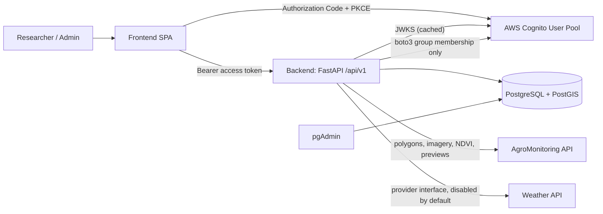
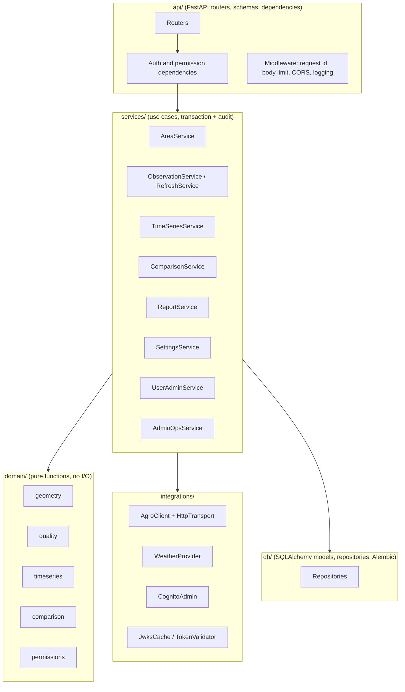
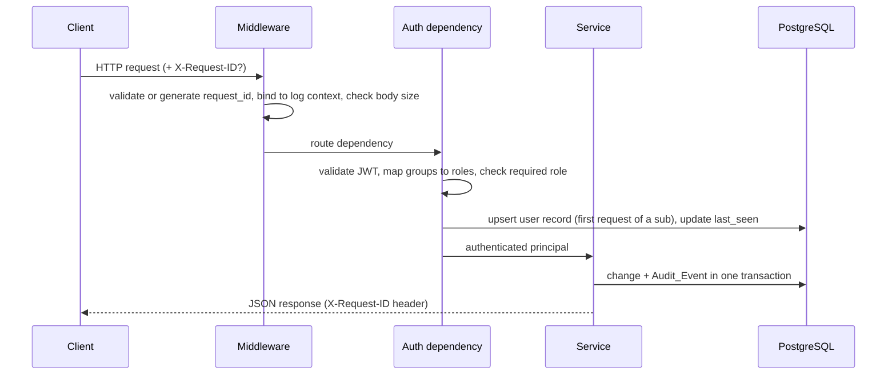
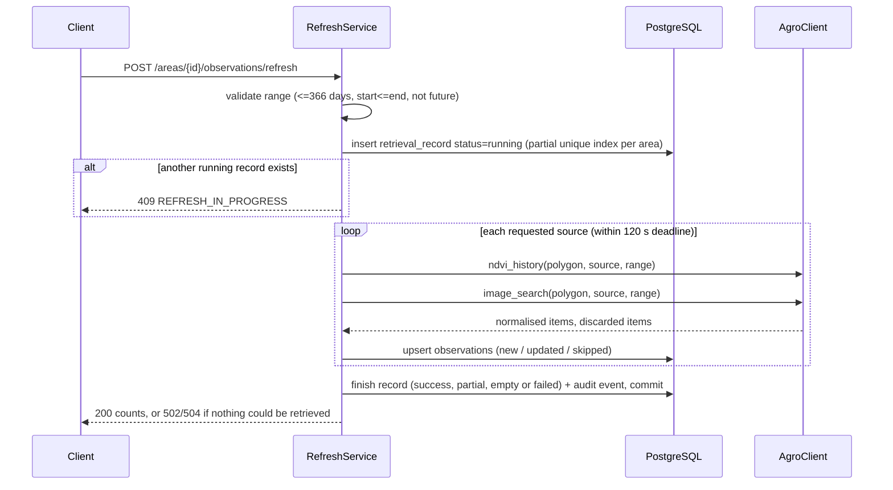
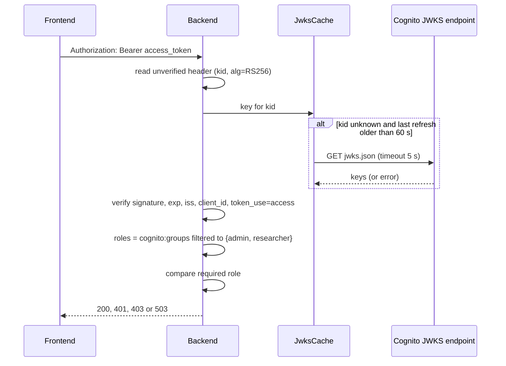

# Design Document: Eco-Sentinel Ghana Backend

## Overview

The Backend is a FastAPI service that manages monitoring areas in Ghana, retrieves satellite observations and NDVI statistics from AgroMonitoring, stores them in PostgreSQL/PostGIS, and serves time series, date comparisons, data-quality indicators and evidence reports to the Frontend. It validates AWS Cognito access tokens itself and enforces the `admin` and `researcher` roles on every operation.

The Backend presents evidence and flags numeric differences "for investigation". It never classifies a change as illegal mining, destruction or recovery, never states where in a polygon a change happened, and contains no ML component (Requirements 8.14, 8.15, 21).

### Design Principles

- **Read from the database, write from refresh.** AgroMonitoring is called only by the refresh operation, monitoring-area registration and admin probes. Every read endpoint serves stored data, so reads work when the provider is down (Requirements 7.16, 23.3).
- **Provider behind an interface.** `AgroClient` and `WeatherProvider` are protocols. Tests substitute mocks and make no network calls.
- **One audited transaction per state change.** The Audit_Event is written in the same database transaction as the change, so an audit failure rolls the change back (Requirements 14.7, 14.8, 18.6).
- **Pure analysis core.** Quality levels, comparisons, time-series statistics, trend slope and geometry validation are pure functions in `app/domain`. They carry the correctness properties.
- **MVP only.** Rasterio, raster change detection, PDF rendering, ML and production AWS infrastructure are out of scope.

### Technology Choices

| Concern | Choice | Reason |
|---|---|---|
| Language / runtime | Python 3.12 | Matches the requested stack. |
| Web framework | FastAPI + Pydantic v2 | OpenAPI generated from the code (Requirement 1.2). |
| Database access | SQLAlchemy 2.x async (`asyncpg`) + GeoAlchemy2 | The async stack lets one refresh run provider calls with timeouts and cancellation (120 s limit, Requirement 23.5). |
| Migrations | Alembic (async env) | Required by Requirement 16.2. |
| HTTP client | HTTPX `AsyncClient` | Required; `MockTransport` supports offline tests. |
| Geometry | Shapely 2 (validation, Ghana containment), PostGIS (`ST_Area` on geography, spatial queries) | Shapely handles pure validation, PostGIS handles area and indexes. |
| Numerics | NumPy for the trend slope. Pandas only if a table helper simplifies report assembly. GeoPandas only to load the Ghana boundary file once at startup. | Kept minimal. Plain Python is used where it is just as clear. |
| JWT | PyJWT with `cryptography` | Own JWKS cache is needed for the 60 s refresh limit (Requirements 2.3 to 2.7). |
| Cognito admin | `boto3` `cognito-idp` (group membership calls only) | Requirement 12.3, 20.14. |
| Settings | `pydantic-settings` | Typed env parsing with fail-fast startup. |
| Tests | Pytest, Hypothesis, `pytest-asyncio`, `pytest-socket`, `respx` is not used; HTTPX `MockTransport` is used | Requirement 22. |
| Quality gates | Ruff, mypy `--strict` | Requirement 23.7, 23.8. |
| Dependency pinning | `uv` with a committed `uv.lock` | Exact versions for all direct and transitive dependencies (Requirement 23.6). |

Rasterio is not a dependency of the MVP (Requirement 21.3).

## Research Findings and Decisions

The workspace was empty, so nothing could be reused. The public AgroMonitoring documentation was consulted on the design date to resolve the uncertainties. Each finding is labelled **Confirmed from public docs** or **To validate against the owner's account**. Content was rephrased for compliance with licensing restrictions.

Sources: [Satellite Imagery API](https://agromonitoring.com/api/images), [Polygons API](https://agromonitoring.com/api/polygons), [Historical NDVI (OpenWeather blog)](https://openweather.co.uk/blog/post/dive-agro-api-part-3-historical-ndvi-api), [Historical weather](https://agromonitoring.com/api/history-weather), [FAQ](https://agromonitoring.com/faq/), [Agro API docs](https://agromonitoring.com/api).

### U1: AgroMonitoring Endpoints

Base URL: `https://api.agromonitoring.com/agro/1.0` (the public docs show `http://`; the client uses `https://`, **to validate**). Authentication is the `appid` query parameter.

| Purpose | Call | Status |
|---|---|---|
| Create polygon | `POST /polygons?appid=` with `{"name": ..., "geo_json": {"type": "Feature", "properties": {}, "geometry": {...}}}`; response has the polygon `id` and `area` (ha) | Confirmed |
| Delete polygon | `DELETE /polygons/{id}?appid=` | Confirmed (the docs list a delete call on this path; used for compensation and geometry replacement) |
| Search imagery | `GET /image/search?polyid=&start=&end=` (start and end are Unix seconds, UTC; optional `clouds_max`, `coverage_min` and similar filters) | Confirmed |
| Search response item | `dt` (Unix UTC), `type` ("Sentinel 2" or "Landsat 8"), `dc` (approximate valid-data coverage %), `cl` (approximate cloud %), `sun`, and four URL groups: `image` (PNG), `tile`, `stats`, `data` (GeoTIFF) | Confirmed |
| NDVI statistics for one image | URL from `stats.ndvi` returns `{std, p25, num, min, max, median, p75, mean}` | Confirmed |
| NDVI history | `GET /ndvi/history?polyid=&start=&end=` (optional `type` = `s2` or `l8`, `clouds_max`, `coverage_min` and similar). Items carry `dt`, `source`, `dc`, `cl`, `data` | Confirmed (exact `data` field set and the `type` parameter value to validate with a real response) |
| Historical weather | `GET /weather/history?lat=&lon=&start=&end=` (Unix seconds, 1-hour step) | Confirmed endpoint; field list partly confirmed, see U5 |
| Rate limit | Free tier is reported at 60 calls per minute | Reported by third-party sources, **to validate** |
| Historical data | The docs state that historical data is not available on the Free account | Confirmed. The owner's plan must allow it. The reference series from January 2026 shows the account can already retrieve history. |

The Agro_Client uses `ndvi/history` for the statistics, `dc` and `cl` (one call per source and range) and `image/search` for the image references. It merges the two by `(source, date)`. This avoids one `stats` call per observation. If the real `ndvi/history` response lacks a field, the client falls back to `image/search` plus the `stats.ndvi` URL per observation. That fallback is implemented behind the same interface and activated by `AGRO_STATS_MODE=per_image`.

### U2: Data Coverage

**Confirmed from public docs.** The provider returns `dc` (valid-data coverage) separately from `cl` (cloud). `Data_Coverage` maps to `dc` and `Cloud_Coverage` to `cl`. If an item lacks `dc`, Data_Coverage is stored as null and never derived from `100 - cl` (Requirement 5.9). The docs call both values "approximate".

### U3: Raster and Tile Investigation (Requirement 21.4)

| Source | What the docs show | Confirmed resolution | Decision |
|---|---|---|---|
| `image` PNG preview | PNG of the polygon per index | 117x117 px in the product owner's tests. The public docs give no size. | **Adopt** for visual orientation only. Proxied by the Backend. |
| `tile` PNG tiles (z/x/y) | Slippy-map tile layers for Leaflet-style viewers | Not stated in the docs. Visual rendering only, not index values. | **Reject for MVP.** Tiles carry no numeric NDVI. A Frontend map layer needs a separate decision because the URL contains the key and would need a tile proxy. |
| `data` GeoTIFF (NDVI, single band) | Downloadable GeoTIFF per image | Not stated in the docs. The sensors' nominal resolution (Sentinel-2 10 m, Landsat 8 30 m) is general knowledge and not a provider-confirmed output resolution. | **Reject for MVP.** It would need Rasterio, and resolution, licence and plan limits are unconfirmed. Recorded as a candidate for a later spec after the owner downloads one file and checks pixel size, CRS and licence. |

Consequently `spatial_analysis_available` is always `false` (Requirement 21.2). `resolution_class` in `meta` is a configured label: `sentinel-2` = `"10 m nominal sensor resolution"`, `landsat-8` = `"30 m nominal sensor resolution"`. These are settings (`RESOLUTION_CLASS_SENTINEL_2`, `RESOLUTION_CLASS_LANDSAT_8`) and are not claims about the delivered polygon data.

### U4: Limits

- **Confirmed:** polygon area must be between 1 and 3000 ha.
- **Consequence:** Requirement 4.5 sets the default maximum at 5000 ha "subject to U4". The design sets the default maximum to **3000 ha** and the Backend refuses to start if `AREA_MAX_HA` exceeds 3000. The minimum default stays at 1 ha.
- **To validate:** polygon count and total-area limits, rate limit, history depth for the owner's plan.
- Agro_Client defaults: 4 concurrent requests, 30 requests per minute (half of the reported 60 per minute).

### U5: Weather Provider

The provider is not confirmed. Design:

- A `WeatherProvider` protocol and a `NullWeatherProvider` (default, `WEATHER_PROVIDER=none`). Weather stays disabled until the owner sets a provider and enables the `weather_enabled` App_Setting.
- **Candidate, not validated:** AgroMonitoring's own historical weather (`GET /weather/history?lat=&lon=&start=&end=`, hourly records with `main.temp` in Kelvin by default, `wind.speed` in m/s, optional rain volume fields). The public docs list `rain.3h` and `snow.3h`; the exact rain field in the history response is **to validate**. It is implemented as `AgroWeatherProvider`, selected with `WEATHER_PROVIDER=agromonitoring`, and reuses the `WEATHER_API_KEY` and `WEATHER_BASE_URL` variables (the owner may set the same key as AgroMonitoring).
- Normalised values carry explicit units. The Backend converts Kelvin to °C and sums precipitation in mm. A value it cannot convert is discarded (Requirement 10.6).

### U6: Sentinel-2 versus Landsat 8 NDVI

The docs describe the same index for both satellites. Whether the scale and rendering are identical in the returned statistics is **not confirmed**. The Backend therefore never mixes sources (Requirements 6.14, 9.6, 8.3) and each Observation keeps its `source`.

### U7 and U8: Cognito Administration

- The Backend uses `boto3` `cognito-idp` calls `AdminAddUserToGroup`, `AdminRemoveUserFromGroup` and `AdminListGroupsForUser`. IAM permissions for these are **assumed** and not verified.
- The feature flag `COGNITO_ADMIN_ENABLED` (default `false`) controls it. When `false`, or when the boto3 call returns `AccessDeniedException`, role-change endpoints return 501 `COGNITO_ADMIN_NOT_ENABLED` and read endpoints keep working.
- The Backend never creates, modifies or deletes pools, clients, groups or users (Requirement 20.14).
- The first Admin is provisioned by an existing Cognito administrator through the console or the CLI (see Cognito Local Development).
- Cognito access tokens normally carry `sub`, `username`, `cognito:groups`, `client_id`, `token_use`, `iss`, `exp` but **no `email`**. The `email` field is therefore usually `null` in `/me` and in the user list. The Frontend can show the email from its ID token.

### Requirement Inconsistencies Found and Resolved

| # | Finding | Design resolution |
|---|---|---|
| 1 | 4.5 default maximum area is 5000 ha, but the provider limit is 3000 ha (U4). | Default 3000 ha, startup refuses a larger value. |
| 2 | 8.1 defines the difference as "later minus earlier", but 8.18 requires the sign to flip when the two inputs are swapped. These conflict. | `ndvi_diff = NDVI(date_b) - NDVI(date_a)` and `ndvi_diff_pct` is relative to the mean of `date_a`. `interval_days` is the absolute number of days. Swapping inputs flips the sign, as 8.18 requires. The Frontend should send the earlier date as `date_a`. 8.2 reads "date_a mean NDVI is 0". |
| 3 | Retrieval_Record status: 5.12 lists success, partial, failed. 6.2, 6.12 and 6.13 also need `running` and `empty`. | Status enum is `running`, `success`, `partial`, `empty`, `failed`. |
| 4 | 7.8 needs `count` in the summary when fewer than 2 points exist, but the contract says `summary: ... \| null`. | `summary` is always an object. Fields other than `count` are `null` for fewer than 2 points. |
| 5 | 6.11 says the preview call returns the reference, pixel size and a statement, but the contract says it returns image bytes. | The `Observation.preview` object carries `url` (Backend proxy URL), `width_px`, `height_px` and `note`. The preview endpoint returns the image bytes. |
| 6 | 14.9 lists the time-series gap threshold for Researchers, but the contract's `GET /settings` omits it. | `GET /settings` also returns `gap_threshold_days`. |
| 7 | Page sizes differ by endpoint family. | Kept as specified: general lists default 50 (setting `default_page_size`), maximum 200. `GET /admin/users` default 50, maximum 100 (12.1). `GET /admin/retrievals` and `GET /admin/activity` default 25, maximum 100 (13.1, 13.7). |
| 8 | 5.2 allows either startup failure or rejection when the Agro key is missing. | `AGRO_API_KEY` is required at startup (17.3). Weather variables are optional (10.2). |
| 9 | Error and warning code lists lack codes the design needs. | Added `PAYLOAD_TOO_LARGE`, `SERVICE_UNAVAILABLE` (error codes) and `ITEMS_DISCARDED`, `INVALID_CLOUD_COVERAGE`, `WEATHER_INVALID_DATA` (warning codes). |
| 10 | 4.1 and the provider docs: MultiPolygon support in `POST /polygons` is not documented. | The API accepts Polygon and MultiPolygon (Requirement 4). If the provider rejects a MultiPolygon with a 4xx, registration fails with 502 `UPSTREAM_ERROR`. To validate. |

## Architecture

### System Context



### Layered Structure



Routers only parse input and call a service. Services own the transaction and write the Audit_Event. Domain functions take plain values and return plain values. Integrations hide HTTP details.

### Request Pipeline



### Refresh Flow



The `running` record is committed in its own short transaction so a concurrent request sees it. If the process dies, a record that is `running` for longer than 150 seconds is treated as expired: it is set to `failed` with code `EXPIRED` the next time a refresh starts for that area and at application startup.

Each source is stored in its own transaction. A failure in source B after source A succeeded gives status `partial` and keeps A's rows (Requirements 5.6, 6.15). A total failure before any item is stored gives `failed` and HTTP 502 or 504 (6.16). The 120 s deadline uses `asyncio.timeout`. On expiry the current source transaction rolls back, the earlier sources stay stored, and the API returns 504 `UPSTREAM_TIMEOUT` (23.5). Requirement 23.5 says previously stored data stays unchanged, so rows committed earlier in the same refresh are the only rows kept.

### Authentication and Authorization



## Components and Interfaces

### Project Layout

```
backend/
  pyproject.toml            # dependencies, ruff, mypy, pytest config
  uv.lock                   # exact pins (committed)
  Dockerfile                # targets: dev (reload), prod
  entrypoint.sh             # runs alembic upgrade head unless MIGRATE_ON_START=false
  Makefile                  # make test = ruff + mypy + pytest
  alembic.ini
  alembic/
    env.py                  # async engine, target_metadata, compare_type
    versions/
  data/
    ghana_boundary.geojson  # supplied by the project owner (see Ghana Boundary)
  app/
    main.py                 # create_app(), lifespan: settings, boundary, JWKS warm-up, stale-lock cleanup
    core/
      config.py             # Settings (pydantic-settings), fail-fast validation
      logging.py            # JSON formatter, request_id context var, RedactionFilter
      errors.py             # AppError hierarchy, error codes, exception handlers
      permissions.py        # the ONLY module that defines permission strings (Req 15.5)
      security.py           # Principal, Role enum, group mapping
      redaction.py          # redact(text, secrets) and URL query scrubbing
    api/
      deps.py               # get_session, get_principal, guard(permission), pagination params
      middleware.py         # RequestIdMiddleware, BodySizeLimitMiddleware
      routers/
        health.py  me.py  areas.py  observations.py  timeseries.py
        comparisons.py  reports.py  settings.py
        admin_users.py  admin_areas.py  admin_ops.py
      schemas/              # Pydantic request/response models, Page[T], Warning, Quality
    domain/
      geometry.py           # validate_geometry(), area rules, bbox parsing
      quality.py            # quality_level(), observation_quality(), comparison_quality()
      timeseries.py         # build_series(), gaps, summary, trend_slope_per_30d()
      comparison.py         # compare(), seasonality_warning(), summary_text()
      constants.py          # LIMITATIONS, CAVEATS, FORBIDDEN_TERMS, resolution classes
    services/
      areas.py  refresh.py  observations.py  timeseries.py  comparisons.py
      reports.py  settings.py  users.py  admin_ops.py  audit.py  weather.py
    integrations/
      agro/ client.py  transport.py  models.py  normalize.py  ratelimit.py
      weather/ base.py  null.py  agro_weather.py
      cognito/ jwks.py  validator.py  admin.py
    db/
      base.py  session.py  models/  (users, areas, observations, retrievals,
                                     reports, comparisons, settings, audit)
      repositories/
  tests/
    unit/  properties/  integration/  api/  conftest.py
```

### Core Interfaces

```python
class Role(StrEnum):
    admin = "admin"
    researcher = "researcher"

@dataclass(frozen=True)
class Principal:
    sub: str
    username: str
    email: str | None
    roles: frozenset[Role]

class AgroClient(Protocol):
    async def create_polygon(self, name: str, geometry: dict[str, Any]) -> ProviderPolygon: ...
    async def delete_polygon(self, polygon_id: str) -> None: ...
    async def ndvi_history(self, polygon_id: str, source: Source,
                           start: date, end: date) -> NormalizedBatch: ...
    async def image_search(self, polygon_id: str, source: Source,
                           start: date, end: date) -> NormalizedBatch: ...
    async def fetch_image(self, image_ref: str) -> ImageBytes: ...
    async def probe(self) -> None: ...          # cheap call used by integration status

class WeatherProvider(Protocol):
    name: str
    configured: bool
    async def history(self, lat: float, lon: float,
                      start: date, end: date) -> WeatherBatch: ...
    async def probe(self) -> None: ...

class CognitoAdmin(Protocol):
    enabled: bool
    async def set_group_membership(self, username: str, group: Role, add: bool) -> None: ...
```

`NormalizedBatch` holds `items: list[NormalizedObservation]` and `discarded: list[DiscardedItem]` (area ID, field name, reason). It is the only shape the services see.

### Settings (Environment)

`Settings` is loaded once at startup. Missing or empty required variables raise one error that lists every missing name and no values, then the process exits non-zero (Requirement 17.3). Required: `DATABASE_URL`, `COGNITO_USER_POOL_ID`, `COGNITO_REGION`, `COGNITO_APP_CLIENT_ID`, `AGRO_API_KEY`, `GHANA_BOUNDARY_PATH`. `LOG_LEVEL` is validated case-insensitively against DEBUG, INFO, WARNING, ERROR, CRITICAL and defaults to INFO. An invalid value exits with a message naming `LOG_LEVEL` (19.5 to 19.7).

| Variable | Default | Purpose |
|---|---|---|
| `APP_ENV` | `development` | `development` enables CORS for local origins only if listed. |
| `LOG_LEVEL` | `INFO` | Log level. |
| `DATABASE_URL` | none | `postgresql+asyncpg://...` |
| `ALLOWED_ORIGINS` | empty | Comma-separated CORS origins. Empty means no CORS headers. |
| `MAX_BODY_BYTES` | `1048576` | 1 KB to 10 MB (17.9). |
| `COGNITO_USER_POOL_ID`, `COGNITO_REGION`, `COGNITO_APP_CLIENT_ID` | none | Token validation. |
| `JWKS_FETCH_TIMEOUT_S` / `JWKS_MIN_REFRESH_INTERVAL_S` | `5` / `60` | JWKS cache behaviour. |
| `COGNITO_ADMIN_ENABLED` | `false` | Enables group changes. |
| `AWS_ACCESS_KEY_ID`, `AWS_SECRET_ACCESS_KEY`, `AWS_SESSION_TOKEN` | empty | Optional. Needed only for `COGNITO_ADMIN_ENABLED=true`. |
| `AGRO_API_KEY` | none | Provider key. |
| `AGRO_BASE_URL` | `https://api.agromonitoring.com/agro/1.0` | |
| `AGRO_CONNECT_TIMEOUT_S` / `AGRO_READ_TIMEOUT_S` | `5` / `30` | Each 1 to 30. |
| `AGRO_MAX_CONCURRENCY` / `AGRO_MAX_RPM` | `4` / `30` | 1 to 20 and 1 to 60. |
| `AGRO_STATS_MODE` | `history` | `history` or `per_image`. |
| `WEATHER_PROVIDER` | `none` | `none` or `agromonitoring`. |
| `WEATHER_API_KEY`, `WEATHER_BASE_URL` | empty | Missing means weather is not configured; the Backend still starts. |
| `GHANA_BOUNDARY_PATH` | none | GeoJSON polygon file. |
| `AREA_MIN_HA` / `AREA_MAX_HA` | `1` / `3000` | Maximum may not exceed 3000. |
| `REFRESH_MAX_RANGE_DAYS` | `366` | |
| `RESOLUTION_CLASS_SENTINEL_2` / `RESOLUTION_CLASS_LANDSAT_8` | see U3 | Labels for `meta.resolution_class`. |
| `MIGRATE_ON_START` | `true` | `false` disables automatic Alembic upgrade. |
| `PDF_ENABLED` | `false` | MVP: PDF returns 501. |

### Authentication Component

`TokenValidator.validate(token) -> Claims`:

1. Read the unverified header. Accept only `alg=RS256` and a `kid`. Anything else is a failure.
2. `JwksCache.get_key(kid)`. If the `kid` is unknown and at least 60 seconds passed since the last refresh attempt, fetch `https://cognito-idp.{region}.amazonaws.com/{pool}/.well-known/jwks.json` with a 5 s timeout. If the `kid` is still unknown, or the refresh is not allowed, the token fails (401). The cache lives in memory and is guarded by an `asyncio.Lock` so concurrent requests cause one fetch.
3. If the fetch fails and a cache exists, keep using the cache. If it fails and no cache exists, raise `ServiceUnavailable` (503).
4. Verify signature and `exp` with PyJWT. Then check `iss == https://cognito-idp.{region}.amazonaws.com/{pool}`, `client_id == app client ID` and `token_use == "access"`. An ID token fails the `token_use` check (it also carries `aud`, not `client_id`).
5. Return `Claims(sub, username, groups, email|None)`.

Failures produce 401 `UNAUTHENTICATED` with `WWW-Authenticate: Bearer`. The message does not say which check failed. The log line carries an internal reason code (`expired`, `bad_signature`, `wrong_issuer` and so on) without the token.

`get_principal` runs `validate`, maps groups to roles, and upserts the user record. A first-seen `sub` creates exactly one row (`INSERT ... ON CONFLICT (sub) DO UPDATE`), which also updates `roles`, `username` and `last_seen_at`. The upsert is written to survive concurrent first requests.

### Authorization Component

`app/core/permissions.py` is the only place that spells permission strings.

```python
class Permission(StrEnum):
    ME = "me:read"
    AREAS_READ = "areas:read"
    OBSERVATIONS_READ = "observations:read"
    OBSERVATIONS_REFRESH = "observations:refresh"
    TIMESERIES_READ = "timeseries:read"
    COMPARISONS_CREATE = "comparisons:create"
    REPORTS_CREATE = "reports:create"
    REPORTS_READ = "reports:read"            # own reports
    REPORTS_READ_ALL = "reports:read_all"    # used inside the service, admin only
    SETTINGS_READ = "settings:read"
    SETTINGS_WRITE = "settings:write"
    AREAS_WRITE = "areas:write"
    USERS_READ = "users:read"
    USERS_WRITE_ROLES = "users:write_roles"
    OPS_READ = "ops:read"                    # retrievals, integrations, activity, dashboard

REQUIRED_ROLE: dict[Permission, Role | None]   # None = any authenticated user (only ME)
def permissions_for(roles: Iterable[Role]) -> list[str]  # deduplicated, sorted
```

`guard(permission)` returns a FastAPI dependency. It reads the roles from the current request's token (never cached across requests, Requirement 3.6). The dependency function carries a `required_role` attribute and the permission, so a test can walk `app.routes` and fail if any route except `/health/*` has no guard (3.2, 22.5). `admin` satisfies every `researcher` requirement (3.4). A user with no recognised group gets 403 on every guarded endpoint except `/me` (3.5).

On a 403 the guard writes an Audit_Event with `outcome="denied"` in a separate session with a 2 s timeout, inside a `try/except`. If the audit write fails, the failure is logged and the 403 is still returned (3.8). The write happens before the response is sent and normally completes in milliseconds, well inside the 5 s limit.

### Monitoring Area Service

Create (admin):

1. Pydantic validates `name` (1 to 100 characters, trimmed) and the geometry shape.
2. `domain.geometry.validate_geometry(geojson, boundary, min_ha, max_ha)` returns a `GeometryResult` or raises `GeometryError(code, detail)`. It never raises anything else (property 6).
3. The area is computed in PostGIS with `ST_Area(ST_GeomFromGeoJSON(...)::geography) / 10000`, rounded to 2 decimals. A single `SELECT` computes it before the insert.
4. Check the duplicate name among active areas (also protected by a unique index, so a race yields 409).
5. `AgroClient.create_polygon` within 10 s. Failure gives 502 or 504 and nothing is stored.
6. Insert the area and the Audit_Event in one transaction. If the insert fails after the provider call succeeded, the service deletes the provider polygon (best effort, logged on failure).

Update geometry: the same validation, then a new provider polygon is created. In one transaction the area geometry, area and `external_polygon_id` are updated, all of its Observations get `geometry_status='stale_geometry'`, and the Audit_Event is written. After the commit the old provider polygon is deleted (best effort). Observations are never deleted. A later refresh upserts rows and resets them to `current` (Requirement 13.10).

Archive and restore set `status`. Restore checks for a name clash with an active area (409).

List, map and detail endpoints use the GiST index through `ST_Intersects(geom, ST_MakeEnvelope(...,4326))`.

#### Ghana Boundary

The project owner supplies `data/ghana_boundary.geojson` (a single Polygon or MultiPolygon, for example derived from geoBoundaries or Natural Earth; the licence is the owner's choice and is not decided here). GeoPandas reads it at startup, Shapely builds a prepared geometry, and `contains` is the containment test. A missing or invalid file stops startup. A coarse boundary is acceptable for the MVP. Slight over-acceptance near the border is a known limitation.

### Geometry Validation Rules (`domain/geometry.py`)

In order, returning the first defect:

1. Type must be `Polygon` or `MultiPolygon` (`INVALID_GEOMETRY_TYPE`).
2. Every coordinate is a finite pair with longitude in [-180, 180] and latitude in [-90, 90] (`COORDINATE_OUT_OF_RANGE`).
3. Every ring has at least 4 positions (`RING_TOO_SHORT`) and first equals last (`RING_NOT_CLOSED`).
4. `shapely.is_valid` is true (`SELF_INTERSECTION`, or `INVALID_GEOMETRY` for other defects).
5. Ghana boundary contains the geometry (`GEOMETRY_OUTSIDE_GHANA`).
6. `min_ha <= area_ha <= max_ha` using the PostGIS value (`AREA_OUT_OF_RANGE`). The bounds are inclusive.

Steps 1 to 5 are pure. Step 6 receives the area from the service, so the pure function stays testable. A `GeometryError` becomes HTTP 422 with `error.code` set to the specific code above (`GEOMETRY_OUTSIDE_GHANA` and `AREA_OUT_OF_RANGE` are the stable codes in the contract; the others are `VALIDATION_ERROR` with `details.defect`).

### AgroMonitoring Client

**Transport.** One shared `httpx.AsyncClient` with `httpx.Timeout(connect=AGRO_CONNECT_TIMEOUT_S, read=AGRO_READ_TIMEOUT_S, write=5, pool=5)`. The API key is added in a single place (`_request`) as the `appid` query parameter. Callers never see it.

**Rate limit and concurrency.** An `asyncio.Semaphore(AGRO_MAX_CONCURRENCY)` and a token bucket `AGRO_MAX_RPM` per minute guard every attempt, including retries. The bucket acquires before each request and waits (inside the overall 120 s deadline).

**Retries.** Retry on HTTP 429, 502, 503, 504 and on `httpx.TimeoutException`, up to 3 retries (4 attempts in total).

```
backoff(n)      = min(2^(n-1), 30) + uniform(0, 1)          # n = 1, 2, 3
wait(n, resp)   = max(backoff(n), min(retry_after, 60))     # when Retry-After parses as seconds
```

Other 4xx responses raise `AgroClientError(status)` at once with no retry. `Retry-After` given as an HTTP date is parsed too. After the last retry the client raises `AgroUpstreamError` (maps to 502) or `AgroTimeoutError` (maps to 504). The error message contains the status and a fixed text, never the upstream body or the URL.

**Normalisation (`normalize.py`).** Each raw item becomes a `NormalizedObservation` or a `DiscardedItem`.

| Field | Source | Rule |
|---|---|---|
| `source` | `type` / `source` | "Sentinel 2" to `sentinel-2`, "Landsat 8" to `landsat-8`. Anything else is discarded. |
| `acquired_on` | `dt` | Unix seconds to UTC date. A non-integer or negative value is discarded. |
| `cloud_coverage` | `cl` | Required, finite, 0 to 100, else discarded. |
| `data_coverage` | `dc` | Optional. If present it must be 0 to 100, else discarded. If absent it is `None`. |
| `ndvi.mean` | `data.mean` | Required, finite, -1 to 1, else discarded. `min`, `max`, `std`, `median` are optional and are set to `None` when missing or non-finite. |
| `preview_ref` | `image.ndvi` | The URL with the `appid` query parameter removed. Absent means `None`. |

Each discarded item logs one warning with the area ID and the field name. The service returns the count of discarded items as the warning `ITEMS_DISCARDED`. When two items in one batch share `(source, date)`, the one with the lower cloud coverage is kept and the other is counted as skipped. The provider date is used as the acquisition date. This is unusual only if two overpasses fall on one UTC date.

**Logging and redaction.** `core/redaction.py` provides `redact_url(url)` (replaces the value of `appid`, `api_key`, `key` and similar parameters with `[REDACTED]`) and `RedactionFilter`, a logging filter. The filter replaces any configured secret value (provider keys, DB password) and any `Bearer <token>` or `Authorization:` value with `[REDACTED]`, in messages, arguments and exception text. HTTPX and `httpcore` loggers are held at WARNING because their DEBUG output prints full URLs. The same filter is installed on the root handler, so inbound and outbound logs are covered (17.5).

**Image proxy.** `fetch_image(image_ref)` re-attaches the key server-side, fetches the PNG (within the same limits) and returns bytes plus the content type. The preview endpoint streams the bytes with `Cache-Control: private, max-age=3600`. It reads the PNG IHDR to get width and height and stores them on the Observation the first time. The authorization check runs first. A denied request never contacts the provider (17.8).

### Observation Service

- **Refresh:** see the Refresh Flow. The upsert compares the new values to the stored row. No stored row means `new`. Any differing stored field means `updated`. All equal means `skipped`. Quality is not stored, so it cannot make a row look changed. A second identical refresh therefore reports `new=0, updated=0` and leaves the count unchanged (6.4). The unique constraint `(area_id, source, acquired_on)` backs this with `INSERT ... ON CONFLICT DO UPDATE ... WHERE (columns differ)`. The row is returned with a flag that says whether it was inserted. In PostgreSQL this is read from `xmax = 0` in `RETURNING`, so the service can classify rows without a second query.
- **Per-source datasets:** all queries filter on `source`. Responses that hold more than one source are grouped by source (9.6).
- **List filters:** `source`, `date_from`, `date_to` (inclusive), `max_cloud_coverage` (`<=`), `min_data_coverage` (`>=`; observations with null Data_Coverage do not match when this filter is used). Filters combine with AND. Order is `acquired_on DESC`. Invalid values give 422 (6.7).
- Observations of an archived area remain readable by ID. Observation 404 is returned when the ID or its area does not exist (6.10). Areas are visible to all Researchers (no per-user area ownership in the requirements).

### Quality Indicator (`domain/quality.py`)

```python
def quality_level(cloud: float | None, data: float | None,
                  cloud_limit: float, data_min: float) -> QualityResult:
    warnings = []
    if cloud is None or not (0 <= cloud <= 100):
        return QualityResult("poor", cloud, data, [W.INVALID_CLOUD_COVERAGE]
                             + ([W.DATA_COVERAGE_UNKNOWN] if data is None else []))
    if data is None:
        warnings.append(W.DATA_COVERAGE_UNKNOWN)
    if cloud > cloud_limit or (data is not None and data < data_min):
        level = "poor"                       # precedence over good and limited
    elif cloud <= 10 and (data is None or data >= 90):
        level = "good"
    else:
        level = "limited"
    return QualityResult(level, cloud, data, warnings)
```

Quality is computed on read with the current Threshold_Config, so a changed setting applies to old data. Reports store the computed values (snapshot). Cloud_Coverage and Data_Coverage are never combined (9.5).

`comparison_quality(a, b)`: the level is the worse of the two Observation levels (`poor` > `limited` > `good`) using the applied limits. Its `cloud_coverage_pct` is the larger of the two, and `data_coverage_pct` is the smaller of the two non-null values (or null if both are null). When either Observation breaches a limit the level is `poor` and the warning `LOW_QUALITY_OBSERVATION` is added (8.12).

### Time Series Service (`domain/timeseries.py`)

Input: Observations of one area and one source, in the range. `build_series(obs, max_cloud, gap_threshold)`:

1. Sort by date ascending. Keep points with `cloud <= max_cloud` when `max_cloud` is given. `excluded_by_cloud` is the number removed.
2. `gap_days_from_previous[i] = (date[i] - date[i-1]).days` for `i >= 1`, else `None`. Gaps are measured between consecutive points that remain after filtering.
3. If any gap exceeds `gap_threshold_days` (default 30, strictly greater than), add `IRREGULAR_SAMPLING`.
4. With fewer than 2 points, the summary has `count` and all other fields `None`, and the warning `INSUFFICIENT_OBSERVATIONS` is added (7.8).
5. Otherwise the summary has `count`, `first_date`, `last_date`, `min`, `max`, `mean_of_means` and `trend_per_30d`, all NDVI values rounded to 4 decimals.

**Trend slope.** Let `x_i` be the days since the first date and `y_i` the mean NDVI. The ordinary least squares slope is `Σ(x_i - x̄)(y_i - ȳ) / Σ(x_i - x̄)²`. Since dates are unique per source, the denominator is positive for 2 or more points. `trend_per_30d = slope * 30`. NumPy computes it (`np.polyfit(x, y, 1)[0]` or the closed form). The result is rounded to 4 decimals only at output.

Every response carries the three limitations from 7.12 (polygon-level aggregates, seasonality not removed, weather not controlled), including when there are 0 points. `meta.resolution_class` comes from configuration.

Weather (`include_weather=true`): see Weather Service.

### Comparison Service (`domain/comparison.py`)

```python
def compare(a: ObsStats, b: ObsStats, t: Thresholds) -> ComparisonResult:
    diff = round(b.mean - a.mean, 4)
    pct  = None if a.mean == 0 else round((b.mean - a.mean) / abs(a.mean) * 100, 2)
    days = abs((b.date - a.date).days)
    flag = "flagged" if abs(b.mean - a.mean) >= t.ndvi_diff else "not_flagged"
    ...
```

Order of checks in the service (Requirement 8.6 puts equal dates before missing observations):

1. Equal dates gives 422 `VALIDATION_ERROR` with `details.defect="EQUAL_DATES"`.
2. Load both Observations for `(area, source, date)`. A missing one gives 404 `NOT_FOUND` naming the missing date.
3. The contract takes one `source`, so a cross-sensor request cannot arise from the body. The domain function still checks `a.source == b.source` and raises `CROSS_SENSOR_COMPARISON` (422), so the rule holds if a later endpoint accepts two observation IDs (8.3).
4. Resolve thresholds: stored App_Settings, with any request override validated against the ranges (8.8, 8.11). Out of range gives 422. Overrides apply to this request only and are echoed in `thresholds_applied`.
5. Compute the result. Add `LOW_QUALITY_OBSERVATION` and `SEASONALITY_NOT_CONTROLLED` where they apply.

The flag compares the unrounded difference to the threshold, with `>=`. This is deterministic because it uses only the stored values and the inputs (8.19). `percent` division uses `Decimal` or float of the stored `Numeric(7,4)` values converted with `float`; the same conversion is used everywhere, so results are repeatable.

**Seasonality warning.** `interval_days = abs(days)`. Add `SEASONALITY_NOT_CONTROLLED` unless there is an integer `k >= 1` with `abs(interval_days - 365 * k) <= 15`. Computing `k = round(interval_days / 365)` and testing `k >= 1 and abs(interval_days - 365*k) <= 15` is equivalent. For example 350 and 380 days do not warn, 349 and 381 do (8.13).

**Summary text.** Built from fixed templates only, never from free text:

- flagged: "Difference flagged for investigation: mean NDVI changed by {diff:+.4f} between {date_a} and {date_b}. This is a polygon-level aggregate; no spatial change is inferred and the cause of any change is not identified."
- not flagged: "Mean NDVI difference of {diff:+.4f} is below the investigation threshold of {t}. This is a polygon-level aggregate; no spatial change is inferred and the cause of any change is not identified."

`constants.FORBIDDEN_TERMS = ("illegal mining", "deforestation", "destruction", "recovery")`. A unit test and property 21 check generated texts against it. `spatial_analysis_available` is the constant `False`.

### Weather Service

`services/weather.py` wraps the provider. For one request it:

1. Returns `weather=None` with `WEATHER_DISABLED` when the provider is `none`, not configured, or the `weather_enabled` setting is false (10.7).
2. Computes the polygon's `ST_PointOnSurface` as lat/lon.
3. Calls `provider.history(...)` for the needed range inside `asyncio.timeout(10)`. The provider applies the Requirement 5 timeout, retry and redaction rules through the same `HttpTransport` class as the Agro_Client.
4. Builds one `WeatherContext` per point (the acquisition day), or for a comparison, one for each date and one for the interval between them. Values are `{"value": number, "unit": "°C"|"mm"|"m/s"}`. A value that is missing or cannot be converted is dropped and `WEATHER_INVALID_DATA` is added (10.6).
5. On total failure or timeout, returns `weather=None` and `WEATHER_UNAVAILABLE`. NDVI values and summaries are unchanged (7.14, 10.8).

Every WeatherContext carries `provider`, `period.from`, `period.to` and the note "Context only; correlation does not imply causation." No correlation is computed (10.10). The history range per call is split into chunks of at most `WEATHER_MAX_RANGE_DAYS` (default 30, to validate against provider limits). Each provider call is logged as a Retrieval_Record with `provider="weather"`.

### Report Service

`POST /reports` runs in one transaction:

1. Validate the request: source is valid, `date_from <= date_to`, span at most 5 years (1826 days), `format` is only on GET.
2. Load the area (404) and its Observations in range for the source. If none, 422 `NO_OBSERVATIONS`.
3. Build the series (no cloud filter), the optional comparisons (each pair uses the same `compare` code and the current thresholds), and optional weather.
4. Assemble the `content` JSON as in the contract, including the fixed `CAVEATS` and `LIMITATIONS` from `domain/constants.py`.
5. Insert the `reports` row (with `content` JSONB), one `comparisons` row per included comparison, and the Audit_Event.

**Snapshotting.** `content` includes the area name, ID, area_ha and geometry GeoJSON, every observation value shown, the quality values computed at that moment, the thresholds applied and the comparison results. The `reports.area_id` foreign key is kept only for listing. Reads of a stored report take only `content`, never the live area or Observations, so later edits cannot change it (11.4). The `comparisons` table stores the same comparison results per report (a queryable copy) and is never read when a report is rendered.

`GET /reports/{id}?format=json` returns `content` plus `id`, `created_at`, `created_by`. `format=pdf` returns 501 `NOT_IMPLEMENTED` while `PDF_ENABLED=false` (11.12). Any other `format` value is 422 (11.8). Reports are listed by `created_by = principal` for Researchers and all for Admins (11.9). A Researcher asking for another user's report gets the same 404 body as for a missing ID (11.10).

### Settings Service

The `app_settings` table holds one row per allow-listed key (seeded by migration). The service exposes the allow-list from a constant dictionary. Reads and writes of other keys return 404 `NOT_FOUND` with `details.reason="unknown_key"`, and keys matching a secret pattern (`key`, `secret`, `password`, `token`, `credential`, case-insensitive) return 422 `VALIDATION_ERROR` with `details.reason="key_not_permitted"` (14.5, 14.6). Because the secret check runs first, a request for a key such as `agro_api_key` is rejected as not permitted and never stored. An update validates type and range, stores the value, updates `updated_by` and `updated_at`, and writes the Audit_Event with old and new values in the same transaction. If the audit insert fails the transaction rolls back (14.8).

| Key | Type | Default | Min | Max | Researcher can read |
|---|---|---|---|---|---|
| `ndvi_diff_threshold` | decimal | 0.10 | 0.00 | 2.00 | yes |
| `cloud_limit_pct` | decimal | 20 | 0 | 100 | yes |
| `data_coverage_min_pct` | decimal | 80 | 0 | 100 | yes |
| `gap_threshold_days` | integer | 30 | 1 | 3660 | yes |
| `weather_enabled` | boolean | false | | | no |
| `default_page_size` | integer | 50 | 1 | 200 | yes |

Values are cached in memory per request, not across requests, so a change applies on the next call. `default_page_size` is the default `limit` for the general list endpoints. It does not alter the maximum of 200.

### User Administration Service

- **List and get:** read local `users` rows. Pages: default 50, maximum 100 (12.1).
- **Change roles** (`PUT /admin/users/{sub}/roles`):
  1. If `COGNITO_ADMIN_ENABLED` is false, return 501 `COGNITO_ADMIN_NOT_ENABLED` and write nothing.
  2. If the target `sub` equals the caller's, return 409 `SELF_ROLE_CHANGE`.
  3. If the change removes `admin` from a user and no other active local user holds `admin`, return 409 `LAST_ADMIN`. The check is best effort: it counts local user rows, so an admin who never called the API is not counted. This is a documented limitation.
  4. Compute the group additions and removals against the stored roles and apply them through `CognitoAdmin` with a 10 s timeout (`botocore` `Config(connect_timeout=5, read_timeout=10, retries={"max_attempts": 1})` and `asyncio.timeout(10)` around the thread call). The boto3 calls run in a worker thread.
  5. On success, update the local roles, write the Audit_Event (actor, target, group, action) and return `{sub, roles, effective_after_next_login: true, message}`. On failure or timeout, leave local roles unchanged, write an Audit_Event with outcome `failure` in a separate transaction and return 502 `UPSTREAM_ERROR` or 504 `UPSTREAM_TIMEOUT`. If the user is unknown locally, return 404.
- Responses never contain tokens or secrets (12.9). Requests to non-admin endpoints that include a `roles` field are rejected by Pydantic `extra="forbid"` with 422 (12.8). There is no endpoint that creates users.

### Admin Operations Service

- **Retrievals:** filters `provider`, `area_id`, `status`, `date_from`, `date_to` (on `started_at`, inclusive). Unknown enum values or `date_from > date_to` give 422. Default page 25, maximum 100.
- **Integration status:** per provider `configured`, `enabled`, `last_success_at`, `last_failure_at`, `last_error` (at most 500 characters, already sanitised), `failures_24h`. Values come from `retrieval_records`. `enabled` is `true` for Agro and equals the `weather_enabled` setting for weather. With `probe=true`, each provider is called once with a 10 s timeout. The result is `{ok, latency_ms}` (a timeout gives `ok=false`) and a `retrieval_records` row of kind `probe` is written, which counts toward the failure count. Keys never appear in this response (13.4).
- **Activity:** filters `actor`, `action`, `date_from`, `date_to`. Default page 25, maximum 100.
- **Dashboard:** five counts using indexed aggregate queries: active areas, observations, reports, users per role (`unnest(roles)`), and retrieval records grouped by status where `started_at >= now() - interval '168 hours'`.

### Audit Service

`audit.record(session, actor, action, target_type, target_id, outcome, details)` inserts into `audit_events` using the caller's session, so the Audit_Event and the action commit or roll back together. Actions are: `area.create`, `area.update`, `area.archive`, `area.restore`, `refresh.trigger`, `report.create`, `role.change`, `setting.update`, `authz.denied`. `details` holds only changed field names and, for settings, old and new values. Request bodies, tokens and credentials never go into `details`. Failure events (`outcome="failure"`) and denials are written in a separate session because the main transaction has rolled back. The table has no update or delete route, and a database trigger rejects `UPDATE` and `DELETE` (18.5).

### Health

- `GET /health/live`: returns `{"status":"ok"}` without touching the database or any provider.
- `GET /health/ready`: runs `SELECT 1` with a 2 s timeout and compares `alembic_version.version_num` to the head revision read from the Alembic script directory at startup. On failure it returns 503 `{"status":"unavailable","failed":["database"|"migrations"]}` with no other text. The two checks run under one overall 3 s limit.

### Logging

One JSON object per line on stdout with fields `ts`, `level`, `logger`, `message`, `request_id` and extra context. `request_id` is held in a `ContextVar` set by `RequestIdMiddleware`, so every log line from the request carries it, including lines from services and integrations. The middleware writes one access log line per request (method, route template, status, duration). `RedactionFilter` is attached to the handler.

### Middleware

- **RequestIdMiddleware** (pure ASGI): accepts `X-Request-ID` if it matches `^[A-Za-z0-9_-]{1,128}$`, otherwise generates a UUID4 hex. It sets the header on every response, including error responses created by exception handlers and the 500 handler.
- **BodySizeLimitMiddleware:** rejects when `Content-Length` exceeds `MAX_BODY_BYTES`, and counts streamed bytes for chunked bodies. It returns 413 `PAYLOAD_TOO_LARGE` before the body is parsed.
- **CORS:** `CORSMiddleware` with `allow_origins=ALLOWED_ORIGINS`, methods and headers limited to what the API uses, `allow_credentials=False`. With an empty list no CORS headers are sent.
- Order from outermost to innermost: RequestId, BodySizeLimit, CORS, routing.

### API Contract

Base path `/api/v1`. All endpoints need `Authorization: Bearer <Cognito access token>` except health. Roles: **R** is Researcher or Admin, **A** is Admin only. This section restates the Requirements' API Contract and lists the differences at the end. OpenAPI at `/api/v1/openapi.json` is generated from the Pydantic models and must match this section.

**Conventions.** Dates are `YYYY-MM-DD`. Timestamps are UTC with a `Z` suffix. Geometries are GeoJSON in EPSG:4326 with `[lon, lat]`. Lists return `Page[T] = {items, total, limit, offset}`. Errors return the Error_Envelope.

**Shared types**

```
Warning      {code: string, message: string}
Quality      {level: "good"|"limited"|"poor", cloud_coverage_pct: number|null,
              data_coverage_pct: number|null, warnings: Warning[]}
NdviStats    {mean: number, min: number|null, max: number|null,
              std: number|null, median: number|null}
Preview      {url: string|null, width_px: int|null, height_px: int|null, note: string}
Observation  {id, area_id, date, source: "sentinel-2"|"landsat-8", ndvi: NdviStats,
              quality: Quality, preview: Preview,
              geometry_status: "current"|"stale_geometry"}
Area         {id, name, description|null, status: "active"|"archived", area_ha,
              geometry (omitted in list unless include_geometry=true),
              external_polygon_id|null, latest_observation_date|null,
              created_at, updated_at}
WeatherContext {provider, period: {from, to},
              values: {<name>: {value: number, unit: string}}, note: string}
Principal-me {sub, username, email|null, roles: string[], permissions: string[]}
```

**Endpoint index**

| Method | Path | Role | Success | Documented errors |
|---|---|---|---|---|
| GET | `/health/live` (unversioned) | none | 200 `{status}` | none |
| GET | `/health/ready` (unversioned) | none | 200 `{status, checks}` | 503 `{status, failed[]}` |
| GET | `/me` | any authenticated | 200 Principal-me | 401 |
| GET | `/areas` | R | 200 `Page[Area]`; query `status` (active default, archived, all), `q`, `bbox`, `include_geometry`, `limit`, `offset` | 401, 403, 422 |
| GET | `/areas/map` | R | 200 GeoJSON FeatureCollection; properties `{id, name, area_ha, latest_observation_date}`; query `status`, `bbox` | 401, 403, 422 |
| GET | `/areas/{area_id}` | R | 200 Area | 404 |
| GET | `/areas/{area_id}/observations` | R | 200 `Page[Observation]`; query `source`, `date_from`, `date_to`, `max_cloud_coverage`, `min_data_coverage`, `limit`, `offset` | 404, 422 |
| GET | `/observations/{observation_id}` | R | 200 Observation | 404 |
| GET | `/observations/{observation_id}/preview` | R | 200 `image/png` bytes via proxy | 404, 502, 504 |
| POST | `/areas/{area_id}/observations/refresh` | R | 200 `{retrieval_id, status: "success"|"partial"|"empty", new, updated, skipped, warnings}` | 404, 409 `REFRESH_IN_PROGRESS`, 422, 502, 504 |
| GET | `/areas/{area_id}/ndvi/timeseries` | R | 200 time-series object (below) | 404, 422 |
| POST | `/areas/{area_id}/comparisons` | R | 200 comparison object (below) | 404, 422 |
| POST | `/reports` | R | 201 Report | 404, 422 `NO_OBSERVATIONS` or validation |
| GET | `/reports` | R (own) / A (all) | 200 `Page[ReportSummary]`; query `area_id`, `created_by` (admin only), `limit`, `offset` | 422 |
| GET | `/reports/{report_id}` | R (own) / A | 200 Report JSON or PDF; query `format=json|pdf` | 404, 422, 501 |
| GET | `/settings` | R | 200 `{ndvi_diff_threshold, cloud_limit_pct, data_coverage_min_pct, gap_threshold_days, default_page_size}` | 401, 403 |
| GET | `/admin/settings` | A | 200 `{items: [{key, value, type, default, min, max, updated_by, updated_at}]}` | 403 |
| PUT | `/admin/settings/{key}` | A | 200 updated setting; body `{value}` | 404, 422 |
| GET | `/admin/users` | A | 200 `Page[{sub, username, email, roles, status, last_seen_at}]`; query `role`, `q`, `limit` (max 100, default 50), `offset` | 403 |
| GET | `/admin/users/{sub}` | A | 200 user | 404 |
| PUT | `/admin/users/{sub}/roles` | A | 200 `{sub, roles, effective_after_next_login: true, message}`; body `{roles: ["admin"|"researcher"]}` | 404, 409 `LAST_ADMIN`/`SELF_ROLE_CHANGE`, 501, 502, 504 |
| POST | `/admin/areas` | A | 201 Area; body `{name, description?, geometry}` | 409, 422, 502, 504 |
| PATCH | `/admin/areas/{area_id}` | A | 200 Area; body `{name?, description?, geometry?}` | 404, 409, 422, 502, 504 |
| POST | `/admin/areas/{area_id}/archive` | A | 200 Area | 404 |
| POST | `/admin/areas/{area_id}/restore` | A | 200 Area | 404, 409 |
| GET | `/admin/retrievals` | A | 200 `Page[{id, provider, kind, area_id, requested_range, status, item_count, duration_ms, started_at, error: {code, message}|null}]`; query `provider`, `area_id`, `status`, `date_from`, `date_to`, `limit` (max 100, default 25), `offset` | 422 |
| GET | `/admin/integrations/status` | A | 200 `{agromonitoring, weather}` each `{configured, enabled, last_success_at, last_failure_at, last_error, failures_24h, probe: {ok, latency_ms}|null}`; query `probe` | 403 |
| GET | `/admin/activity` | A | 200 `Page[AuditEvent]`; query `actor`, `action`, `date_from`, `date_to`, `limit` (max 100, default 25), `offset` | 422 |
| GET | `/admin/dashboard` | A | 200 `{areas_active, observations_total, reports_total, users_by_role, retrievals_7d_by_status}` | 403 |

All protected endpoints also return 401 and 403 (403 for a role below the one required) and 422 for any invalid input and 500 for unexpected errors. `PATCH /admin/areas/{id}` also covers "update name or description" in Requirement 13.9. Refresh is Role R, as in the contract, even though Requirement 13.9 lists "trigger refresh" among admin operations: Researchers and Admins may both trigger it.

**Time-series response**

```json
{
  "area_id": "uuid", "source": "sentinel-2",
  "points": [{"date": "2026-03-16", "ndvi_mean": 0.594, "cloud_coverage_pct": 0.06,
              "data_coverage_pct": 100, "quality": {"...": "..."},
              "gap_days_from_previous": 10, "weather": null}],
  "summary": {"count": 8, "first_date": "2026-01-25", "last_date": "2026-04-30",
              "min": 0.5198, "max": 0.6953, "mean_of_means": 0.6107, "trend_per_30d": 0.0451},
  "meta": {"excluded_by_cloud": 0, "resolution_class": "10 m nominal sensor resolution"},
  "warnings": [], "limitations": ["...", "...", "..."]
}
```

(The sample numbers illustrate the shape; summary values come from the formulas above.) Query parameters: `source` required, `date_from`, `date_to` (the span is at most 3660 days, an omitted bound is replaced by the first or last stored date), `max_cloud_coverage`, `include_weather`.

**Comparison request and response**

```json
{
  "source": "sentinel-2", "date_a": "2026-03-06", "date_b": "2026-04-30",
  "thresholds": {"ndvi_diff": 0.1, "max_cloud": 20, "min_data_coverage": 80},
  "include_weather": false
}
```

Response: `{area_id, source, a: Observation, b: Observation, ndvi_diff, ndvi_diff_pct|null, interval_days, flag, thresholds_applied: {ndvi_diff, max_cloud, min_data_coverage}, quality: Quality, spatial_analysis_available: false, summary_text, weather: {a, b, between}|null, warnings, limitations}`. `ndvi_diff = mean(date_b) - mean(date_a)`.

**Report**

```
Report {id, title, created_at, created_by: {sub, username},
        area: {id, name, area_ha, geometry}, period: {from, to}, source,
        observations: [{date, ndvi_mean, cloud_coverage_pct, data_coverage_pct, quality}],
        summary, comparisons: [ComparisonResult], thresholds_applied,
        weather|null, caveats: string[], limitations: string[]}
ReportSummary {id, title, area_id, area_name, period, source, created_at, created_by}
```

`caveats` is the fixed list from `constants.CAVEATS`: polygon-level aggregates; seasonality, rainfall and acquisition conditions affect NDVI; sensors are not equivalent; cloud and data coverage limit reliability; previews are low resolution; the platform does not determine the cause of any change.

**AuditEvent** `{id, occurred_at, actor_sub, action, target_type, target_id, request_id, outcome, details}`.

**Differences from the Requirements' API Contract.** (1) `Quality` fields `cloud_coverage_pct` can be null for invalid provider data (Requirement 9.4). (2) `Preview` gains `note`. (3) `GET /settings` gains `gap_threshold_days`. (4) Time-series `summary` is always an object. (5) Error codes `PAYLOAD_TOO_LARGE` and `SERVICE_UNAVAILABLE`, and the warning codes in Research item 9, are added. (6) Retrieval items gain `kind` (`refresh` or `probe`). Everything else matches.

### Error Codes and HTTP Mapping

See the Error Handling section.

## Data Models

### Entity Relationships

```mermaid
erDiagram
    users ||--o{ reports : creates
    areas ||--o{ observations : has
    areas ||--o{ retrieval_records : "refreshed by"
    areas ||--o{ reports : "subject of"
    reports ||--o{ comparisons : includes
    users ||--o{ audit_events : "acts in (sub, no FK)"
    app_settings }o--|| users : "updated_by (sub)"

    users { uuid id PK; text sub UK; text username; text email; text[] roles; text status; timestamptz first_seen_at; timestamptz last_seen_at }
    areas { uuid id PK; text name; text description; text status; geometry geom; numeric area_ha; text external_polygon_id; uuid created_by FK }
    observations { uuid id PK; uuid area_id FK; text source; date acquired_on; numeric cloud_coverage; numeric data_coverage; numeric ndvi_mean; text geometry_status }
    retrieval_records { uuid id PK; text provider; text kind; uuid area_id FK; text status; int item_count; int duration_ms }
    reports { uuid id PK; uuid area_id FK; uuid created_by FK; jsonb content }
    comparisons { uuid id PK; uuid report_id FK; jsonb result }
    app_settings { text key PK; text value; text data_type }
    audit_events { uuid id PK; timestamptz occurred_at; text actor_sub; text action; text outcome }
```

### Tables

All primary keys are UUID v4 (`gen_random_uuid()`, available in PostgreSQL 13 and later). All timestamps are `timestamptz` and stored in UTC (16.10). `created_at` and `updated_at` default to `now()`, and `updated_at` is set in the ORM `onupdate`. Enumerations are `text` columns with check constraints, which are simpler to migrate than PostgreSQL enum types.

**users**

| Column | Type | Notes |
|---|---|---|
| id | uuid PK | |
| sub | text NOT NULL | UNIQUE (`uq_users_sub`) |
| username | text NOT NULL | |
| email | text NULL | usually null (access tokens carry no email) |
| roles | text[] NOT NULL DEFAULT '{}' | check: every element in (`admin`, `researcher`) |
| status | text NOT NULL DEFAULT 'active' | check in (`active`, `disabled`) |
| first_seen_at, last_seen_at, created_at, updated_at | timestamptz NOT NULL | |

Index: `ix_users_roles` (GIN on `roles`).

**areas**

| Column | Type | Notes |
|---|---|---|
| id | uuid PK | |
| name | text NOT NULL | check `char_length(name) BETWEEN 1 AND 100` |
| description | text NULL | |
| status | text NOT NULL DEFAULT 'active' | check in (`active`, `archived`) |
| geom | geometry(Geometry, 4326) NOT NULL | check `GeometryType(geom) IN ('POLYGON','MULTIPOLYGON')` |
| area_ha | numeric(12,2) NOT NULL | check `area_ha > 0` |
| external_polygon_id | text NULL | |
| created_by | uuid NULL FK users(id) ON DELETE SET NULL | |
| created_at, updated_at | timestamptz NOT NULL | |

Indexes: `ix_areas_geom` GiST on `geom` (4.12); `uq_areas_active_name` UNIQUE on `lower(name)` WHERE `status = 'active'` (4.13); `ix_areas_status`.

**observations**

| Column | Type | Notes |
|---|---|---|
| id | uuid PK | |
| area_id | uuid NOT NULL FK areas(id) ON DELETE RESTRICT | |
| source | text NOT NULL | check in (`sentinel-2`, `landsat-8`) |
| acquired_on | date NOT NULL | |
| cloud_coverage | numeric(5,2) NULL | `ck_obs_cloud_range`: NULL or between 0 and 100 |
| data_coverage | numeric(5,2) NULL | `ck_obs_data_range`: NULL or between 0 and 100 |
| ndvi_mean | numeric(7,4) NOT NULL | check between -1 and 1 |
| ndvi_min, ndvi_max, ndvi_std, ndvi_median | numeric(7,4) NULL | |
| preview_ref | text NULL | provider URL without `appid` |
| preview_width_px, preview_height_px | integer NULL | set on first preview fetch |
| geometry_status | text NOT NULL DEFAULT 'current' | check in (`current`, `stale_geometry`) |
| retrieval_id | uuid NULL FK retrieval_records(id) ON DELETE SET NULL | last retrieval that wrote it |
| created_at, updated_at | timestamptz NOT NULL | |

Constraints and indexes: `uq_observation_area_source_date` UNIQUE (`area_id`, `source`, `acquired_on`) (6.3, 16.5); `ix_obs_area_source_date` on (`area_id`, `source`, `acquired_on` DESC) serves the list and series queries.

NDVI values are stored at 4 decimals, which matches the reference series.

**retrieval_records**

| Column | Type | Notes |
|---|---|---|
| id | uuid PK | |
| provider | text NOT NULL | check in (`agromonitoring`, `weather`) |
| kind | text NOT NULL DEFAULT 'refresh' | check in (`refresh`, `probe`, `polygon`, `weather`) |
| area_id | uuid NULL FK areas(id) ON DELETE SET NULL | |
| requested_by | text NULL | actor `sub` |
| requested_from, requested_to | date NULL | |
| status | text NOT NULL | check in (`running`, `success`, `partial`, `empty`, `failed`) |
| item_count | integer NOT NULL DEFAULT 0 | stored items, check >= 0 |
| duration_ms | integer NULL | check >= 0 |
| error_code | text NULL | |
| error_message | text NULL | check `char_length <= 500`, sanitised |
| raw_payload | text NULL | check `octet_length(raw_payload) <= 65536` (16.7, 16.8). Only set when a developer enables it. Already redacted. |
| started_at | timestamptz NOT NULL | |
| finished_at | timestamptz NULL | |

Indexes: `uq_retrieval_one_running` UNIQUE on (`area_id`) WHERE `status = 'running' AND kind = 'refresh'` (6.13); `ix_retrieval_started` on (`started_at` DESC); `ix_retrieval_provider_status` on (`provider`, `status`, `started_at`).

If a payload exceeds 65536 bytes the service stores the record without `raw_payload` and sets `error_code='RAW_PAYLOAD_TOO_LARGE'`.

**reports**

| Column | Type | Notes |
|---|---|---|
| id | uuid PK | |
| title | text NOT NULL | default built from area and range |
| area_id | uuid NOT NULL FK areas(id) ON DELETE RESTRICT | |
| created_by | uuid NOT NULL FK users(id) ON DELETE RESTRICT | |
| source | text NOT NULL | same check as observations |
| period_from, period_to | date NOT NULL | check `period_from <= period_to` |
| content | jsonb NOT NULL | the full snapshot |
| created_at | timestamptz NOT NULL | |

Indexes: `ix_reports_created_by` (`created_by`, `created_at` DESC), `ix_reports_area` (`area_id`).

**comparisons** (per-report copies, 16.1)

| Column | Type | Notes |
|---|---|---|
| id | uuid PK | |
| report_id | uuid NOT NULL FK reports(id) ON DELETE CASCADE | |
| area_id | uuid NOT NULL FK areas(id) ON DELETE RESTRICT | |
| source | text NOT NULL | |
| date_a, date_b | date NOT NULL | check `date_a <> date_b` |
| result | jsonb NOT NULL | |
| created_at | timestamptz NOT NULL | |

Index: `ix_comparisons_report` (`report_id`). The API does not persist comparisons computed outside a report.

**app_settings**

| Column | Type | Notes |
|---|---|---|
| key | text PK | |
| value | text NOT NULL | stored as text and parsed by `data_type` |
| data_type | text NOT NULL | check in (`integer`, `decimal`, `boolean`) |
| default_value | text NOT NULL | |
| min_value, max_value | numeric NULL | check: both null for boolean |
| updated_by | text NULL | actor `sub` |
| updated_at | timestamptz NOT NULL | |

**audit_events**

| Column | Type | Notes |
|---|---|---|
| id | uuid PK | |
| occurred_at | timestamptz NOT NULL DEFAULT now() | |
| actor_sub | text NULL | |
| action | text NOT NULL | |
| target_type | text NOT NULL | |
| target_id | text NULL | |
| request_id | text NOT NULL | |
| outcome | text NOT NULL | check in (`success`, `failure`, `denied`) |
| details | jsonb NOT NULL DEFAULT '{}' | |

Indexes: `ix_audit_time` (`occurred_at` DESC), `ix_audit_actor_time` (`actor_sub`, `occurred_at` DESC), `ix_audit_action_time` (`action`, `occurred_at` DESC). A trigger function `audit_events_immutable()` raises an exception on `UPDATE` or `DELETE`.

### Alembic Migration Plan

| Revision | Content | Downgrade drops |
|---|---|---|
| `0001_extensions_users` | `CREATE EXTENSION IF NOT EXISTS postgis` (16.4), `pgcrypto` is not needed, `users` | `users` (the extension is left in place) |
| `0002_areas` | `areas`, GiST and unique indexes | `areas` |
| `0003_retrievals_observations` | `retrieval_records`, `observations`, constraints and indexes | both tables |
| `0004_reports_comparisons` | `reports`, `comparisons` | both tables |
| `0005_settings_audit` | `app_settings` with seed rows for the six keys, `audit_events`, immutability trigger | both tables and the function |

Rules: every migration is hand-reviewed after `alembic revision --autogenerate`. Foreign key, check and unique constraints get explicit names through a SQLAlchemy `naming_convention` so autogenerate and the models agree. The `env.py` uses `compare_type=True` and `compare_server_default=True`. GeoAlchemy2 index handling is configured with an `include_object` hook so Alembic does not try to manage the `spatial_ref_sys` table.

Each downgrade is written to drop only what its upgrade created, so a down-then-up cycle succeeds, and tables from earlier revisions keep their rows (16.9). The seed rows live in the upgrade step of `0005` and are re-inserted when it is re-applied.

Schema-drift test (16.3): create an empty database, run `alembic upgrade head`, then call `alembic.autogenerate.compare_metadata` through `connection.run_sync` against `Base.metadata`. The test fails if the diff list is not empty. The test ignores `spatial_ref_sys` and the GeoAlchemy2 auto indexes by the same `include_object` hook.

Startup: `entrypoint.sh` runs `alembic upgrade head` when `MIGRATE_ON_START` is not `false`. If it fails the script exits non-zero with the Alembic error on stdout, so uvicorn never starts (20.7, 20.8).

### Persistence Rules

- Constraint violations (foreign key, unique, check) raise `IntegrityError`. A handler maps them to 409 `CONFLICT` for unique constraints and 422 `VALIDATION_ERROR` for check and foreign-key violations. The envelope `details` carries `constraint_type` (`unique`, `foreign_key`, `check`) and the constraint name, never SQL text. The session rolls back first (16.6).
- Sessions are one per request. Services call `commit()` once at the end of a use case. An unhandled exception rolls back (1.6).
- Image binaries are never stored (6.5).

## Local Development Environment

### Docker Compose

Four services on one user-defined network `eco-net`. Service names resolve through Docker DNS.

```yaml
name: eco-sentinel

services:
  postgis:
    image: postgis/postgis:16-3.4
    environment:
      POSTGRES_USER: ${POSTGRES_USER:?POSTGRES_USER is required}
      POSTGRES_PASSWORD: ${POSTGRES_PASSWORD:?POSTGRES_PASSWORD is required}
      POSTGRES_DB: ${POSTGRES_DB:?POSTGRES_DB is required}
    volumes:
      - pgdata:/var/lib/postgresql/data
    ports:
      - "${BIND_ADDRESS:-127.0.0.1}:${POSTGRES_PORT:-5432}:5432"
    healthcheck:
      test: ["CMD-SHELL", "pg_isready -U $${POSTGRES_USER} -d $${POSTGRES_DB}"]
      interval: 10s
      timeout: 5s
      retries: 5
    networks: [eco-net]

  backend:
    build: { context: ./backend, target: dev }
    env_file: .env
    environment:
      DATABASE_URL: postgresql+asyncpg://${POSTGRES_USER:?}:${POSTGRES_PASSWORD:?}@postgis:5432/${POSTGRES_DB:?}
      COGNITO_USER_POOL_ID: ${COGNITO_USER_POOL_ID:?COGNITO_USER_POOL_ID is required}
      COGNITO_REGION: ${COGNITO_REGION:?COGNITO_REGION is required}
      COGNITO_APP_CLIENT_ID: ${COGNITO_APP_CLIENT_ID:?COGNITO_APP_CLIENT_ID is required}
      AGRO_API_KEY: ${AGRO_API_KEY:?AGRO_API_KEY is required}
    command: ["./entrypoint.sh", "uvicorn", "app.main:create_app", "--factory",
              "--host", "0.0.0.0", "--port", "8000", "--reload", "--reload-dir", "/app/app"]
    volumes:
      - ./backend:/app            # bind mount, hot reload (20.9)
    depends_on:
      postgis: { condition: service_healthy }
    ports:
      - "${BIND_ADDRESS:-127.0.0.1}:${BACKEND_PORT:-8000}:8000"
    healthcheck:
      test: ["CMD", "python", "-c",
             "import urllib.request,sys; sys.exit(0 if urllib.request.urlopen('http://127.0.0.1:8000/health/ready', timeout=4).status==200 else 1)"]
      interval: 10s
      timeout: 5s
      retries: 5
      start_period: 30s
    networks: [eco-net]

  frontend:
    build: { context: ./frontend }       # defined by the eco-sentinel-frontend spec
    env_file: .env
    depends_on:
      backend: { condition: service_healthy }
    ports:
      - "${BIND_ADDRESS:-127.0.0.1}:${FRONTEND_PORT:-5173}:5173"
    networks: [eco-net]

  pgadmin:
    image: dpage/pgadmin4:8
    environment:
      PGADMIN_DEFAULT_EMAIL: ${PGADMIN_DEFAULT_EMAIL:?PGADMIN_DEFAULT_EMAIL is required}
      PGADMIN_DEFAULT_PASSWORD: ${PGADMIN_DEFAULT_PASSWORD:?PGADMIN_DEFAULT_PASSWORD is required}
    volumes:
      - pgadmin-data:/var/lib/pgadmin
    ports:
      - "${BIND_ADDRESS:-127.0.0.1}:${PGADMIN_PORT:-5050}:80"
    depends_on:
      postgis: { condition: service_healthy }
    networks: [eco-net]

networks:
  eco-net: {}
volumes:
  pgdata: {}
  pgadmin-data: {}
```

Design notes:

- The `${VAR:?message}` form makes `docker compose` stop before creating any container and print the variable name (20.4). Compose reads `.env` from the project directory by default (20.3).
- Published ports bind to `127.0.0.1` unless `BIND_ADDRESS` is overridden in `.env` (20.15). Port 5432 is published only for local tools. The owner may remove it.
- The `frontend` service points at the Frontend spec's build context. Until that exists, the stack can start with `docker compose up postgis backend pgadmin`. Requirement 20.1 counts four services, and the stack definition keeps all four.
- The bind mount covers the whole `backend/` directory. `uvicorn --reload` uses `watchfiles` and restarts in about 1 to 2 seconds after a save. A `prod` Dockerfile target copies the source, runs without `--reload` and drops the mount.
- The Backend becomes healthy within 120 seconds: Postgres is healthy after a few seconds, Alembic runs, uvicorn starts, and the `start_period` of 30 s gives time for the first `ready` call (20.11).
- `backend` runs as a non-root user. `pgadmin` credentials come from `.env`.

### Dockerfile (outline)

```
FROM python:3.12-slim AS base      # installs libgeos/libproj runtime packages needed by Shapely/GeoPandas wheels if not bundled
COPY pyproject.toml uv.lock ./
RUN pip install uv && uv sync --frozen --no-dev
FROM base AS dev                   # adds dev group (pytest, hypothesis, ruff, mypy); source arrives by bind mount
FROM base AS prod                  # COPY app/ alembic/ data/ ; CMD without --reload
```

### `.env.example`

Placeholder values only. `.gitignore` excludes `.env` and `.env.*` and keeps `.env.example` (`!.env.example`), as Requirement 17.2 requires.

```
# --- Compose / Postgres ---
BIND_ADDRESS=127.0.0.1
POSTGRES_USER=eco
POSTGRES_PASSWORD=change-me
POSTGRES_DB=eco_sentinel
POSTGRES_PORT=5432
BACKEND_PORT=8000
FRONTEND_PORT=5173
PGADMIN_PORT=5050
PGADMIN_DEFAULT_EMAIL=admin@example.com
PGADMIN_DEFAULT_PASSWORD=change-me

# --- Backend ---
APP_ENV=development
LOG_LEVEL=INFO
ALLOWED_ORIGINS=http://localhost:5173
MAX_BODY_BYTES=1048576
MIGRATE_ON_START=true
GHANA_BOUNDARY_PATH=/app/data/ghana_boundary.geojson
AREA_MIN_HA=1
AREA_MAX_HA=3000
REFRESH_MAX_RANGE_DAYS=366
RESOLUTION_CLASS_SENTINEL_2=10 m nominal sensor resolution
RESOLUTION_CLASS_LANDSAT_8=30 m nominal sensor resolution
PDF_ENABLED=false

# --- Cognito (token validation) ---
COGNITO_REGION=eu-west-1
COGNITO_USER_POOL_ID=eu-west-1_EXAMPLE
COGNITO_APP_CLIENT_ID=exampleclientid1234567890
JWKS_FETCH_TIMEOUT_S=5
JWKS_MIN_REFRESH_INTERVAL_S=60
COGNITO_ADMIN_ENABLED=false
AWS_ACCESS_KEY_ID=
AWS_SECRET_ACCESS_KEY=
AWS_SESSION_TOKEN=

# --- AgroMonitoring ---
AGRO_API_KEY=replace-with-your-key
AGRO_BASE_URL=https://api.agromonitoring.com/agro/1.0
AGRO_CONNECT_TIMEOUT_S=5
AGRO_READ_TIMEOUT_S=30
AGRO_MAX_CONCURRENCY=4
AGRO_MAX_RPM=30
AGRO_STATS_MODE=history

# --- Weather (disabled until the owner confirms a provider) ---
WEATHER_PROVIDER=none
WEATHER_API_KEY=
WEATHER_BASE_URL=
WEATHER_MAX_RANGE_DAYS=30
```

### Developer Commands (documented in `README.md`)

| Task | Command |
|---|---|
| Start | `docker compose up -d` |
| Stop | `docker compose down` (add `-v` only to delete data) |
| Rebuild | `docker compose build backend && docker compose up -d backend` |
| Logs | `docker compose logs -f backend` |
| PostgreSQL shell | `docker compose exec postgis psql -U $POSTGRES_USER -d $POSTGRES_DB` |
| Migrations manually | `docker compose exec backend alembic upgrade head` (or `downgrade -1`) |
| Test suite | `docker compose exec backend make test` |

### Cognito Local Development

The developer creates the Cognito resources by hand in the AWS console. The Backend does not create or change them (20.14).

| Item | Value (example) |
|---|---|
| User pool | one pool, sign-in by email or username |
| App client | public client, no client secret, Authorization code grant, scopes `openid` `email` `profile` |
| Callback URL | `http://localhost:5173/auth/callback` |
| Sign-out (logout) URL | `http://localhost:5173/` |
| Allowed web origin for the Backend | `ALLOWED_ORIGINS=http://localhost:5173` |
| Groups | `admin` and `researcher` (exact lowercase names, case-sensitive) |
| Backend variables | `COGNITO_REGION`, `COGNITO_USER_POOL_ID`, `COGNITO_APP_CLIENT_ID`, optional `JWKS_*` |
| Tokens | The Frontend sends the **access token** to the Backend. ID tokens are rejected. |
| Group claim | `cognito:groups` appears in the access token once the user belongs to a group. Users added to a group get it after their next sign-in (or refresh of tokens). |

**First Admin.** An existing Cognito administrator adds the first user to the `admin` group, for example:

```
aws cognito-idp admin-add-user-to-group \
  --user-pool-id <POOL_ID> --username <USERNAME> --group-name admin
```

or through the console (User pool, Groups, `admin`, Add user to group). The API has no public route that grants `admin` (20.13). Researchers are added the same way, or by an Admin through `PUT /admin/users/{sub}/roles` when `COGNITO_ADMIN_ENABLED=true` and the IAM identity behind `AWS_*` may call `cognito-idp:AdminAddUserToGroup`, `AdminRemoveUserFromGroup` and `AdminListGroupsForUser` on the pool. These permissions are an assumption (U7). When the Backend lacks them, `PUT /admin/users/{sub}/roles` returns 501.

A role change takes effect only in tokens issued after the change, so the user must sign in again or refresh the token (12.10).

## Correctness Properties

*A property is a characteristic or behavior that should hold true across all valid executions of a system-essentially, a formal statement about what the system should do. Properties serve as the bridge between human-readable specifications and machine-verifiable correctness guarantees.*

**Property reflection.** Properties for the gap rule and the summary statistics stay separate because they check different fields. The cloud filter and the ordering and range checks of a series are combined (Property 19). Flag threshold and difference arithmetic stay separate (Properties 22 and 23) because the boundary behaviour of the flag is its own risk. Quality level and the comparison low-quality warning are combined (Property 18). Settings validation and threshold override validation are combined (Property 27). The Hypothesis tests required by Requirement 22.9 map to Properties 8 (geometry), 22 (comparison symmetry) and 14 (idempotent refresh).

### Property 1: Request ID echo or generation

*For any* `X-Request-ID` header value (including absent, empty, over-long and non-ASCII values), the response `X-Request-ID` equals the input when it is 1 to 128 characters of letters, digits, hyphens and underscores, and otherwise is a newly generated identifier that matches the same pattern and differs from the input.

**Validates: Requirements 1.7, 1.8, 1.9**

### Property 2: Pagination envelope

*For any* stored data set and any valid `limit` and `offset`, the response has at most `limit` items, `total` equals the number of matching records regardless of `limit` and `offset`, and `limit` and `offset` are echoed. *For any* `limit` outside 1 to 200, negative `offset` or non-integer value, the response is 422 naming the parameter.

**Validates: Requirements 1.10, 1.11**

### Property 3: Error envelope shape and secrecy

*For any* error condition (validation, authentication, authorization, not found, upstream failure, unhandled exception) and any set of configured secret values, the response body is a valid Error_Envelope with a `request_id`, and no secret value, stack trace or SQL text appears in the body, the headers or the captured logs.

**Validates: Requirements 1.5, 1.6, 12.9, 17.4, 22.7**

### Property 4: Token acceptance

*For any* token signed with the local test key, the token is accepted if and only if the signature verifies, `exp` is in the future, `iss` equals the configured issuer, `client_id` equals the configured client, and `token_use` equals `access`. Every other token (expired, wrong issuer, wrong client, ID token, unknown `kid`, bad signature, missing) is rejected with 401.

**Validates: Requirements 2.1, 2.2, 2.10**

### Property 5: Startup configuration validation

*For any* subset of the required environment variables that is missing or empty, startup fails and the error message lists exactly the missing variable names and contains none of the variable values. *For any* string given as `LOG_LEVEL`, startup accepts it if and only if it equals DEBUG, INFO, WARNING, ERROR or CRITICAL ignoring case, and otherwise fails naming `LOG_LEVEL`.

**Validates: Requirements 2.11, 2.12, 17.3, 19.5, 19.6, 19.7**

### Property 6: Group to role mapping

*For any* list of group names, the derived roles are exactly the set of members of that list equal (case-sensitively) to `admin` or `researcher`. *For any* role set, a requirement for the `researcher` role is satisfied if and only if the set contains `researcher` or `admin`, and a requirement for `admin` is satisfied if and only if the set contains `admin`. A role set that is empty is denied every guarded operation except `/me`.

**Validates: Requirements 3.1, 3.4, 3.5**

### Property 7: Permission derivation

*For any* set of roles, the permissions returned by `/me` are the union of the permission strings of each role, contain no duplicates, and are empty if and only if the role set is empty.

**Validates: Requirements 15.2, 15.3**

### Property 8: Geometry validation is total and correct

*For any* generated GeoJSON value (including malformed types, unclosed rings, self-intersections, out-of-range coordinates, and polygons inside or outside Ghana), `validate_geometry` returns either accept or a rejection with a defect code, and never raises any other exception. A geometry is accepted if and only if it is a Polygon or MultiPolygon, all coordinates are in range, every ring has at least 4 positions and is closed, it is valid, and it lies within the Ghana boundary.

**Validates: Requirements 4.2, 4.3, 22.6, 22.9**

### Property 9: Area range is inclusive

*For any* computed area in hectares and any configured minimum and maximum with minimum not above maximum, the area is accepted if and only if `minimum <= area <= maximum`, so values equal to either bound are accepted.

**Validates: Requirements 4.5**

### Property 10: Bounding box parsing

*For any* string, `parse_bbox` accepts it if and only if it holds exactly four numeric values with longitudes in -180 to 180, latitudes in -90 to 90, `minLon <= maxLon` and `minLat <= maxLat`. For every accepted box, formatting and parsing it again returns the same box.

**Validates: Requirements 4.9, 4.10**

### Property 11: Retry wait schedule

*For any* retry number n from 1 to 3 and any `Retry-After` value (absent, numeric or date), the computed wait is at least `min(2^(n-1), 30)` seconds and at most that value plus 1 second when no `Retry-After` applies. When `Retry-After` is present, the wait is at least `min(Retry-After, 60)` seconds. The client makes at most 4 requests for one call.

**Validates: Requirements 5.4**

### Property 12: Provider item normalisation

*For any* raw provider item, normalisation returns either a normalised observation or a discarded item. Every normalised observation has a known source, a UTC date, cloud coverage in 0 to 100, data coverage in 0 to 100 or `None`, and mean NDVI in -1 to 1. A missing `dc` yields `None` and is never replaced by `100 - cl`. For any list of raw items, the number of normalised plus discarded items equals the number of inputs, except that duplicates by `(source, date)` are counted as skipped.

**Validates: Requirements 5.7, 5.8, 5.9**

### Property 13: Secret redaction

*For any* text that embeds a secret value in a URL query string, an `Authorization` header, a `Bearer` token or free text, the redacted output does not contain the secret and contains `[REDACTED]` in its place. Text that contains no secret is unchanged.

**Validates: Requirements 5.10, 17.5, 17.6**

### Property 14: Refresh counts and idempotence

*For any* provider batch and any initial stored state, the counts `new`, `updated` and `skipped` are non-negative and sum to the number of valid retrieved items. *For any* batch, running the same refresh twice leaves the stored Observations equal to those after the first run, and the second run reports `new = 0` and `updated = 0`.

**Validates: Requirements 6.1, 6.4, 22.9**

### Property 15: Refresh range validation

*For any* pair of dates, the refresh request is accepted if and only if `start <= end`, the span is at most the configured maximum (366 days) and `end` is not in the future. A rejected request stores no Observation and leaves no `running` Retrieval_Record.

**Validates: Requirements 6.2**

### Property 16: Observation list filtering

*For any* set of stored Observations and any combination of `source`, `date_from`, `date_to`, `max_cloud_coverage` and `min_data_coverage`, the returned items are exactly those satisfying all the supplied filters (inclusive bounds, AND semantics), ordered by date descending. *For any* out-of-range or malformed filter value, or `date_from` after `date_to`, the response is 422 and contains no Observations.

**Validates: Requirements 6.6, 6.7**

### Property 17: Sources are never mixed

*For any* collection of Observations from both sources, a time series, a comparison, or a report built for one source contains only that source's Observations, and a grouped response preserves the count of each source's Observations without merging, averaging or interpolating across sources.

**Validates: Requirements 6.14, 7.3, 9.6**

### Property 18: Quality level

*For any* cloud coverage, data coverage (a number or `None`), cloud limit and data minimum, the level is `poor` when cloud is `None`, outside 0 to 100, above the limit, or data is not `None` and below the minimum. Otherwise the level is `good` when cloud is at most 10 and data is `None` or at least 90, and `limited` in every other case. A `None` data coverage never produces `poor` by itself and always yields `DATA_COVERAGE_UNKNOWN`. For any pair of Observations, the comparison carries `LOW_QUALITY_OBSERVATION` and level `poor` if and only if at least one of them is `poor` for the cloud and data-coverage limits applied.

**Validates: Requirements 8.12, 9.1, 9.2, 9.3, 9.4**

### Property 19: Series selection and ordering

*For any* set of Observations, date range and `max_cloud_coverage`, the series points are exactly the Observations of the source in the range (inclusive) with cloud coverage at most the limit, in ascending date order, and `excluded_by_cloud` equals the number of in-range Observations removed by the cloud limit. Every response, including one with no points, carries the three limitations.

**Validates: Requirements 7.1, 7.6, 7.12**

### Property 20: Gaps and irregular sampling

*For any* series of 2 or more points, the gap of point `i` equals the whole days between its date and the previous date, the first gap is `None`, and `IRREGULAR_SAMPLING` is present if and only if some gap is greater than the gap threshold.

**Validates: Requirements 7.9, 7.10**

### Property 21: Series summary and trend

*For any* series of fewer than 2 points, every summary field except `count` is `None` and `INSUFFICIENT_OBSERVATIONS` is present. *For any* series of 2 or more points, `min <= mean_of_means <= max`, and `first_date` and `last_date` equal the first and last point dates. *For any* series generated from `y = c + s*x` (x in days), `trend_per_30d` equals `30 * s` within rounding to 4 decimals. Adding a constant to all NDVI values leaves the trend unchanged, and multiplying all values by `k` multiplies the trend by `k`.

**Validates: Requirements 7.8, 7.11**

### Property 22: Comparison arithmetic and symmetry

*For any* two Observations of one source with different dates, `ndvi_diff` equals `round(mean_b - mean_a, 4)`, `ndvi_diff_pct` is `None` if and only if `mean_a` is 0, and otherwise equals the percentage of the difference relative to `mean_a` rounded to 2 decimals, and `interval_days` is the absolute number of days between the dates. Comparing `(A, B)` and then `(B, A)` gives differences equal in magnitude and opposite in sign, equal interval days and equal flag status. Repeating the same call returns identical numeric values.

**Validates: Requirements 8.1, 8.2, 8.18, 8.19, 22.9**

### Property 23: Flag threshold

*For any* two mean NDVI values and any threshold in 0.00 to 2.00, the flag is `flagged` if and only if the absolute unrounded difference is greater than or equal to the threshold.

**Validates: Requirements 8.7**

### Property 24: Seasonality warning

*For any* interval in days, `SEASONALITY_NOT_CONTROLLED` is present if and only if there is no integer `k >= 1` with `abs(interval - 365*k) <= 15`.

**Validates: Requirements 8.13**

### Property 25: Cross-sensor and equal-date refusal

*For any* two Observations with different sources, the comparison is refused with `CROSS_SENSOR_COMPARISON` and returns no result. *For any* request with equal dates, the comparison is refused with 422, whether or not the Observations exist.

**Validates: Requirements 8.3, 8.4, 8.6**

### Property 26: Neutral wording and no spatial claim

*For any* comparison result, the summary text does not contain "illegal mining", "deforestation", "destruction" or "recovery" (case-insensitive), contains the statements that the value is a polygon-level aggregate, that no spatial change is inferred and that the cause is not identified, and the field `spatial_analysis_available` is `false`.

**Validates: Requirements 8.14, 8.15, 21.1, 21.2, 21.5**

### Property 27: Settings and override validation

*For any* key and value, an update or a request override is accepted if and only if the key is on the allow-list, is not a secret-like key, and the value has the right type and lies in the range of the setting. A rejected update leaves every stored value, `updated_by` and `updated_at` unchanged, and a request override never changes stored settings.

**Validates: Requirements 8.8, 8.9, 8.10, 8.11, 14.3, 14.5, 14.6**

### Property 28: Weather normalisation

*For any* raw weather record, every returned value carries an explicit unit and a temperature given in Kelvin is converted to °C as `K - 273.15`. A value that is missing or has an unconvertible unit is discarded without affecting the remaining values, and `WEATHER_INVALID_DATA` is reported when any value is discarded.

**Validates: Requirements 10.5, 10.6**

### Property 29: Report content and snapshot

*For any* set of Observations in the range, the generated report lists every one of them with date, mean NDVI, cloud coverage, data coverage and quality, includes the fixed caveats unchanged, and states the thresholds applied. *For any* later change to those Observations, the area geometry or name, or the stored settings, retrieving the report returns content equal to the content returned at creation.

**Validates: Requirements 11.2, 11.3, 11.4**

### Property 30: Report visibility

*For any* set of users and reports, a Researcher's report list contains exactly the reports that user created, an Admin's list contains all reports, and a Researcher's request for another user's report returns a response equal (status and body) to the response for a report ID that does not exist.

**Validates: Requirements 11.9, 11.10**

### Property 31: Admin count never reaches zero

*For any* user set containing at least one admin and any sequence of role-change requests, no accepted request leaves the set without an admin, and every request whose target is the caller is rejected with `SELF_ROLE_CHANGE`.

**Validates: Requirements 12.6, 12.7**

### Property 32: Request body limit

*For any* request body size and configured maximum between 1 KB and 10 MB, the request is rejected with 413 before parsing if and only if the body exceeds the maximum.

**Validates: Requirements 17.9**

## Error Handling

All errors are returned as the Error_Envelope `{"error": {"code", "message", "details", "request_id"}}`. The handler for `AppError`, `RequestValidationError`, `HTTPException`, `IntegrityError` and a catch-all `Exception` is installed in `core/errors.py`. The catch-all logs the exception with the `request_id` (through the redaction filter), rolls back the session and returns a fixed message.

| HTTP | Code | Raised when |
|---|---|---|
| 401 | `UNAUTHENTICATED` | Missing or invalid token. Adds `WWW-Authenticate: Bearer`. |
| 403 | `FORBIDDEN` | Role missing. Writes a `denied` Audit_Event. |
| 404 | `NOT_FOUND` | Area, observation, report, user or settings key not found. A Researcher asking for another user's report gets the same body. |
| 409 | `CONFLICT` | Duplicate active name, unique-constraint violation, restore name clash. |
| 409 | `REFRESH_IN_PROGRESS` | A refresh for the area is running. |
| 409 | `LAST_ADMIN`, `SELF_ROLE_CHANGE` | Role change guards. |
| 413 | `PAYLOAD_TOO_LARGE` | Body above `MAX_BODY_BYTES`. |
| 422 | `VALIDATION_ERROR` | Schema, parameter, filter, range, equal dates and check-constraint errors. `details.fields` lists each invalid field with a reason. |
| 422 | `GEOMETRY_OUTSIDE_GHANA`, `AREA_OUT_OF_RANGE` | Area validation. |
| 422 | `CROSS_SENSOR_COMPARISON`, `NO_OBSERVATIONS` | Comparison and report rules. |
| 501 | `NOT_IMPLEMENTED` | PDF format not enabled. |
| 501 | `COGNITO_ADMIN_NOT_ENABLED` | Role change without Cognito admin permissions. |
| 502 | `UPSTREAM_ERROR` | Provider or Cognito failure after retries. No upstream body or URL in the message. |
| 503 | `SERVICE_UNAVAILABLE` | JWKS cannot be fetched and nothing is cached. |
| 504 | `UPSTREAM_TIMEOUT` | Provider timeout or 120 s refresh deadline. |
| 500 | `INTERNAL_ERROR` | Any unhandled error, and audit-write failure of a state-changing action. |

Rules:

- **Atomicity.** Any exception inside a use case rolls back the whole transaction. The Audit_Event of a state-changing action is part of that transaction, so an audit failure returns 500 and the action does not persist (18.6).
- **Partial refresh.** Stored sources are kept and the Retrieval_Record is `partial`. The response is 200 with `status="partial"` and an `UPSTREAM_ERROR` warning entry in `warnings`. The "error indication" required by 6.15 is that warning plus the status.
- **Provider errors.** `AgroClientError` (non-retryable 4xx) maps to 502 `UPSTREAM_ERROR`. The upstream status is logged and put in `details.upstream_status`, never the body.
- **Authentication versus availability.** An invalid token gives 401. A JWKS outage with no cache gives 503.
- **Weather.** Weather failures never fail the request. They become warnings and a `null` weather value.
- **Constraint errors.** `IntegrityError` becomes 409 (unique) or 422 (check, foreign key) with `details.constraint_type`.
- **Idempotent compensation.** Provider polygons created for a failed area write are deleted on a best-effort basis. A failure to delete is logged with the polygon ID.

## Testing Strategy

### Approach

The suite combines example-based unit and integration tests with Hypothesis property tests. Property tests cover the pure domain core and the parts of the services that run against a fake or a test database. Example tests cover wiring, specific scenarios and external-service behaviour. Property-based testing is applied to the domain functions (geometry, quality, time series, comparison, redaction, retry schedule, normalisation, settings validation). It is not applied to Docker Compose, Alembic wiring or provider behaviour, which use smoke and integration tests with one to three examples.

### Property-Based Tests (Hypothesis)

- Library: **Hypothesis**. No property-testing code is written from scratch.
- Every property test runs at least **100 examples** (`@settings(max_examples=100)` or a profile that sets it; DB-backed properties use 100 examples with small data sets and `deadline=None`).
- Each property in the Correctness Properties section is implemented by **one** property-based test.
- Each test carries a tag comment in the form `# Feature: eco-sentinel-backend, Property N: <property text>`.
- Custom strategies live in `tests/properties/strategies.py`: GeoJSON polygons (valid, unclosed, self-intersecting, out of range, inside and outside Ghana), observation sets per source, token claim mutations, header values, and raw provider items.
- Properties 14, 16, 29, 30 and 31 run against the test PostGIS database inside a rolled-back transaction per example.

### Unit and Example Tests

| Area | Tests |
|---|---|
| Quality, thresholds, summary statistics, trend, validation (22.1) | At least one passing and one boundary case for each of the five areas. |
| Reference series (22.8) | The eight reference points give ascending order, exact 4-decimal means, the expected summary and comparison for pairs such as (2026-03-06, 2026-04-30) with the sign swap and the cross-sensor refusal. |
| Auth (22.4) | Locally generated RSA key. Tokens: valid, expired, wrong issuer, wrong client, ID token, bad signature, unknown `kid`, missing. JWKS refresh limit and cache fallback with a fake clock. |
| Authorization matrix (22.5) | Walks `app.routes` and calls every non-health endpoint with no token, a Researcher token and an Admin token. The test fails if a route is not in the matrix or lacks a guard. |
| Provider client (22.3) | HTTPX `MockTransport`: success, timeout, 429 with `Retry-After` (asserts the wait through an injected sleep function), 5xx stopping at 4 attempts, 4xx other than 429 giving exactly one request, malformed payloads, empty results. |
| Geospatial (22.6) | Invalid rings, self-intersection, outside Ghana, area at and around the minimum and maximum, a reference polygon with area within 1% of the known value. |
| Error handling (22.7) | Envelope shape for each error class and a scan of bodies and captured logs for configured secrets. |
| Admin and settings | Role change flows with a fake `CognitoAdmin` (success, failure, timeout, not enabled, last admin, self change), audit atomicity by injecting an audit failure, and the immutable audit trigger. |
| Health and logging | `ready` with the database up and down, and with migrations behind head. Log lines carry one `request_id`. |
| Report | Caveats identical across reports. PDF returns 501. |

### Integration Tests (PostGIS)

Run against a real PostGIS database created for the run: migrations apply to an empty database and revert (22.2); schema equals the models (16.3); each downgrade-then-upgrade cycle keeps earlier tables' rows (16.9); GiST index present; unique, foreign-key and check constraints reject bad rows; spatial queries return the expected rows for a fixed fixture; the partial unique index blocks a second running refresh.

### Network Isolation and Quality Gates

- `pytest-socket` blocks all sockets except the test database host (`--allow-hosts=postgis`). A test that opens any other connection fails with an error naming the host (22.10). Real credentials are never read; `conftest.py` sets dummy values.
- `make test` runs `ruff check`, `ruff format --check`, `mypy --strict app` and `pytest`, and exits non-zero if any step fails (23.8). The documented command is `docker compose exec backend make test` (20.10, 22.10).
- Public functions are fully annotated, and mypy `disallow_untyped_defs` enforces it (23.7).
- A CI check fails if `uv.lock` is out of date relative to `pyproject.toml` (23.6).

### Performance and Compose Checks (manual or scripted, outside the unit suite)

- A script seeds 500 Observations and measures the p95 of area read endpoints over 100 requests (target 500 ms), seeds 1000 areas and measures the map endpoint (target 1000 ms), and generates a 100-Observation report over 20 runs (target 10 s at p95). The same script repeats the reads with the provider mock set to fail.
- A smoke script runs `docker compose up -d` from a clean `.env`, waits for the Backend to report healthy within 120 s, confirms that no container starts when a required variable is missing, and that published ports are bound to `127.0.0.1`.

### Open Items to Validate Against the Owner's Account

1. Real `ndvi/history` and `image/search` responses (field names, `type` parameter, `dc` presence, MultiPolygon registration, polygon delete call).
2. Provider rate limit, polygon count and area totals, and history depth of the plan.
3. A downloaded GeoTIFF and tile sample (pixel size, CRS, licence) to complete the U3 decision.
4. Weather provider choice, endpoints, fields, units and limits.
5. IAM permissions for Cognito group changes, and whether the Frontend needs the email shown from the ID token.
