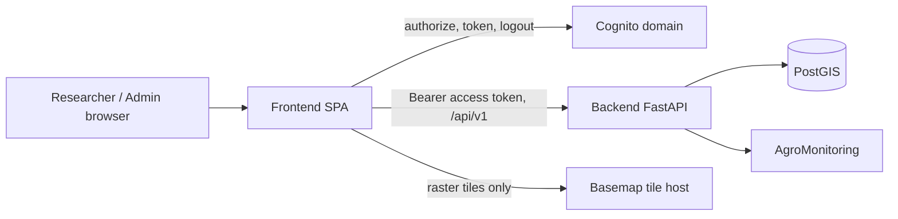
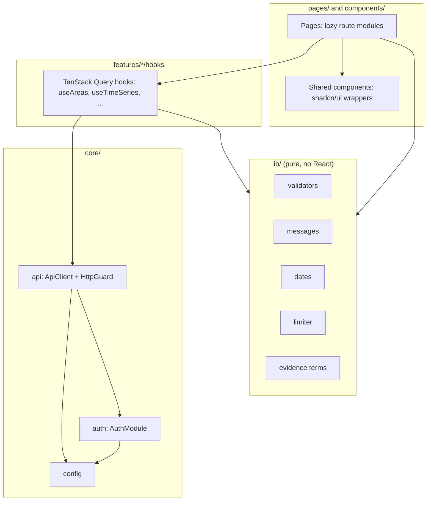
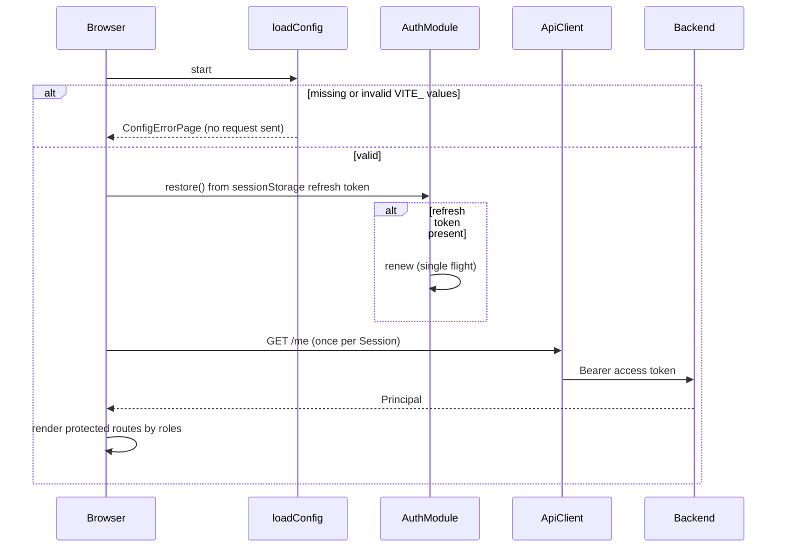
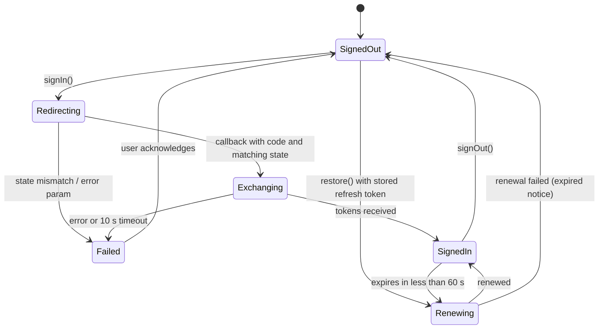
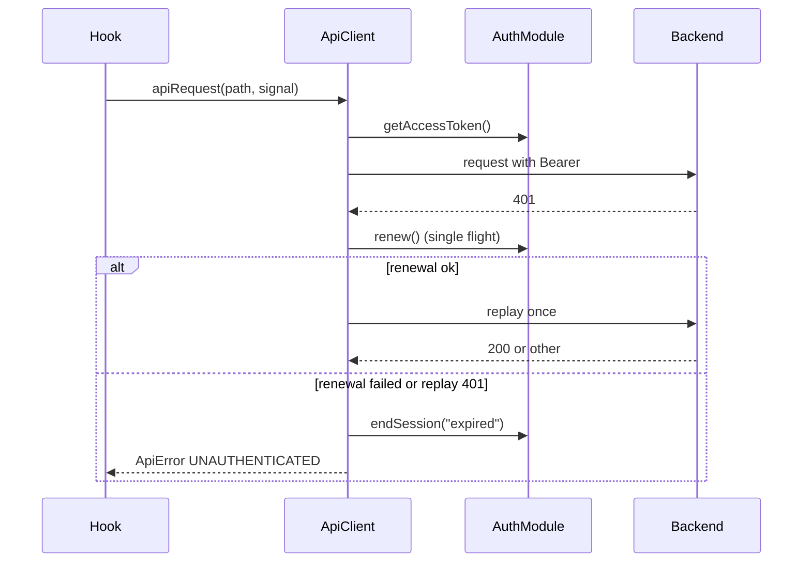
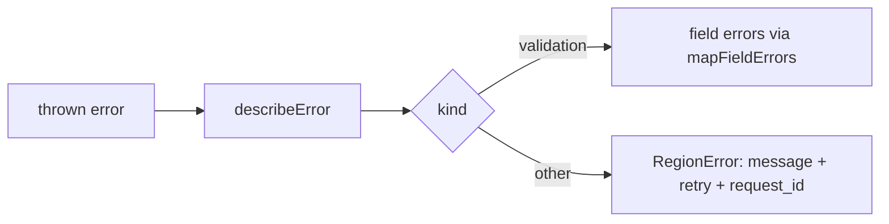
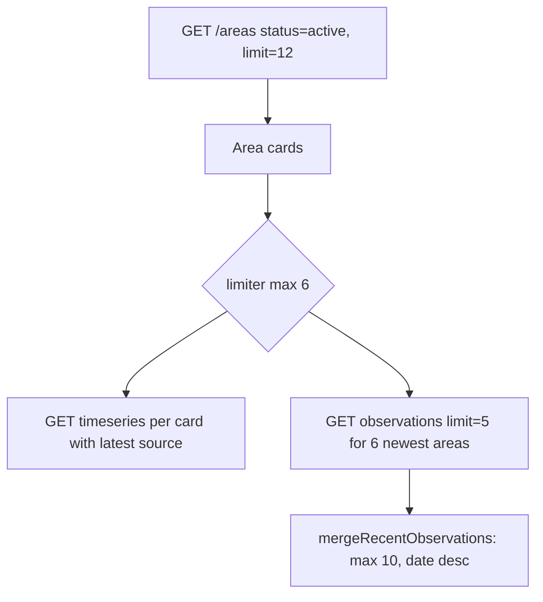

# Design Document: Eco-Sentinel Ghana Frontend

## Overview

The Frontend is a React single-page application for researchers and administrators. It signs users in through AWS Cognito (Authorization Code with PKCE), loads the Principal from `GET /me`, and calls only the Backend API (`/api/v1`) and Cognito. It shows NDVI evidence, quality indicators, weather context, date comparisons flagged "for investigation", and stored reports. It never classifies a change as illegal mining, destruction or recovery, never states where in a polygon a change happened, and never presents weather as a cause (Requirements 10, 11, 20).

The Backend `design.md` (section "API Contract") is authoritative. This design reuses its type names (`Area`, `Observation`, `Quality`, `NdviStats`, `Preview`, `Warning`, `WeatherContext`, `Report`, `ReportSummary`, `AuditEvent`, `Principal-me`, `Page[T]`), field names, error codes and warning codes. It adds no endpoint.

### Design Principles

- **The Backend computes, the Frontend displays.** Quality level, differences, flags, trend, warnings and summary text come from the Backend and are never recomputed in the browser (Requirements 7.5, 11.13). The only client-side logic is input validation, ordering of the two comparison dates, request shaping and rendering.
- **Server state in one cache.** TanStack Query owns every Backend response: 30 s reuse, request cancellation on navigation, retries only on user action, invalidation after writes.
- **One module for wording.** Every warning code, error code and Frontend-authored sentence about evidence lives in `src/lib/messages.ts` and is covered by a forbidden-term scan (Requirement 20).
- **Frontend guards are usability aids.** The Backend enforces security (Requirement 4.8).
- **MVP only.** No ML, no classification, no map drawing tools, no PDF, no production AWS infrastructure.

### Technology Choices

| Concern | Choice | Reason |
|---|---|---|
| Language / build | TypeScript (`strict`), Vite | Required. |
| UI | React 18, Tailwind CSS 3, shadcn/ui (Radix primitives) | Required. Radix gives focus trapping and return focus for dialogs (Requirement 21.9) and keyboard support. |
| Routing | React Router 7 (package `react-router`; `createBrowserRouter`, `lazy` routes, library mode) | Route-level code splitting for the admin area and the map (Requirement 24.4). Small and standard. Upgraded from 6 in task 1 at the owner's request: 6.30 carries a moderate advisory fixed only in 7. |
| Server state | TanStack Query 5 | Provides `staleTime: 30_000` reuse (24.2), `AbortSignal` cancellation on unmount (24.3), per-region loading and error states (Requirement 6), and `invalidateQueries` after writes. Writing this by hand would be larger and less tested. |
| Forms | Plain controlled components with small pure validators in `src/lib/validators` | Forms are few and each has simple rules. A form library would add more code than it saves, and pure validators are directly property-testable. |
| Map | MapLibre GL JS | Required. Wrapped in one hook, `useMap`, so tests mock one module (23.12). |
| Charts | Recharts | Required. |
| Tests | Vitest, React Testing Library, `@testing-library/user-event`, MSW 2, `vitest-axe` (axe-core), `fast-check` | `fast-check` supplies the property-based tests. It runs under Vitest and is the standard TypeScript choice. |
| Date handling | Plain `YYYY-MM-DD` strings and UTC arithmetic helpers | The Backend uses calendar dates. Avoiding a date library removes time-zone bugs and a dependency. |
| Crypto | Web Crypto API (`crypto.subtle.digest`, `crypto.getRandomValues`) | Native PKCE support. No library. |
| Linting | ESLint (typescript-eslint, react-hooks, jsx-a11y), `tsc --noEmit` | Requirement 22.8, 22.13. |
| Dependency pinning | `npm ci` with committed `package-lock.json`, exact versions in `package.json` (no `^` or `~`, `.npmrc` `save-exact=true`) | Requirement 22.12. |
| Runtime | Node 22 LTS (`node:22-alpine`), `engines.node >= 22.12` | Decided in task 1: Node 20 reached end of life in April 2026, and MapLibre GL JS 6 (the release without the critical advisory affecting 4.x) needs Node 22 to install. Tooling versions chosen then: Vite 7, Vitest 4, Recharts 3 (2.x is deprecated), fast-check 4. Lock files are written with npm 11, because npm 10 fails with an internal error when installing Vitest 4. |

Not used on purpose: Redux or other global stores (the Auth_Module is a small module with `useSyncExternalStore`), a Cognito SDK (the authorization code flow is three HTTP calls), a date library, a form library, a CSS-in-JS library.

## Research Findings and Decisions

Content from sources was rephrased for compliance with licensing restrictions.

### Gap Resolutions (G1 to G11)

| Gap | Resolution |
|---|---|
| **G1** No cross-area observation feed | The dashboard calls `GET /areas/{id}/observations?limit=5` for the 6 areas with the newest `latest_observation_date` and merges client-side (max 10 rows, sorted by `date` descending). The merge is a pure function `mergeRecentObservations`. |
| **G2** No cross-area NDVI summary | One `GET /areas/{id}/ndvi/timeseries` per card (up to 12). All dashboard calls go through a shared limiter of 6 concurrent requests (Concurrency Limiter section). The call uses a bounded range (last 365 days) to keep payloads small. |
| **G3** No exposed area limits | No limit is hard-coded. The Frontend shows the Backend `AREA_OUT_OF_RANGE` message unchanged. |
| **G4** Preview extent unconfirmed | The preview is drawn at the polygon bounding box, labelled "approximate, not used for analysis". The image is 117x117 px, so it is a coarse orientation aid. It is fetched with the Access_Token and shown from a blob URL. |
| **G5** Basemap | See Basemap Decision below. |
| **G6** Email usually null | `Principal.email` is shown when present. Otherwise the `email` claim of the ID token, kept in memory only, is used for display. Otherwise the username only. |
| **G7** No comparison history | The comparison result lives in component state and in a session-scoped store of `{areaId -> flag}` used only for the dashboard indicator (Requirement 7.6). It is not persisted. |
| **G8** No user search by email, no user creation | The users page uses `role` and `q` only. No creation, reset or delete control exists. |
| **G9** Refresh token in browser storage | Requirement 3.6 sets the choice: refresh token in `sessionStorage`, access token in memory. See Token Storage Trade-off for the risks and the mitigations. |
| **G10** Refresh takes up to 120 s | The refresh dialog stays open with an indeterminate progress indicator and an elapsed-time counter. The request timeout is 130 s. |
| **G11** `Preview.url` can be null | Observation views show "No preview available" and no control when `preview.url` is null. |

### Basemap Decision (G5)

Options considered:

| Option | Key needed | Fit |
|---|---|---|
| OpenStreetMap standard raster tiles (`tile.openstreetmap.org`) | No | The OSMF tile usage policy allows light use with attribution and forbids heavy use and bulk requests. A research tool with a few users is light use. |
| A vector tile provider with a free tier | Usually a key | Violates "no key or secret" (Requirement 8.2). |
| Self-hosted tiles | No | Needs infrastructure, outside the MVP. |
| Plain background only | No | Always works, but gives no orientation. |

**Decision.** Use OpenStreetMap raster tiles as the default basemap through a MapLibre raster source with the required attribution text, `maxzoom: 19`, 256 px tiles, and a `tileSize`-aware request limit. The tile URL template is a `VITE_BASEMAP_TILE_URL` value with the OSM template as the default, so the owner can swap in another keyless tile server without a code change. The host of that URL is added to the request allow-list as the single permitted third-party host (Requirement 2.5, 21.14). A 10 s tile-failure timer switches to a plain background (`background` layer in `Public_Config` colour Slate 50) and shows a notice (Requirement 8.3). The OSM policy is a known open risk for production traffic. It is recorded in Open Items.

Source: [OSMF Tile Usage Policy](https://operations.osmfoundation.org/policies/tiles/). The policy text was consulted for the "light use with attribution" conclusion and should be re-read before any production rollout.

### Token Storage Trade-off (G9)

The access token is kept in a module variable (memory). The refresh token is in `sessionStorage`, as Requirement 3.6 requires. `sessionStorage` is scoped to one tab and cleared when the tab closes, but any script running on the page can read it, so a cross-site scripting flaw would expose it. Mitigations in this design: no `dangerouslySetInnerHTML` (an ESLint rule forbids it), Backend text rendered as text nodes only, a strict `Content-Security-Policy` meta/header in the production build (`default-src 'self'`; `connect-src` limited to the API and Cognito hosts; `img-src 'self' blob: data:` plus the basemap host; `style-src 'self' 'unsafe-inline'` because MapLibre sets inline styles), no third-party scripts (Requirement 21.14), and refresh token rotation configured on the Cognito app client where available. A backend-for-frontend with an HttpOnly cookie would be safer and is recorded as a later option.

### Cognito Endpoints

Hosted UI / managed login endpoints on the Cognito domain: `GET /oauth2/authorize`, `POST /oauth2/token`, `GET /logout`. The token request uses `application/x-www-form-urlencoded` with `grant_type`, `client_id`, `code`, `redirect_uri` and `code_verifier` (no client secret, public client), and for renewal `grant_type=refresh_token`, `client_id`, `refresh_token`. Cognito's refresh response normally returns a new access token and ID token and no new refresh token, so the stored refresh token is kept unless the response contains one. Source: [Amazon Cognito token endpoint docs](https://docs.aws.amazon.com/cognito/latest/developerguide/token-endpoint.html). The exact response fields should be verified against the owner's user pool.

### Other Findings

- Requirement 1.4/1.5 text is consistent with the route table in Requirement 1.1. Requirement 1.7 and 4.3 ask for a notice on redirect. The notice is carried in router state and shown by a single `NoticeHost` component.
- Requirement 24.2 reuses GETs for 30 s. `GET /me` is the exception (once per Session). Both are expressed as TanStack Query `staleTime` values (`30_000` default, `Infinity` for `me`).
- Requirement 22.6 allows either a failing container or the configuration error page. The design does both: the Vite config fails the dev server start when a required variable is missing, and the runtime guard in `loadConfig()` renders the error page (for production builds and tests).
- Requirement 11.15 prefills threshold overrides from `GET /settings`. Backend `GET /settings` returns `ndvi_diff_threshold`, `cloud_limit_pct`, `data_coverage_min_pct`, `gap_threshold_days`, `default_page_size`. The comparison request body fields are `thresholds.ndvi_diff`, `thresholds.max_cloud`, `thresholds.min_data_coverage`. The mapping table is in the Comparison section.
- The Backend contract lists the refresh request body as `date_from`, `date_to`, `sources`, as used in Requirement 13.3. The Backend design text describes the refresh range as a start and end date without naming the body fields. The Frontend sends `date_from`, `date_to` and `sources`, following Requirement 13.3. This is flagged in Open Items to confirm with the Backend implementation.
- The Backend contract lists the comparison warning `PERCENT_DIFFERENCE_UNDEFINED` in the Frontend requirements glossary, while the Backend design lists neither this code nor a rule for emitting it. The message module defines text for it. If the Backend never emits it, the mapping is unused.

## Architecture

### System Context



The browser makes requests to exactly three hosts: the API base URL host, the Cognito domain and the basemap tile host. The `HttpGuard` described below enforces this (Requirement 2.5).

### Layered Structure



Pages read data only through feature hooks. Hooks call `ApiClient`. `ApiClient` asks `AuthModule` for the token. Pure helpers in `lib/` have no React or browser dependencies, which makes them property-testable.

### Application Start Sequence



### Routing and Guards

All pages except the sign-in landing, callback, signed-out and error pages are lazy route modules. The admin routes and the map route are separate chunks (Requirement 24.4).

| Path | Page module | Guard | Notes |
|---|---|---|---|
| `/` | `LandingPage` | public | Sign-in control. Shows the expired-session notice from router state. |
| `/auth/callback` | `CallbackPage` | public | Runs the code exchange once. |
| `/signed-out` | `SignedOutPage` | public | |
| `/auth/error` | `AuthErrorPage` | public | Shows the failure class from router state. |
| `/dashboard` | `DashboardPage` | session + any role | |
| `/map` | `MapPage` (lazy, map chunk) | session + any role | |
| `/areas` | `AreaListPage` | session + any role | |
| `/areas/:areaId` | `AreaDetailPage` | session + any role | Contains observation history, refresh dialog, links. |
| `/areas/:areaId/timeseries` | `TimeSeriesPage` | session + any role | |
| `/areas/:areaId/compare` | `ComparisonPage` | session + any role | |
| `/reports` | `ReportListPage` | session + any role | Includes the "Create report" dialog (area selectable). |
| `/reports/:reportId` | `ReportViewPage` | session + any role | |
| `/admin`, `/admin/users`, `/admin/areas`, `/admin/retrievals`, `/admin/settings`, `/admin/activity` | admin chunk | session + `admin` | |
| `*` | `NotFoundPage` | none | Link to `/dashboard` or `/`. |

The "Create report" form is reached from `/areas/:areaId` (area fixed) and from `/reports` (area selectable) as a dialog, so no extra route exists beyond the list in Requirement 1.1.

**Guard components.**

```tsx
<RequireSession>      // no session -> save path, navigate("/", {state: {from}})
  <RequirePrincipal>  // loads /me, shows loading/error/retry, no-role page
    <RequireRole role="admin"> // researcher -> navigate("/dashboard", {state:{notice:"ADMIN_REQUIRED"}})
```

`RequirePrincipal` renders the loading state for up to 10 s, the error state with retry for network errors, 500, 503 and timeouts (Requirement 4.5), and `NoRolePage` when `roles` is empty (Requirement 3.13). A 401 from `/me` triggers the renew-and-replay in `ApiClient`. If that fails, the Session ends and the user lands on `/` with the expired-session notice.

On each route change a `RouteAnnouncer` sets `document.title` to `"<Page name> - Eco-Sentinel"` and moves focus to the `h1` with `tabIndex={-1}` within 500 ms (Requirement 1.11). A skip link is the first focusable element (Requirement 1.12).

### Auth_Module

State machine:



**Public surface (`core/auth/authModule.ts`).**

```ts
export interface AuthState {
  status: "signed_out" | "renewing" | "signed_in";
  idEmail: string | null;            // display only (Requirement 4.6)
}
export interface AuthModule {
  getState(): AuthState;
  subscribe(l: () => void): () => void;     // for useSyncExternalStore
  signIn(returnTo: string): Promise<void>;  // builds URL, stores state+verifier, redirects
  handleCallback(search: string): Promise<CallbackResult>; // ok | {error: AuthFailure}
  getAccessToken(): Promise<string | null>; // renews if expires in < 60 s, single flight
  renew(): Promise<boolean>;                // single flight, used by ApiClient on 401
  signOut(): void;
  restore(): Promise<void>;
}
```

**PKCE and state (pure functions in `core/auth/pkce.ts`).**

```ts
randomString(len: number): string                 // base64url of getRandomValues, length exactly len
codeChallengeS256(verifier: string): Promise<string> // base64url(SHA-256(ascii(verifier))), no padding
buildAuthorizeUrl(cfg, {state, challenge}): string
```

- `code_verifier`: 64 characters from the unreserved set (RFC 7636 allows 43 to 128).
- `state`: 43 characters of base64url (32 random bytes), at least 32 characters (Requirement 3.1).
- Storage: `sessionStorage` keys `eco.pkce.verifier`, `eco.pkce.state`, `eco.pkce.returnTo`.
- Authorize URL query: `response_type=code`, `client_id`, `redirect_uri`, `scope=openid email profile`, `state`, `code_challenge`, `code_challenge_method=S256`.

**Callback handling** (`handleCallback`), run once per page load guarded by a ref so React strict mode does not run it twice:

1. Read `state` and `verifier` from `sessionStorage`. If either is missing, or the URL `state` differs: clear stored values, return `{error: "state_mismatch"}` with no token request (Requirements 3.3, 3.14).
2. If the URL has `error`: clear, return `{error: "access_denied"}`. The `error_description` is never shown.
3. POST the code to the token endpoint with a 10 s `AbortController`. Remove `state` and `verifier` from storage immediately after the request is sent (Requirement 3.2).
4. On a non-2xx response, a network error or a timeout: `{error: "token_exchange_failed"}` or `{error: "network_failure"}`.
5. On success: keep `access_token` and `expires_at` in module variables, keep the ID token email claim in memory only (decoded with a plain base64url JSON parse, used for display only, never for access), write `refresh_token` to `sessionStorage` key `eco.rt`, and navigate to the saved `returnTo` or `/dashboard`. Nothing is written to `localStorage` (Requirement 3.5).

**Renewal.** `getAccessToken()` returns the in-memory token when `expires_at - now > 60 s`. Otherwise it calls `renew()`. `renew()` keeps one in-flight promise (`inflight ??= doRenew().finally(() => inflight = null)`), so concurrent callers share one request (Requirement 3.7). `doRenew` posts the `refresh_token` grant with a 10 s timeout and makes one attempt only. On failure it clears the Session, clears the query cache and navigates to `/` with the notice "Your session has expired. Sign in again." (Requirement 3.8). A timer scheduled at `expires_at - 60 s` triggers proactive renewal while the tab is active.

**Sign-out.** Clear module tokens, `sessionStorage` keys `eco.*`, `queryClient.clear()`, then `window.location.assign(<cognito>/logout?client_id=...&logout_uri=...)`. Cognito returns the browser to `/signed-out` (Requirement 3.9).

**Implemented in task 7:** `createAuthModule(config, {guard, storage, fetch?, redirect?, now?, onSessionEnded?})` builds the module, so tests inject the token endpoint, the redirect and the clock. It also implements `endSession("expired")` from the API client's `AuthProvider` interface. `handleCallback` is memoised per search string in addition to the `CallbackPage` ref. A callback with a matching state but no `code` reports `token_exchange_failed`. A non-2xx answer or a body that fails `isTokenResponse` is `token_exchange_failed`; a network error or the 10 s timeout is `network_failure`. `safeReturnTo` accepts only in-app paths and maps the public auth routes to `/dashboard`. `createAppServices(config)` in `core/appServices.ts` wires the guard, Auth_Module, API client, query client and router once per page load; `onSessionEnded` clears the query cache and, for an expired Session, navigates to `/` with router state `{notice: "session_expired"}`. The landing page redirects a signed-in user to the saved path or `/dashboard`, and shows "Restoring your session" while a stored refresh token is renewed. Auth page wording and the four failure-class texts live in `lib/messages.ts` (`AUTH_TEXT`, `AUTH_FAILURE_TEXT`). `router.tsx` holds the four public routes and a temporary catch-all; task 8 adds the protected lazy routes, the guards and `NotFoundPage`.

**Only the access token is sent to the Backend.** `ApiClient` takes it from `getAccessToken()`. The ID token is never exposed outside the module except the email claim (Requirement 3.11, 3.12). Roles come only from `GET /me`.

### API_Client

```ts
export interface RequestOptions {
  method?: "GET" | "POST" | "PUT" | "PATCH";
  query?: Record<string, string | number | boolean | undefined>;
  body?: unknown;
  signal?: AbortSignal;          // from TanStack Query: cancellation on navigation
  timeoutMs?: number;            // default 30_000; refresh uses 130_000
  auth?: boolean;                // false for /health
  responseType?: "json" | "blob";
}
export async function apiRequest<T>(path: string, opts?: RequestOptions): Promise<T>;
```

Behaviour, in order:

1. **Allow-list (`HttpGuard`).** Build the URL from the API base URL (`VITE_API_BASE_URL`, which ends with `/api/v1`) and the path. A path that is absolute or contains `//`, `..` or a scheme is rejected. The final URL host must equal the API host, the Cognito domain host or the basemap host. Otherwise throw `DisallowedHostError` and send nothing (Requirement 2.5). Cognito calls use the same `guardedFetch`.
2. **Limit clamping.** `clampLimit(path, limit)` returns an integer from 1 to the endpoint maximum: 100 for `/admin/users`, `/admin/retrievals`, `/admin/activity`, 200 otherwise (Requirement 5.15). Non-integers are floored and values below 1 become 1. `offset` is clamped to an integer of 0 or more.
3. **Bearer.** `Authorization: Bearer <token>` from `getAccessToken()` unless `auth === false`.
4. **Timeout and cancellation.** A combined signal (`AbortSignal.any([callerSignal, timeoutSignal])`). A timeout throws `ApiTimeoutError`. A caller abort throws `AbortError`, which TanStack Query discards without an error state (Requirement 24.3).
5. **Response parsing.** 2xx returns the parsed JSON (or a `Blob` for `responseType: "blob"`). Any other status is converted by `parseError(status, body)` into `ApiError {status, code, message, details, requestId}`. A body that is not a valid Error_Envelope gives `code: "UNKNOWN"` with a generic or Backend message (Requirement 5.11). Network failure gives `NetworkError`.
6. **401 handling.** For a protected call that returns 401 and has not been replayed, call `auth.renew()` once. If renewal succeeds, replay the original request once. If renewal fails or the replay returns 401, call `auth.endSession("expired")` and throw `ApiError` (Requirement 5.3).
7. **403.** Throw `ApiError` with `FORBIDDEN`. No retry, the Session stays (Requirement 5.4).



**Implemented in task 6:** the client is built by `createApiClient(guard, auth)` and the endpoint functions by `createEndpoints(client)`, so tests and the app inject the Auth_Module through the `AuthProvider` interface (`getAccessToken`, `renew`, `endSession`) instead of a module singleton; the app wires them in task 8. Health endpoints (`getHealthLive`, `getHealthReady`) are included, unversioned and without a token. `HttpGuard` also refuses backslashes, user information in URLs and path segments that decode to `/`, `.` or `..`. `lib/pagination.ts` names the three admin lists whose maximum is 100, so the API-path scan exempts it alongside `endpoints.ts`. `src/types/api.ts` includes the Backend additions (observation-list `meta`, report `warnings`, probe `outcome`); a check against the running Backend's OpenAPI found the 29 endpoint functions and the response field names in agreement.

**Error types** (`core/api/errors.ts`): `ApiError`, `NetworkError`, `ApiTimeoutError`, `DisallowedHostError`. A pure function `describeError(e: unknown): DisplayError` in `lib/messages.ts` maps any thrown value to `{title, body, requestId?, retry: boolean, kind}`. It is total: it returns a value for every input (Property 7).

**Retries.** TanStack Query's automatic retry is disabled (`retry: false`). A retry happens only when the user activates a retry control (Requirement 5.6, 5.8), which calls `refetch()` once per activation.

### Data Fetching, Caching and Invalidation

`QueryClient` defaults: `staleTime: 30_000`, `gcTime: 300_000`, `retry: false`, `refetchOnWindowFocus: false`, `refetchOnReconnect: false`. Within 30 s an identical key is served from cache with no request (Requirement 24.2). `me` uses `staleTime: Infinity` and is removed on sign-out.

**Query keys** (`core/api/keys.ts`) are tuples that include every parameter, so identical requests share an entry:

```ts
keys.me()                                   // ["me"]
keys.areas(params)                          // ["areas", params]
keys.areaMap(params)                        // ["areas","map", params]
keys.area(id)                               // ["areas", id]
keys.observations(areaId, params)           // ["observations", areaId, params]
keys.observation(id)                        // ["observation", id]
keys.timeseries(areaId, params)             // ["timeseries", areaId, params]
keys.reports(params), keys.report(id)
keys.settings()                             // ["settings"]
keys.adminSettings(), keys.adminUsers(p), keys.adminUser(sub)
keys.adminRetrievals(p), keys.adminActivity(p), keys.adminIntegrations(probe), keys.adminDashboard()
```

**Invalidation rules** (executed in `onSuccess` of each mutation):

| Mutation | Invalidates |
|---|---|
| Refresh observations (status `success` or `partial`) | `["observations", areaId]`, `["timeseries", areaId]`, `keys.area(areaId)`, `["areas"]` list and map (the latest date changes) |
| Create, edit, archive, restore area | `["areas"]` (list, map, details), the dashboard queries |
| Create report | `["reports"]` |
| Update setting | `keys.settings()`, `keys.adminSettings()` |
| Change roles | `keys.adminUser(sub)`, `["admin","users"]` |
| Sign-out or expired Session | `queryClient.clear()` |

Comparisons are mutations (`POST`) and are not cached. Refresh with status `empty` or a 409/5xx changes nothing and invalidates nothing (Requirement 13.6, 13.8, 13.9).

**Page cancellation.** Each `useQuery` passes its `signal` to `apiRequest`. When the page unmounts and no other observer exists, TanStack Query aborts the request, and `ApiClient` rethrows `AbortError` which is not shown (Requirement 24.3).

### Concurrency Limiter

`lib/limiter.ts` provides a small FIFO limiter:

```ts
export function createLimiter(max: number): <T>(task: (signal: AbortSignal) => Promise<T>, signal?: AbortSignal) => Promise<T>;
```

Invariants: at most `max` tasks run at the same time, tasks start in submission order, a task aborted while queued never starts, and a task's slot is released when it settles (resolve, reject or abort). The dashboard creates one limiter with `max = 6` per dashboard mount and wraps the per-card time-series and observation calls. These are the only calls that need it, because the list call (`GET /areas`) is a single request that happens before them (Requirement 24.6).

### Error Display Pipeline



`RegionError` renders inside the affected region only (Requirement 6.3). `mapFieldErrors(details.fields, knownFields)` splits Backend `details.fields` into entries that match displayed form fields and entries that do not; the latter go to the form-level message (Requirement 5.5).

## Components and Interfaces

### Project Layout

```
frontend/
  package.json  package-lock.json  .npmrc  tsconfig.json  vite.config.ts
  tailwind.config.ts  postcss.config.js  eslint.config.js  components.json
  index.html  Dockerfile  .env.example  README.md
  public/
  src/
    main.tsx  App.tsx  router.tsx
    core/
      config.ts                 # loadConfig(): Public_Config validation
      auth/ authModule.ts  pkce.ts  tokenEndpoint.ts  storage.ts  AuthProvider.tsx
      api/  client.ts  httpGuard.ts  errors.ts  keys.ts  queryClient.ts  endpoints.ts
    types/
      api.ts                    # mirrors the Backend contract (below)
    lib/
      messages.ts               # the single warning/error/evidence text module
      evidence.ts               # FORBIDDEN_TERMS, containsForbiddenTerm
      validators.ts             # dates, bbox, thresholds, geojson, settings, refresh range
      dates.ts                  # YYYY-MM-DD helpers, orderDates
      limiter.ts                # concurrency limiter
      pagination.ts             # clampLimit, clampOffset
      merge.ts                  # mergeRecentObservations
      format.ts                 # number and date formatting
      ndviRamp.ts               # viridis-like ramp
      routes.ts                 # the only module that writes in-app route paths (exempt from the API-path scan)
    features/
      areas/  observations/  timeseries/  comparison/  reports/  dashboard/
      map/    admin/         settings/    # each: hooks.ts + components
    components/
      ui/                       # shadcn/ui generated components
      layout/  AppShell.tsx  Sidebar.tsx  Header.tsx  SkipLink.tsx  NoticeHost.tsx
      common/  StatusBadge.tsx  WarningBanner.tsx  RegionState.tsx  DataTable.tsx
               Pagination.tsx  FormField.tsx  ChartContainer.tsx  Legend.tsx  EvidenceNote.tsx
    pages/                      # lazy route modules (see routing table)
    styles/ globals.css  print.css
  tests/
    setup.ts  msw/handlers.ts  msw/server.ts  factories.ts
    unit/  properties/  components/  integration/  a11y/  scan/
```

### Public Config

```ts
export interface PublicConfig {
  cognitoDomain: string;      // VITE_COGNITO_DOMAIN, https URL
  cognitoClientId: string;    // VITE_COGNITO_CLIENT_ID
  cognitoRegion: string;      // VITE_COGNITO_REGION
  redirectUri: string;        // VITE_REDIRECT_URI
  logoutUri: string;          // VITE_LOGOUT_URI
  apiBaseUrl: string;         // VITE_API_BASE_URL, ends with /api/v1
  basemapTileUrl: string;     // VITE_BASEMAP_TILE_URL (optional, OSM default)
}
export function loadConfig(env: Record<string, string | undefined>): {ok: true; config: PublicConfig} | {ok: false; missing: string[]; invalid: string[]};
```

Required: all except `VITE_BASEMAP_TILE_URL`. A value that is missing, empty or whitespace is `missing`. `apiBaseUrl`, `redirectUri`, `logoutUri` and `cognitoDomain` that do not parse as absolute URLs are `invalid`. `main.tsx` renders `ConfigErrorPage` when `ok` is false and does not create the `AuthModule` or any `fetch` (Requirement 2.2, 2.3).

### Message Module (`lib/messages.ts`)

The single place that maps codes to text (Requirement 20.10, 20.11).

```ts
export const WARNING_TEXT: Record<KnownWarningCode, string>;
export const ERROR_TEXT: Record<KnownErrorCode, string>;
export const EVIDENCE_TEXT: { aggregateNote, flagged, notFlagged, spatialUnavailable, ... };
export function warningText(w: Warning): string;
export function errorText(e: {code: string; message?: string}): string;
export function describeError(e: unknown): DisplayError;
```

Rules:

- `warningText(w)`: if `w.code` is in `WARNING_TEXT`, return that text. Otherwise return `w.message` when it is non-empty. Otherwise return `"Unrecognised notice (" + w.code + ")"`.
- `errorText` follows the same three-step rule over `ERROR_TEXT`.
- Backend `summary_text`, `limitations`, `caveats` and `Warning.message` are never passed through this module. They are rendered unchanged by `VerbatimText` (a component that renders a string inside a `<p>` with `white-space: normal; overflow-wrap: anywhere` and no truncation CSS, Requirement 20.9).
- `WARNING_TEXT` covers every code in the requirements glossary: `INSUFFICIENT_OBSERVATIONS`, `IRREGULAR_SAMPLING`, `WEATHER_UNAVAILABLE`, `WEATHER_DISABLED`, `LOW_QUALITY_OBSERVATION`, `SEASONALITY_NOT_CONTROLLED`, `DATA_COVERAGE_UNKNOWN`, `ITEMS_DISCARDED`, `INVALID_CLOUD_COVERAGE`, `WEATHER_INVALID_DATA`, `PERCENT_DIFFERENCE_UNDEFINED`.
- `ERROR_TEXT` covers `UNAUTHENTICATED`, `FORBIDDEN`, `VALIDATION_ERROR`, `NOT_FOUND`, `CONFLICT`, `GEOMETRY_OUTSIDE_GHANA`, `AREA_OUT_OF_RANGE`, `CROSS_SENSOR_COMPARISON`, `NO_OBSERVATIONS`, `REFRESH_IN_PROGRESS`, `LAST_ADMIN`, `SELF_ROLE_CHANGE`, `COGNITO_ADMIN_NOT_ENABLED`, `UPSTREAM_ERROR`, `UPSTREAM_TIMEOUT`, `NOT_IMPLEMENTED`, `PAYLOAD_TOO_LARGE`, `SERVICE_UNAVAILABLE`, `INTERNAL_ERROR`.
- `AREA_OUT_OF_RANGE` uses the Backend `message` unchanged, so no limit is hard-coded (G3).
- **Implemented in task 5:** `WARNING_TEXT` also covers `UPSTREAM_ERROR`, which the Backend sends as a warning with a partial refresh. `KnownWarningCode` and `KnownErrorCode` are derived from the two tables and re-exported by `src/types/api.ts`, so the codes are defined once. The Backend's generic `BAD_REQUEST` code (framework 4xx responses) has no authored text and falls back to the Backend message. `errorText` uses the generic notice `Unrecognised error (<code>)`. `GEOMETRY_OUTSIDE_GHANA` uses the fixed text "The polygon is not entirely within Ghana."
- Example texts: `IRREGULAR_SAMPLING` is "Observations are unevenly spaced; gaps exceed the threshold." `LOW_QUALITY_OBSERVATION` is "At least one of the observations has low quality for the limits applied." `SEASONALITY_NOT_CONTROLLED` is "The interval is not a whole number of years, so seasonal effects are not controlled." `WEATHER_DISABLED` is "Weather context is turned off."

### Evidence Language Module (`lib/evidence.ts`)

```ts
export const FORBIDDEN_TERMS = ["illegal mining","illegal","deforestation","destruction","destroyed","recovery","recovered"] as const;
export function containsForbiddenTerm(text: string): string | null; // case-insensitive, returns first match
```

`EvidenceNote` renders the standard statements: "NDVI values are polygon-level aggregates." (every screen with NDVI), the correctness-not-causation note from the Backend `WeatherContext.note` (every screen with weather, shown unchanged), and the flag label "Flagged for investigation" with the difference value and threshold value. Backend text is excluded from the forbidden-term scan, so the scan targets source files and rendered text with Backend text replaced by test fixtures that contain no such terms (see Testing Strategy).

### TypeScript Types (`src/types/api.ts`)

Types mirror the Backend "Shared types" and endpoint index. Names and fields are identical to the Backend design.

```ts
export type Source = "sentinel-2" | "landsat-8";
export type Role = "admin" | "researcher";
export type QualityLevel = "good" | "limited" | "poor";
export type GeometryStatus = "current" | "stale_geometry";
export type AreaStatus = "active" | "archived";
export type FlagStatus = "flagged" | "not_flagged";
export type RetrievalStatus = "running" | "success" | "partial" | "empty" | "failed";
export type AuditOutcome = "success" | "failure" | "denied";

export type KnownWarningCode =
  | "INSUFFICIENT_OBSERVATIONS" | "IRREGULAR_SAMPLING" | "WEATHER_UNAVAILABLE"
  | "WEATHER_DISABLED" | "LOW_QUALITY_OBSERVATION" | "SEASONALITY_NOT_CONTROLLED"
  | "DATA_COVERAGE_UNKNOWN" | "ITEMS_DISCARDED" | "INVALID_CLOUD_COVERAGE"
  | "WEATHER_INVALID_DATA" | "PERCENT_DIFFERENCE_UNDEFINED";
export interface Warning { code: string; message: string }

export type KnownErrorCode =
  | "UNAUTHENTICATED" | "FORBIDDEN" | "VALIDATION_ERROR" | "NOT_FOUND" | "CONFLICT"
  | "GEOMETRY_OUTSIDE_GHANA" | "AREA_OUT_OF_RANGE" | "CROSS_SENSOR_COMPARISON"
  | "NO_OBSERVATIONS" | "REFRESH_IN_PROGRESS" | "LAST_ADMIN" | "SELF_ROLE_CHANGE"
  | "COGNITO_ADMIN_NOT_ENABLED" | "UPSTREAM_ERROR" | "UPSTREAM_TIMEOUT"
  | "NOT_IMPLEMENTED" | "PAYLOAD_TOO_LARGE" | "SERVICE_UNAVAILABLE" | "INTERNAL_ERROR";
export interface ErrorEnvelope {
  error: { code: string; message: string; details: Record<string, unknown> | null; request_id: string };
}

export interface Page<T> { items: T[]; total: number; limit: number; offset: number }

export interface Quality {
  level: QualityLevel; cloud_coverage_pct: number | null;
  data_coverage_pct: number | null; warnings: Warning[];
}
export interface NdviStats { mean: number; min: number | null; max: number | null; std: number | null; median: number | null }
export interface Preview { url: string | null; width_px: number | null; height_px: number | null; note: string }
export interface Observation {
  id: string; area_id: string; date: string; source: Source; ndvi: NdviStats;
  quality: Quality; preview: Preview; geometry_status: GeometryStatus;
}
export type GeoJsonGeometry = { type: "Polygon" | "MultiPolygon"; coordinates: unknown };
export interface Area {
  id: string; name: string; description: string | null; status: AreaStatus; area_ha: number;
  geometry?: GeoJsonGeometry; external_polygon_id: string | null;
  latest_observation_date: string | null; created_at: string; updated_at: string;
}
export interface WeatherValue { value: number; unit: string }
export interface WeatherContext {
  provider: string; period: { from: string; to: string };
  values: Record<string, WeatherValue>; note: string;
}
export interface PrincipalMe { sub: string; username: string; email: string | null; roles: string[]; permissions: string[] }

export interface TimeSeriesPoint {
  date: string; ndvi_mean: number; cloud_coverage_pct: number | null;
  data_coverage_pct: number | null; quality: Quality;
  gap_days_from_previous: number | null; weather: WeatherContext | null;
}
export interface TimeSeriesSummary {
  count: number; first_date: string | null; last_date: string | null; min: number | null;
  max: number | null; mean_of_means: number | null; trend_per_30d: number | null;
}
export interface TimeSeriesResponse {
  area_id: string; source: Source; points: TimeSeriesPoint[]; summary: TimeSeriesSummary;
  meta: { excluded_by_cloud: number; resolution_class: string };
  warnings: Warning[]; limitations: string[];
}

export interface ThresholdsApplied { ndvi_diff: number; max_cloud: number; min_data_coverage: number }
export interface ComparisonRequest {
  source: Source; date_a: string; date_b: string;
  thresholds?: Partial<ThresholdsApplied>; include_weather: boolean;
}
export interface ComparisonResult {
  area_id: string; source: Source; a: Observation; b: Observation;
  ndvi_diff: number; ndvi_diff_pct: number | null; interval_days: number; flag: FlagStatus;
  thresholds_applied: ThresholdsApplied; quality: Quality;
  spatial_analysis_available: false; summary_text: string;
  weather: { a: WeatherContext | null; b: WeatherContext | null; between: WeatherContext | null } | null;
  warnings: Warning[]; limitations: string[];
}

export interface RefreshRequest { date_from: string; date_to: string; sources?: Source[] }
export interface RefreshResult {
  retrieval_id: string; status: "success" | "partial" | "empty";
  new: number; updated: number; skipped: number; warnings: Warning[];
}

export interface ReportRequest {
  area_id: string; source: Source; date_from: string; date_to: string; title?: string;
  comparisons?: { date_a: string; date_b: string }[]; include_weather: boolean;
}
export interface ReportSummary {
  id: string; title: string; area_id: string; area_name: string;
  period: { from: string; to: string }; source: Source;
  created_at: string; created_by: { sub: string; username: string };
}
export interface Report {
  id: string; title: string; created_at: string; created_by: { sub: string; username: string };
  area: { id: string; name: string; area_ha: number; geometry: GeoJsonGeometry };
  period: { from: string; to: string }; source: Source;
  observations: { date: string; ndvi_mean: number; cloud_coverage_pct: number | null;
                  data_coverage_pct: number | null; quality: Quality }[];
  summary: TimeSeriesSummary; comparisons: ComparisonResult[];
  thresholds_applied: ThresholdsApplied; weather: WeatherContext | null;
  caveats: string[]; limitations: string[];
}

export interface SettingItem {
  key: string; value: number | boolean; type: "integer" | "decimal" | "boolean";
  default: number | boolean; min: number | null; max: number | null;
  updated_by: string | null; updated_at: string;
}
export interface PublicSettings {
  ndvi_diff_threshold: number; cloud_limit_pct: number; data_coverage_min_pct: number;
  gap_threshold_days: number; default_page_size: number;
}
export interface AdminUser { sub: string; username: string; email: string | null; roles: string[]; status: string; last_seen_at: string | null }
export interface RoleChangeResult { sub: string; roles: string[]; effective_after_next_login: true; message: string }
export interface RetrievalRecord {
  id: string; provider: "agromonitoring" | "weather"; kind: string; area_id: string | null;
  requested_range: { from: string | null; to: string | null } | null;
  status: RetrievalStatus; item_count: number; duration_ms: number | null; started_at: string;
  error: { code: string; message: string } | null;
}
export interface AuditEvent {
  id: string; occurred_at: string; actor_sub: string | null; action: string; target_type: string;
  target_id: string | null; request_id: string; outcome: AuditOutcome; details: Record<string, unknown>;
}
export interface IntegrationStatus {
  configured: boolean; enabled: boolean; last_success_at: string | null; last_failure_at: string | null;
  last_error: string | null; failures_24h: number; probe: { ok: boolean; latency_ms: number } | null;
}
export interface AdminDashboard {
  areas_active: number; observations_total: number; reports_total: number;
  users_by_role: Record<string, number>; retrievals_7d_by_status: Record<string, number>;
}
```

Fields the Backend design leaves loosely specified (the `requested_range` shape, `SettingItem.value` encoding, the `PUT /admin/settings/{key}` response) are typed as above and listed in Open Items. A runtime check is not added for every response. Only `GET /me`, the error envelope and Cognito responses are checked at runtime (`isErrorEnvelope`, `isPrincipalMe`, `isTokenResponse`), because those are trust boundaries the Frontend must survive when malformed. Other responses are trusted to match the contract. MSW handlers are typed with the same interfaces so a contract change breaks compilation.

**Endpoint functions (`core/api/endpoints.ts`).** One function per Backend endpoint with typed inputs and outputs. The list is exactly the Backend endpoint index: `getMe`, `listAreas`, `getAreaMap`, `getArea`, `listObservations`, `getObservation`, `fetchPreviewBlob`, `refreshObservations`, `getTimeSeries`, `createComparison`, `createReport`, `listReports`, `getReport`, `getSettings`, `getAdminSettings`, `putAdminSetting`, `listAdminUsers`, `getAdminUser`, `putUserRoles`, `createAdminArea`, `patchAdminArea`, `archiveAdminArea`, `restoreAdminArea`, `listRetrievals`, `getIntegrationStatus`, `listActivity`, `getAdminDashboard`. No other path string appears in `src` (a test greps `src` for `"/` path literals outside this file, see Testing Strategy).

### Page and Component Designs

#### App Shell and Layout

`AppShell` uses a CSS grid. Viewport_Class breakpoints are the Tailwind screens `sm: 640px` and `lg: 1024px`. Below 640 px the sidebar is a `Sheet` (shadcn drawer) opened by a menu button with a 44 px touch target. From 640 px the sidebar is persistent. The header shows the username, the email (Requirement 4.6, 4.7) and a sign-out button. The `NoticeHost` shows dismissible notices for at least 5 seconds (Requirement 1.7). Navigation items are derived from the role set by a pure function `navItems(roles)` (Property 13).

#### Common Region States

`RegionState` wraps a TanStack Query result:

```tsx
<RegionState query={q} empty={{noun:"areas", action?}} isEmpty={(d)=>d.items.length===0}>
  {(data) => ...}
</RegionState>
```

It renders: loading skeleton with `aria-busy="true"` within 100 ms (the skeleton renders synchronously when `isPending`), `RegionError` with a retry button (disabled while `isFetching`), an "outdated" badge when `isError && data` exists (Requirement 5.8), the empty state, or the children. On a retry success the error is replaced in the same render pass (Requirement 6.8).

#### Dashboard



- Count uses `total`. Zero total shows the empty state and calls nothing else (Requirement 7.12).
- The source for a card comes from the first observation of the area. Because no endpoint returns the latest observation's source, the dashboard first fetches `GET /areas/{id}/observations?limit=1` for that card (through the limiter), then the time series with that source. The observation call is shared with the "Recent observations" request through the cache (the recent request uses `limit=5`, a different key, so the card call uses `limit=5` too: one request per area serves both the source lookup and the table). Cards for areas outside the 6 newest still need the source, so they use the same `limit=5` call. The total is at most 12 observation calls and 12 time-series calls, run through the limiter.
- Time-series range: `date_from` = `latest_observation_date` minus 365 days, `date_to` = `latest_observation_date`.
- A failed card shows an error indicator on that card only (Requirement 7.8).
- Card change indicator uses the in-session comparison store: `sessionComparisons.get(areaId)?.flag`. It is empty unless the user ran a comparison.
- The statement from Requirement 7.9 and the NDVI aggregate note appear at the top of the page.

#### Map

`useMap(containerRef, options)` is the only code that imports `maplibre-gl`. It returns a typed controller:

```ts
interface MapController {
  setAreas(fc: AreaFeatureCollection): void;   // source "areas", layers "areas-fill", "areas-outline"
  fitToFeatures(): void; fitToGhana(): void;
  setSelected(id: string | null): void;        // feature-state selected
  showPreview(blobUrl: string, bbox: BBox, opacity: number): void; // source "preview", layer "preview-raster"
  setPreviewOpacity(o: number): void;
  removePreview(): void;                       // removes layer, then source
  onSelect(cb: (id: string | null) => void): void;
  onBasemapFailure(cb: () => void): void;
  destroy(): void;
}
```

- **Data.** `GET /areas/map?status=active` returns a FeatureCollection with properties `{id, name, area_ha, latest_observation_date}`. The collection is set as a GeoJSON source with `promoteId: "id"`. `fitToFeatures` uses a bbox computed by `featureCollectionBounds` (pure). Zero features gives the Ghana bounds `[-3.3, 4.7, 1.3, 11.2]` (approximate bounding box of Ghana, `GHANA_BOUNDS` constant).
- **Selection.** A click on a feature sets `feature-state.selected = true` (outline width 4 px versus 2 px, a darker colour), clears the previous selection and opens `AreaDetailsPanel` within 300 ms with the properties already in the feature. The panel then runs `useArea(id)` and `useObservations(id, {limit: 10})` in separate regions. A failure shows a retry control in the observations section only, the polygon stays selected (Requirement 8.7). A background click clears the selection.
- **Controls.** Zoom in, zoom out and reset are our own `<button>` elements (not the MapLibre default control) so they are focusable and 44 px on mobile. MapLibre's keyboard navigation stays on for the canvas. Beside the map is a visible link to `/areas` (Requirement 8.15).
- **Legend.** `MapLegend` lists outline colours default and selected and, while an overlay is active, the opacity and "Low-resolution preview, for orientation only". No layer is coloured by condition (Requirement 8.16).
- **Overlay colours.** Default outline `#047857` (Primary Emerald) with a white 1 px halo line below it, fill `#059669` at 15% opacity, selected outline `#064E3B` at 4 px. The outline colours meet 3:1 against the OSM light background, the white halo keeps them separate from dark basemap features (Requirement 21.13).
- **WebGL failure.** `useMap` catches the creation error and returns `{supported: false}`. `MapPage` then shows the unsupported message with a link to `/areas` (Requirement 8.13).
- **Basemap failure.** The raster source's `error` events are counted. If no tile has loaded 10 s after the first tile request, `onBasemapFailure` fires, the raster layer is hidden, the `background` layer shows, and the notice is displayed.
- **Attribution.** An `AttributionControl` with `customAttribution: "© OpenStreetMap contributors"` (or the text paired with `VITE_BASEMAP_ATTRIBUTION`) stays visible at all zooms.

**Preview overlay.** `usePreviewOverlay(map)`:

1. User activates "Show preview" (only when `preview.url` is non-null). The control is disabled while the request is pending.
2. `fetchPreviewBlob(observation.preview.url)` runs through `apiRequest` with `responseType: "blob"`, the bearer token and the 30 s timeout. The `preview.url` is a Backend proxy URL. It is resolved against the API host and checked by the `HttpGuard`; a URL on another host is rejected.
3. `URL.createObjectURL(blob)` creates the blob URL. `controller.showPreview(blobUrl, bboxOf(area.geometry), opacity)` removes any existing overlay first (at most one, Requirement 9.12), then adds an `image` source with the four bbox corners in order top-left, top-right, bottom-right, bottom-left, and a `raster` layer with `raster-opacity`.
4. The default opacity is 0.70, the slider range 0 to 100 percent in steps of 1.
5. While visible, the UI shows `preview.note` from the Backend, "117 by 117 px" style size text (`width_px` by `height_px`, "unknown" for each null) and the statement "The overlay position is approximate and is not used for analysis."
6. On remove, on replacing, and on unmount: `removeLayer`, `removeSource`, then `URL.revokeObjectURL(blobUrl)` (Requirement 9.14). The hook keeps the active blob URL in a ref so a replacement always revokes the previous one.
7. Errors 404, 502 and 504 show the Requirement 5 message beside the control, leave the map unchanged and keep the control enabled.

Only the preview route draws bitmaps. No satellite or index tiles are requested (Requirement 9.13).

#### Area List and Details

- `AreaListPage`: filters in the URL query string (`status`, `q`, `bbox`, `page`) so back and forward work. The `q` input is debounced 300 ms by `useDebouncedValue`, limited to 100 characters. The bounding-box inputs run `validateBbox` (pure) before any request. "Use map extent" is offered only when the area list is opened from the map link, which passes the extent in router state. The table shows 20 rows per page and uses `limit=20&offset=...`. Empty result: empty state with "Reset filters".
- `AreaDetailPage`: header with name, status badge (`Archived` when relevant), description, `area_ha`, `created_at`, `updated_at`, `latest_observation_date`, a small non-interactive `useMap` instance with the polygon (lazy loaded), links to time series, comparison and "Create report", and a "Refresh observations" button (Requirement 13). The observation history section loads when it is opened (a collapsible section that renders its query only when expanded), with `source`, `date_from`, `date_to`, `max_cloud_coverage`, `min_data_coverage` filters validated by `validateObservationFilters` and 20 rows per page. Selecting a row loads `GET /observations/{id}` into `ObservationDetail` (Requirement 9).
- `ObservationDetail` shows the date, the source label ("Sentinel-2" or "Landsat 8"), mean NDVI plus each non-null min, max, std and median, cloud coverage and data coverage as two separate labelled values (`data_coverage_pct` null shows "Not reported" plus the `DATA_COVERAGE_UNKNOWN` text), the `QualityBadge` and all quality warnings, the `stale_geometry` badge and text, and the preview control or "No preview available".

#### Refresh Dialog

`RefreshDialog` is a Radix dialog with `date_from`, `date_to`, a source checkbox pair (default both) and a confirm button. `validateRefreshRange(from, to, today)` returns field errors for: empty or invalid calendar date, `from > to`, `to > today`, span over 366 days (inclusive span `(to - from) + 1`, so a range of exactly 366 days passes; the Backend rule is "at most 366 days", see Open Items for the inclusive/exclusive ambiguity). When both sources are selected `sources` is omitted. While pending the dialog shows an indeterminate progress bar, an elapsed seconds counter and "The retrieval can take up to two minutes."; confirm and close are disabled except Escape which only closes the dialog without aborting the request (the request keeps running and the result is shown as a toast on completion, so a refresh is never duplicated). Results map to Requirement 13.5 to 13.11: success counts, empty message with zeros, partial warning with counts and warnings, 409 message with a "Try again later" button that closes the dialog, 502 and 504 with "previously stored observations are unchanged", client abort at 130 s with the unknown-result message. The returned `retrieval_id` is shown (Requirement 13.11).

#### Time Series Page

- Filters live in the URL: `source`, `date_from`, `date_to`, `max_cloud_coverage`, `include_weather`. The source preselects from the area's latest observation source when known (taken from a `limit=1` observations query), otherwise the page asks the user to choose and sends no request (Requirement 10.3, 10.4).
- `validateTimeSeriesFilters` checks `date_from <= date_to`, span at most 3660 days and `max_cloud_coverage` as an integer 0 to 100. Invalid input shows a field error and sends nothing; the previous chart stays (Requirement 10.18).
- The apply button calls `useTimeSeries` with exactly one `source`. The source selector is a radio group, so a second source cannot be requested in the same call and the chart receives a single-source response (Requirement 10.6).
- `NdviChart` (Recharts `ComposedChart` with a `Line`) plots `ndvi_mean` against `date`. Custom `dot` renderer: circle for `good` and `limited`, a ring (hollow diamond with 2 px outline) for `poor`; the legend lists every style (Requirement 10.8). Y axis domain is `[-1, 1]` unless the data range is narrower, in which case the domain is padded around the data. The tooltip is a custom component with date, source label, mean NDVI, cloud coverage, data coverage or "Not reported", quality level, `gap_days_from_previous` or "Not applicable", and weather when present. Points are focusable through `accessibilityLayer` and the table below the chart provides the full data (Requirement 10.9).
- Line colour is a single series colour. Points are coloured by NDVI value with the viridis-like ramp (`ndviRamp(value)`), with a legend bar showing the displayed min and max (Requirement 21.12).
- `SummaryPanel` shows `count`, `first_date`, `last_date`, `min`, `max`, `mean_of_means` and "Linear trend (NDVI per 30 days)" with "Not available" for nulls. One point: no trend and the `INSUFFICIENT_OBSERVATIONS` text. Zero points: empty state with "Refresh observations" only when the Principal has the `observations:refresh` permission.
- `WarningBanner` renders each warning through `warningText`. `Limitations` renders every `limitations` entry through `VerbatimText`. `meta.excluded_by_cloud > 0` shows "N observations excluded by the cloud filter". `meta.resolution_class` is shown as "Sensor resolution: ...".
- Weather: when `weather` is present on a point, the tooltip and table show each value with its unit, `provider`, `period` and `note` (from the Backend). Weather warning codes show the NDVI data plus the message, never an error state.
- Screen-reader summary: a visually hidden paragraph `"Chart of N NDVI points for <Source label> from <first_date> to <last_date>."` linked with `aria-describedby` on the chart container (Requirement 10.22). The chart container has `min-h-[240px]` and `min-w-0` to prevent page overflow.

#### Comparison Page

- The date selectors list only dates of stored observations for the chosen source: `useObservationDates(areaId, source)` pages through `GET /areas/{id}/observations?source=...&limit=200` until all pages are read (the first page usually suffices, a loop with a cap of 10 pages handles the rest). The list is deduplicated and sorted.
- `orderDates(d1, d2)` returns `{date_a, date_b}` with `date_a` the earlier. Equal or missing dates give a field error and no request (Requirement 11.2, 11.3). Because the Backend defines `ndvi_diff = mean(date_b) - mean(date_a)`, this ordering makes a positive difference mean a later higher NDVI.
- Request: `POST /areas/{id}/comparisons` with `{source, date_a, date_b, include_weather, thresholds?}`. `thresholds` contains only overrides the user changed.
- **Threshold mapping.** Prefill from `GET /settings`:

| Override field (request) | Prefill from `GET /settings` | Accepted range |
|---|---|---|
| `thresholds.ndvi_diff` | `ndvi_diff_threshold` | 0.00 to 2.00 |
| `thresholds.max_cloud` | `cloud_limit_pct` | 0 to 100 |
| `thresholds.min_data_coverage` | `data_coverage_min_pct` | 0 to 100 |

  When a setting is missing the field shows "not available" and has no prefill.
- `validateThresholdOverrides` checks type and range before sending. The 422 field messages are shown next to the matching fields.
- Result: `ComparisonResultView` shows two `ObservationSummaryCard`s side by side (date a, date b, mean NDVI, median when non-null, cloud, data coverage, quality), the signed difference (`formatSigned(ndvi_diff, 4)`), `ndvi_diff_pct` with 2 decimals or "Not defined", `interval_days`, the flag badge ("Difference flagged for investigation" or "Difference below investigation threshold"), the `thresholds_applied` values, the comparison `QualityBadge`, `summary_text` via `VerbatimText`, "Spatial analysis is not available" when `spatial_analysis_available` is false, the weather block, the warning banner and the limitations section.
- The sign indicator uses neutral slate/indigo ramp colours, never the status colours (Requirement 11.14). The flag badge uses the information colour, not warning or error.
- Errors: `CROSS_SENSOR_COMPARISON`, `NOT_FOUND` naming the date (the message is taken from the Backend `message`, which names the date), 5xx, network. Selections are always kept. The submit control is disabled while pending.
- On success the result is stored in `sessionComparisons` (a module-level `Map` cleared on sign-out) with `{flag, date_a, date_b}` for the dashboard indicator.

#### Reports

- `CreateReportDialog`: area (fixed or a select populated from `GET /areas?limit=200&status=active`), source, dates, title, up to 10 comparison pairs, weather toggle. `validateReportForm` covers: `date_from <= date_to`, span at most 1826 days, title at most 200 characters, at most 10 pairs, no pair with equal dates; pairs are ordered earlier first with `orderDates`. On 201 navigate to `/reports/{id}`. `NO_OBSERVATIONS` shows the message with a link to the area page's refresh action.
- `ReportListPage`: `GET /reports` with `limit=20`, newest first (as returned), `area_id` filter for all, `created_by` filter for admins only.
- `ReportViewPage`: `GET /reports/{id}?format=json`. Everything on the page is rendered from that single response. The chart and table reuse `NdviChart` and `ObservationsTable` fed from `report.observations` (mapped into the `TimeSeriesPoint` shape with `gap_days_from_previous: null` and `weather: null`). It shows the stored summary, comparisons through `ComparisonResultView`, thresholds, weather, `caveats` and `limitations` in an always-visible section, and the sentence "This report is a snapshot created on <created_at> and does not change when data is refreshed."
- **Download JSON.** The page keeps the raw response text. The download uses `Blob([rawText], {type: "application/json"})` and an anchor with `download="report-<id>.json"`, so the bytes are unmodified. Achieved by requesting with `responseType: "text"`-style handling: the report query stores `{raw: string, parsed: Report}` (the client parses once and keeps the string).
- **Print.** A "Print" button calls `window.print()`. `print.css` (`@media print`) hides the sidebar, header, buttons and dialogs, expands the content to full width, forces the caveats and limitations section to display, avoids page breaks inside the section, and switches the chart to a black-on-white scheme.
- No PDF control exists. If code requests `format=pdf` and receives 501 `NOT_IMPLEMENTED` the not-available message is shown (kept only so the path is covered by a test).
- A 404 shows the generic not-found state, identical for a missing report and another user's report.

#### Admin Area Management

- `AdminAreasPage` lists with `status=all`, 20 rows per page, with create, edit, archive and restore controls.
- `AreaForm` fields: name (1 to 100), description (0 to 1000), geometry text area and a file input (`accept=".geojson,.json"`). `validateGeoJsonInput(text)` is a pure function returning `{ok: true, geometry} | {ok: false, check, position?}`. Its checks and no others: (1) valid JSON (reports the parse error position from the `SyntaxError` message when available), (2) extract the geometry from a Polygon, MultiPolygon, a Feature holding one, or a FeatureCollection with exactly one feature holding one, (3) type is Polygon or MultiPolygon, (4) every coordinate is a number pair (or triple) with longitude in [-180, 180] and latitude in [-90, 90]. It does not check ring closure, self-intersection, area or Ghana containment (Requirement 14.6); the Backend does.
- File rules: a file over 1 MB or an extension other than `.geojson` and `.json` is rejected before reading, leaving the existing text unchanged (Requirement 14.5).
- The preview map shows the parsed polygon within 2 seconds with the note "longitude, latitude (EPSG:4326)".
- Create sends `POST /admin/areas` with `{name, description, geometry}`. While pending the submit is disabled and a progress state is shown ("Registering the polygon with the data provider"). Error mapping: `GEOMETRY_OUTSIDE_GHANA`, `AREA_OUT_OF_RANGE` (Backend message), `CONFLICT` as a name field error, 502 and 504 as "provider registration failed and the area was not saved". Form values are kept on every error.
- Edit sends `PATCH /admin/areas/{id}` with only changed fields (`diffAreaForm(original, current)` returns an object that is empty when nothing changed, which keeps submit disabled). A changed geometry opens a confirmation first (Requirement 14.12).
- Archive and restore use a confirmation dialog, then `POST .../archive` or `.../restore`. Failure leaves the displayed status unchanged. Restore `409` shows the duplicate-name message (Requirement 14.15).
- All write controls render only when the Principal has the `admin` role.

#### Admin Overview, Users, Retrievals, Activity, Settings

- **Overview.** Five independent regions with their own queries: `GET /admin/dashboard`, `GET /admin/integrations/status`, `GET /admin/retrievals?status=failed&limit=5`, `GET /admin/activity?limit=10`. "Probe providers" calls `GET /admin/integrations/status?probe=true` through a separate query key (`keys.adminIntegrations(true)`) enabled on click, with its own 30 s timeout, and the control is disabled while it runs and re-enabled on failure. Status indicators carry a text label. Zero counts show "0". No key is displayed.
- **Users.** `GET /admin/users` with `role`, `q`, `limit` (default 25, clamped to 100). The role editor is a dialog with two checkboxes and a confirm button that is disabled while a request is in flight for that user. The editor is disabled with a reason when the target `sub` equals the Principal's `sub`. Result handling for 200, 501, 409 `SELF_ROLE_CHANGE`, 409 `LAST_ADMIN`, 404, 502 and 504 follows Requirement 17.5 to 17.10. The editor stays open with selections retained on 404, 502 and 504. The 501 message includes a short note on the Cognito console path "User pool, Groups, add or remove the user".
- **Retrievals.** Filters `provider`, `area_id`, `status`, `date_from`, `date_to` with `validateDateRange`. Table with all columns from Requirement 18.1 and a status badge for `running`, `success`, `partial`, `empty`, `failed` (text plus colour). Error shows `error.code` and `error.message` as received.
- **Activity.** Filters `actor`, `action`, `date_from`, `date_to`. `details` rendered as a read-only key-value list (`KeyValueList` renders `String(value)` or `JSON.stringify` for nested values, text only).
- **Settings.** One row per item. `SettingInput` matches `type`: number input for `integer` and `decimal`, switch for `boolean`. `validateSetting(item, raw)` checks empty, number parse, integer-ness for `integer` and the `min`/`max` bounds; the error appears within 200 ms because validation runs synchronously on change. The save is disabled when invalid. On 200 the row is replaced by the returned record. `SETTING_DESCRIPTIONS` (at most 160 characters each) covers the six known keys. Unknown keys show the key only. A note "Earlier stored reports are not changed" appears after a successful save.
- Researcher pages needing thresholds read `GET /settings` and show "not available" for missing keys.

### Design System

**Tokens.** Defined once as CSS variables in `globals.css` and mapped in `tailwind.config.ts`. **Implemented in task 4:** the hex values live in `src/styles/tokens.ts` (also used by the contrast test), and `globals.css` declares them as RGB channels so Tailwind opacity modifiers work; a unit test checks the two agree. shadcn/ui semantic names (`primary`, `secondary`, `accent`, `muted`, `destructive`, `border`, `input`, `ring`) map onto the tokens. One addition: form control borders use Slate 500 `#64748B`, because Slate 200 on white is about 1.2:1 and control boundaries need 3:1 (Requirement 21.3). All Tailwind shadow sizes map to the single card shadow and the duration scale stops at 200 ms. shadcn/ui components were generated with CLI 2.3.0, the last release for Tailwind 3; the generated `sonner` wrapper no longer uses `next-themes` (light theme only).

```css
:root {
  --emerald-700: #047857;  /* primary */
  --emerald-600: #059669;  /* secondary */
  --emerald-900: #064E3B;  /* dark accent */
  --emerald-100: #D1FAE5;  /* light accent */
  --green-50:    #F0FDF4;  /* subtle background */
  --slate-50:    #F8FAFC;  /* main background */
  --surface:     #FFFFFF;
  --slate-900:   #0F172A;  /* primary text */
  --slate-600:   #475569;  /* secondary text */
  --slate-200:   #E2E8F0;  /* border */
  /* semantic status, used only for status */
  --status-success: #15803D; --status-success-bg: #DCFCE7;
  --status-warning: #B45309; --status-warning-bg: #FEF3C7;
  --status-error:   #B91C1C; --status-error-bg:   #FEE2E2;
  --status-info:    #1D4ED8; --status-info-bg:    #DBEAFE;
  --focus-ring: #0F172A;
  --shadow-card: 0 1px 3px rgba(15, 23, 42, 0.08);
}
```

Contrast checks (computed against the listed backgrounds): Slate 900 on Slate 50 is about 17:1, Slate 600 on white is about 7.6:1, white on Emerald 700 is about 5.5:1, Emerald 700 on white is about 5.5:1, the status text colours on their `-bg` colours are at least 4.5:1 (checked by a unit test that computes the WCAG ratio from the hex values, Requirement 21.3). Success green and Emerald 700 differ in hue and lightness, and the status colours are used only in `StatusBadge`, `WarningBanner` and `RegionError`, so primary emerald never signals status (Requirement 21.6).

**Look and feel.** Light theme on Slate 50, white cards with `--shadow-card` (blur 3 px, opacity 0.08), emerald for primary buttons, active nav item and selected states. One gradient: the landing page background (`linear-gradient(Green 50 → Slate 50)`). Transitions are `duration-150` at most. A `@media (prefers-reduced-motion: reduce)` rule sets `animation: none !important; transition: none !important` globally (Requirement 21.10, 21.11).

**Focus.** `:focus-visible { outline: 2px solid var(--focus-ring); outline-offset: 2px }`, with a white inner ring (`box-shadow: 0 0 0 4px #fff`) so it holds 3:1 on emerald buttons and dark surfaces. Interactive elements keep the default Radix keyboard behaviour (Tab, Shift+Tab, Enter, Space, Escape, arrow keys). On mobile `min-h-11 min-w-11` (44 px) applies to buttons, icon buttons, links in nav and table row actions through a `touch-target` utility.

**Fonts.** System stack: `ui-sans-serif, system-ui, -apple-system, "Segoe UI", Roboto, "Helvetica Neue", Arial, sans-serif`. No web fonts, no CDN scripts (Requirement 21.14).

**NDVI ramp.** `ndviRamp(v: number, min = -1, max = 1): string` interpolates a viridis-like 9-stop table (`#440154, #472D7B, #3B528B, #2C728E, #21908D, #27AD81, #5DC863, #AADC32, #FDE725`), clamping `v` to `[min, max]`. It is monotonic in lightness, so the order is readable under protanopia, deuteranopia and tritanopia. The `NdviLegend` shows the gradient bar with the minimum and maximum labelled. The line itself is Slate 900 so the ramp is used for markers only.

**shadcn/ui components used:** `button`, `input`, `label`, `textarea`, `select`, `checkbox`, `switch`, `radio-group`, `slider`, `dialog`, `alert-dialog`, `sheet`, `tabs`, `table`, `badge`, `card`, `tooltip`, `skeleton`, `progress`, `collapsible`, `toast` (sonner). Project components built on them: `StatusBadge`, `QualityBadge`, `FlagBadge`, `WarningBanner`, `RegionState`, `DataTable` (with `Pagination`), `FormField` (label, input slot, error text with `aria-describedby`), `ChartContainer`, `NdviLegend`, `MapControls`, `MapLegend`, `VerbatimText`, `EvidenceNote`, `AuthCard`.

**Status text and icons.** `QualityBadge`: Good (check icon), Limited (minus-circle icon), Poor (alert icon). `FlagBadge`: flagged (flag icon) and not flagged (circle icon). Retrieval and integration badges carry a label in every case (Requirement 21.5).

### Responsive Strategy

Mobile-first Tailwind classes. Viewport_Class boundaries are `sm` 640 px and `lg` 1024 px (the Tailwind `md` breakpoint is unused, to keep the three classes unambiguous).

| Concern | Mobile (below 640) | Tablet (640 to 1023) | Desktop (1024 and above) |
|---|---|---|---|
| Navigation | `Sheet` drawer, menu button | persistent sidebar, icons plus labels | persistent sidebar |
| Tables | `DataTable` renders stacked cards (`ResponsiveTable` swaps the layout with a CSS container query hidden/shown pair) | scrollable inside its own `overflow-x-auto` wrapper | full table |
| Charts | full width, min height 240 px | same | same, side panels beside |
| Map panels | details panel as a bottom sheet | right-hand panel 320 px | right-hand panel 360 px |

The page body has `min-w-0` on grid children and `overflow-x-hidden` is never used to hide defects. Long Backend text uses `overflow-wrap: anywhere`. The layout test checks `document.documentElement.scrollWidth <= clientWidth` at 360, 768 and 1280 px in jsdom with a stubbed width, plus a Playwright-free check of class presence (jsdom does not lay out CSS, see Testing Strategy).

### Code Splitting and Performance

Admin pages and the map are `React.lazy` route chunks (Requirement 24.4). MapLibre is imported only inside `features/map/useMap.ts`, which is imported only by `MapPage`, `AreaDetailPage` (mini map, dynamic `import()` on mount) and `AreaForm` (preview map, dynamic `import()`). Recharts is lazy loaded with the time-series and report pages. `DataTable` renders at most 200 rows per page (`limit` capped by `clampLimit`) with simple row components, no virtualisation, which fits the 200 ms render target (Requirement 24.7). The table row component is wrapped in `React.memo`.

### Docker and Local Development

**`frontend/Dockerfile`**

```dockerfile
FROM node:22-alpine AS base
WORKDIR /app
COPY package.json package-lock.json .npmrc ./
RUN npm ci

FROM base AS dev
# source arrives by bind mount (./frontend:/app); node_modules stays in the image volume
ENV HOST=0.0.0.0
EXPOSE 5173
CMD ["npm", "run", "dev", "--", "--host", "0.0.0.0", "--port", "5173"]

FROM base AS build
COPY . .
RUN npm run build
```

The compose service builds the `dev` target.

**Compose service** (added to the root `docker-compose.yml` defined by the Backend spec, replacing the placeholder `frontend` block):

```yaml
  frontend:
    build: { context: ./frontend, target: dev }
    environment:   # public VITE_ values and dev-server settings only, no env_file
      VITE_API_BASE_URL: ${VITE_API_BASE_URL:-}
      # ... the other VITE_ variables the same way ...
      FRONTEND_PORT: ${FRONTEND_PORT:-5173}
      CHOKIDAR_USEPOLLING: ${CHOKIDAR_USEPOLLING:-false}
      VITE_USE_POLLING: ${VITE_USE_POLLING:-false}
    volumes:
      - ./frontend:/app
      - frontend-node-modules:/app/node_modules   # keeps image-installed modules visible under the bind mount
    ports:
      - "${BIND_ADDRESS:-127.0.0.1}:${FRONTEND_PORT:-5173}:5173"
    depends_on:
      backend: { condition: service_healthy }
    networks: [eco-net]
```

**Changed in task 2:** the service does not use `env_file: .env`, because the root `.env` also holds the backend secrets (provider keys, database and AWS credentials) and the frontend container needs none of them. Compose passes only the `VITE_` variables, `FRONTEND_PORT` and the polling switches. An unset `VITE_` variable arrives as an empty string; `vite.config.ts` treats empty as absent, so a value in `frontend/.env` (local runs) still applies. The `ALLOWED_ORIGINS` default lists both `http://localhost:<port>` and `http://<BIND_ADDRESS>:<port>`, because those are different browser origins. The `frontend-node-modules` named volume is added to the top-level `volumes`. The Backend `ALLOWED_ORIGINS` becomes `${ALLOWED_ORIGINS:-http://localhost:5173}` and `.env.example` sets it to `http://${BIND_ADDRESS}:${FRONTEND_PORT}` equivalents (Requirement 22.11). Because the browser, not the container, calls the Backend, `VITE_API_BASE_URL` is the host-visible URL (`http://localhost:8000/api/v1`), not `http://backend:8000`.

**`vite.config.ts` (relevant parts)**

```ts
export default defineConfig(({ mode }) => {
  const env = loadEnv(mode, process.cwd(), "VITE_");
  if (mode !== "test") assertRequiredEnv(env); // throws listing missing names -> non-zero exit (Req 22.6)
  return {
    plugins: [react()],
    server: {
      host: "0.0.0.0", port: 5173, strictPort: true,
      watch: { usePolling: process.env.VITE_USE_POLLING === "true" || process.env.CHOKIDAR_USEPOLLING === "true" },
      hmr: { clientPort: Number(process.env.FRONTEND_PORT ?? 5173) },
    },
    test: { environment: "jsdom", setupFiles: ["tests/setup.ts"], globals: true },
  };
});
```

`assertRequiredEnv` throws with the names of every missing or empty `VITE_` variable and no values, so the container exits non-zero with a log entry (Requirement 22.6). The runtime `loadConfig()` is the second line of defence.

**Root `.env.example` additions** (placeholders only):

```
# --- Frontend (public values only) ---
VITE_API_BASE_URL=http://localhost:8000/api/v1
VITE_COGNITO_DOMAIN=https://your-domain.auth.eu-west-1.amazoncognito.com
VITE_COGNITO_CLIENT_ID=exampleclientid1234567890
VITE_COGNITO_REGION=eu-west-1
VITE_REDIRECT_URI=http://localhost:5173/auth/callback
VITE_LOGOUT_URI=http://localhost:5173/signed-out
VITE_BASEMAP_TILE_URL=https://tile.openstreetmap.org/{z}/{x}/{y}.png
FRONTEND_PORT=5173
VITE_USE_POLLING=false
CHOKIDAR_USEPOLLING=false
```

`frontend/.env.example` lists the same `VITE_` variables. `.gitignore` excludes `.env` and `.env.*` and keeps `.env.example` (Requirement 2.6). Only `VITE_` variables reach the browser bundle. The `VITE_*` names contain no `SECRET` or `API_KEY` (checked by a test, Requirement 23.11).

**Developer commands** (documented in `frontend/README.md`):

| Task | Command |
|---|---|
| Start | `docker compose up -d frontend` |
| Stop | `docker compose stop frontend` |
| Rebuild | `docker compose build frontend && docker compose up -d frontend` |
| Logs | `docker compose logs -f frontend` |
| Tests, once | `docker compose exec frontend npm run test -- --run` |
| Lint and types | `docker compose exec frontend npm run check` (runs `eslint .` and `tsc --noEmit`) |
| Polling for file changes | set `VITE_USE_POLLING=true` in `.env`, then `docker compose up -d frontend` |

**Cognito local settings** (same as the Backend docs): a public app client with no client secret, Authorization code grant, scopes `openid`, `email`, `profile`, callback URL `http://localhost:5173/auth/callback`, sign-out URL `http://localhost:5173/signed-out`, allowed web origin `http://localhost:5173` (also the Backend `ALLOWED_ORIGINS`), groups `admin` and `researcher`. The Backend design's sign-out URL example is `http://localhost:5173/`; this spec uses `/signed-out` (Requirement 22.10, 3.9). Both URLs must be registered on the app client, and the README says so. Users need re-sign-in after a group change to get new tokens.

## Data Models

Client-side models beyond the Backend types (`src/types/api.ts`):

```ts
// Auth
interface TokenResponse { access_token: string; refresh_token?: string; id_token?: string; expires_in: number; token_type: string }
type AuthFailure = "state_mismatch" | "access_denied" | "token_exchange_failed" | "network_failure";
interface StoredAuth { // sessionStorage keys
  "eco.pkce.verifier"?: string; "eco.pkce.state"?: string; "eco.pkce.returnTo"?: string; "eco.rt"?: string;
}

// Errors
interface DisplayError { kind: "validation"|"auth"|"forbidden"|"not_found"|"conflict"|"upstream"|"network"|"server"|"unsupported"|"payload"|"unknown";
                         title: string; body: string; requestId?: string; retry: boolean }
interface FieldErrors { matched: Record<string,string>; unmatched: string[] }

// Dates and ranges
type DateString = string;           // YYYY-MM-DD, validated by isCalendarDate
interface DateRange { from: DateString; to: DateString }

// Map
type BBox = [minLon: number, minLat: number, maxLon: number, maxLat: number];
interface AreaFeatureProperties { id: string; name: string; area_ha: number; latest_observation_date: string | null }
type AreaFeatureCollection = GeoJSON.FeatureCollection<GeoJSON.Polygon | GeoJSON.MultiPolygon, AreaFeatureProperties>;
interface PreviewOverlayState { observationId: string; blobUrl: string; opacity: number }

// Dashboard
interface RecentObservationRow { areaName: string; observation: Observation }
interface SessionComparison { flag: FlagStatus; date_a: string; date_b: string }

// Validators
type ValidationResult<T> = { ok: true; value: T } | { ok: false; errors: Record<string, string> };
```

Nothing is persisted except the `sessionStorage` keys above. The Principal, the access token and the ID token email stay in memory (Requirement 4.2).

## Correctness Properties

*A property is a characteristic or behavior that should hold true across all valid executions of a system-essentially, a formal statement about what the system should do. Properties serve as the bridge between human-readable specifications and machine-verifiable correctness guarantees.*

**Property reflection.** The prework found these overlaps, which were merged. The date-range checks for time series (10.18), comparison (11.3), observation filters (12.10), refresh (13.2), retrieval and activity filters (18.6, 18.9) and report forms (15.2) share one pure validator family, so they form one property (Property 11) with the per-form limits as parameters. Error-envelope totality (5.2, 5.11) and "details are never displayed" (5.12) are merged into one property about `describeError`. The message mapping for warnings and errors (20.10, 20.11) is one property. Requirement 15.2 limits other than dates (title length, pair count) are separate from date ranges (Property 25). Comparison arithmetic is not tested in the Frontend because the Backend computes it (11.13). The display-fidelity property (Property 19) covers that the Frontend shows the Backend values without recomputation. The Frontend `limit` clamp (5.15) and the pagination envelope (5.14) are combined into Property 10.

### Property 1: Public configuration validation

*For any* map of environment values, `loadConfig` returns `ok` if and only if every required variable is present, non-empty after trimming, and every URL variable parses as an absolute URL. Otherwise it returns the exact set of missing names and the exact set of invalid names, with no variable value in the result.

**Validates: Requirements 2.1, 2.2, 2.3**

### Property 2: Request host allow-list

*For any* request path or URL string, `HttpGuard` permits the request if and only if the resolved host equals the API host, the Cognito domain host or the configured basemap host, and the path contains no scheme, no `//` prefix and no `..` segment. A refused request makes no `fetch` call.

**Validates: Requirements 2.5**

### Property 3: PKCE derivation and authorize URL

*For any* generated `code_verifier`, its length is 43 to 128 characters from the unreserved set and the `code_challenge` equals the unpadded base64url encoding of the SHA-256 digest of the verifier. *For any* generated `state`, its length is at least 32 characters. *For any* configuration, the authorize URL contains `response_type=code`, the client ID, the redirect URI, the scopes `openid`, `email` and `profile`, the `state`, the `code_challenge` and `code_challenge_method=S256`.

**Validates: Requirements 3.1**

### Property 4: Callback state gate

*For any* pair of stored `state` (present or absent) and returned `state` (present or absent), and any stored verifier (present or absent), the Auth_Module sends a token request if and only if both states and the verifier are present and the two states are equal. Every other case clears stored auth values and reports `state_mismatch` without a token request.

**Validates: Requirements 3.2, 3.3, 3.14**

### Property 5: Single-flight renewal

*For any* number N of concurrent calls to `getAccessToken` made while the token expires in less than 60 seconds, exactly one token endpoint request is sent and all N calls resolve with the same renewed token (or all resolve with `null` when renewal fails).

**Validates: Requirements 3.7, 5.3**

### Property 6: Role-based navigation

*For any* list of role strings, `navItems(roles)` contains Dashboard, Map, Areas and Reports if and only if the list contains `admin` or `researcher`, contains the six admin items if and only if the list contains `admin`, and is empty when the list contains neither role.

**Validates: Requirements 1.4, 1.5, 1.6, 3.13**

### Property 7: Bearer attachment

*For any* endpoint function other than the health endpoints and any access token string, the outgoing request carries the header `Authorization: Bearer <token>` with that exact token, and requests to health endpoints carry no `Authorization` header.

**Validates: Requirements 5.1, 3.11**

### Property 8: Error description is total and hides details

*For any* HTTP status and any response body (valid Error_Envelope, other JSON, non-JSON text, empty) and for any thrown value, `describeError` returns a `DisplayError` with a non-empty title and body, never throws, includes the `request_id` when the body is a valid envelope, and the rendered text never contains any string taken from `error.details`.

**Validates: Requirements 5.2, 5.7, 5.11, 5.12**

### Property 9: Code to text mapping

*For any* warning or error code string, `warningText` and `errorText` return the authored text when the code is known, the Backend `message` unchanged when the code is unknown and the message is non-empty, and a generic notice that contains the code when the code is unknown and the message is absent or empty.

**Validates: Requirements 20.10, 20.11**

### Property 10: Pagination clamping

*For any* number given as `limit` and any list endpoint, `clampLimit` returns an integer between 1 and the endpoint maximum (100 for `/admin/users`, `/admin/retrievals`, `/admin/activity`, otherwise 200), returns the input unchanged when it is already an integer in that range, and `clampOffset` returns an integer of 0 or more.

**Validates: Requirements 5.14, 5.15**

### Property 11: Date range validation

*For any* pair of calendar-date strings `from` and `to`, any maximum span in days and any "today", the range validator accepts the pair if and only if both strings are valid calendar dates, `from <= to`, the inclusive span does not exceed the maximum, and, for refresh ranges, `to <= today`. A rejected input produces a field error and the request builder is not invoked.

**Validates: Requirements 10.18, 11.3, 12.10, 13.2, 15.2, 18.6, 18.9**

### Property 12: Comparison date ordering

*For any* two distinct calendar dates, `orderDates` returns `date_a` equal to the earlier and `date_b` equal to the later, and the result is the same for both argument orders. *For any* equal dates or a missing date, it returns an error and no request body.

**Validates: Requirements 11.2, 11.3, 15.1**

### Property 13: Recent observations merge

*For any* collection of per-area observation lists, `mergeRecentObservations` returns at most 10 rows, every row comes from an input list, rows are sorted by date descending, and the result contains every observation that is among the 10 newest dates of the whole input.

**Validates: Requirements 7.4**

### Property 14: Concurrency limiter

*For any* list of tasks with arbitrary durations, outcomes (resolve, reject, abort) and any maximum `m` between 1 and 20, the number of tasks running at the same time never exceeds `m`, tasks start in submission order, every task that is not aborted while queued runs to completion, and a task aborted while queued never starts.

**Validates: Requirements 7.2, 24.6**

### Property 15: Feature collection bounds

*For any* non-empty FeatureCollection of Polygon and MultiPolygon features, `featureCollectionBounds` returns a bounding box that contains every coordinate of every feature and is the smallest such box. *For any* empty collection it returns the Ghana bounds.

**Validates: Requirements 8.1**

### Property 16: Preview overlay lifecycle

*For any* sequence of show-preview and remove-preview operations on a mocked map, at most one preview source and one preview layer are registered after each step, no preview source or layer remains after a removal, and every created blob URL that is no longer the active overlay has been revoked.

**Validates: Requirements 9.12, 9.14, 23.12**

### Property 17: One source per data request

*For any* time-series filter state, the generated query contains exactly one `source` parameter with a value of `sentinel-2` or `landsat-8`, and *for any* chart input that mixes observations from both sources, the chart input guard rejects it and renders no merged series.

**Validates: Requirements 10.2, 10.6, 20.5**

### Property 18: Chart accessible summary

*For any* non-empty list of time-series points and any source, the screen-reader summary contains the number of points, the first date, the last date and the source label, in that the first date is not later than the last date.

**Validates: Requirements 10.22**

### Property 19: Backend value display fidelity

*For any* `ComparisonResult`, the rendered comparison shows `ndvi_diff` with an explicit sign and exactly 4 decimals, `ndvi_diff_pct` with 2 decimals or "Not defined" when null, `interval_days` unchanged, the flag label that matches `flag`, and the `summary_text` unchanged. *For any* finite number `x`, `formatSigned(x, 4)` begins with `+` when `x >= 0` and `-` otherwise, and parsing the output returns a value within 0.00005 of `x`.

**Validates: Requirements 11.8, 11.9, 11.13**

### Property 20: Threshold override validation and minimal request

*For any* triple of override values, validation accepts a field if and only if it is a number within its range (`ndvi_diff` 0 to 2, `max_cloud` 0 to 100, `min_data_coverage` 0 to 100). *For any* prefilled defaults and user edits, the `thresholds` object of the request contains exactly the fields whose edited value differs from the default and is omitted when none differs.

**Validates: Requirements 11.15, 11.16**

### Property 21: Bounding box validation

*For any* four inputs, `validateBbox` accepts them if and only if all four are finite numbers, longitudes are within -180 to 180, latitudes are within -90 to 90, `minLon < maxLon` and `minLat < maxLat`, and for every accepted box formatting then parsing returns the same box.

**Validates: Requirements 12.4, 12.5**

### Property 22: Refresh source selection

*For any* selection of sources, the refresh request omits `sources` if and only if both `sentinel-2` and `landsat-8` are selected, and otherwise `sources` contains exactly the selected sources.

**Validates: Requirements 13.1, 13.3**

### Property 23: GeoJSON client check

*For any* input text, `validateGeoJsonInput` never throws and accepts the text if and only if it is valid JSON that is a Polygon, a MultiPolygon, a Feature holding one of them, or a FeatureCollection with exactly one such feature, and every coordinate is a number pair within longitude -180 to 180 and latitude -90 to 90. It accepts valid unclosed rings, self-intersecting rings and geometries outside Ghana, because those checks belong to the Backend.

**Validates: Requirements 14.2, 14.4, 14.6**

### Property 24: Area form diff

*For any* original area values and edited values, `diffAreaForm` returns exactly the fields among `name`, `description` and `geometry` whose values differ, and returns an empty object if and only if no field differs.

**Validates: Requirements 14.11**

### Property 25: Report form validation

*For any* report form input, the validator accepts it if and only if the date range is valid with an inclusive span of at most 1826 days, the title has at most 200 characters, there are at most 10 comparison pairs, and no pair has equal or missing dates. Every accepted pair is output with the earlier date first.

**Validates: Requirements 15.1, 15.2**

### Property 26: Report download is unmodified

*For any* JSON text returned by the Backend for a report, the downloaded file content equals the response text byte for byte, and the file name contains the report ID.

**Validates: Requirements 15.11**

### Property 27: Setting value validation

*For any* setting item and any raw input string, `validateSetting` accepts it if and only if the string is non-empty, parses as a number (a boolean for `boolean` items), is an integer when the type is `integer`, and lies within `min` and `max` when those are not null.

**Validates: Requirements 19.2, 19.3**

### Property 28: Forbidden terms are detected and absent from authored text

*For any* string, `containsForbiddenTerm` returns a match if and only if the string contains one of "illegal mining", "illegal", "deforestation", "destruction", "destroyed", "recovery" or "recovered" in any letter case. *For any* string in the message module and in the Frontend-authored text catalogue, `containsForbiddenTerm` returns no match.

**Validates: Requirements 20.1, 11.14, 23.8**

### Property 29: Backend text is rendered verbatim

*For any* string, including long strings, strings with markup characters and strings with only whitespace, `VerbatimText` renders a text node whose content equals the input, with no truncation and no HTML interpretation.

**Validates: Requirements 20.9**

### Property 30: Observation display

*For any* `Observation`, the rendered detail shows the mean NDVI, shows `cloud_coverage_pct` and `data_coverage_pct` as two separate labelled values, shows "Not reported" and the `DATA_COVERAGE_UNKNOWN` text when `data_coverage_pct` is null, shows the quality level as a text label, shows each non-null NDVI statistic, and shows the preview control if and only if `preview.url` is not null.

**Validates: Requirements 9.1, 9.2, 9.3, 9.4, 9.9**

### Property 31: Contrast of design tokens

*For any* declared foreground and background token pair, the WCAG contrast ratio is at least 4.5 for body text pairs and at least 3 for large text and component boundary pairs, and the ratio function is symmetric in its arguments and lies between 1 and 21.

**Validates: Requirements 21.3, 21.6**

### Property 32: NDVI ramp

*For any* value and any range with `min < max`, `ndviRamp` returns a valid 7-character hex colour, returns the first stop for values at or below `min` and the last stop for values at or above `max`, and the relative luminance of the returned colour is non-decreasing as the value increases.

**Validates: Requirements 21.12**

## Error Handling

All errors reach the user through `describeError` and are shown inside the affected region. The mapping:

| Condition | Source | UI behaviour |
|---|---|---|
| 401 on a protected call | Backend | One renewal, one replay. On failure the Session ends and the user lands on `/` with "Your session has expired. Sign in again." |
| 403 `FORBIDDEN` | Backend | "You do not have permission for this action." Session kept, user stays on the page, no retry. |
| 404 `NOT_FOUND` | Backend | Region-level not-found state with a link to the list. Reports show the same state whether the report is missing or belongs to another user. |
| 409 `CONFLICT`, `REFRESH_IN_PROGRESS`, `LAST_ADMIN`, `SELF_ROLE_CHANGE` | Backend | Specific messages from `ERROR_TEXT`. Form values and displayed state are kept. |
| 413 `PAYLOAD_TOO_LARGE` | Backend | "The submitted content is too large." Form values kept. |
| 422 `VALIDATION_ERROR` with `details.fields` | Backend | Field messages next to matching fields. Unmatched entries appear at the top of the form. Entered values kept. |
| 422 `GEOMETRY_OUTSIDE_GHANA`, `AREA_OUT_OF_RANGE`, `CROSS_SENSOR_COMPARISON`, `NO_OBSERVATIONS` | Backend | Specific messages. `AREA_OUT_OF_RANGE` shows the Backend `message`. |
| 501 `NOT_IMPLEMENTED`, `COGNITO_ADMIN_NOT_ENABLED` | Backend | "Not available in this version" and the Cognito console hint for role changes. |
| 502, 503, 504 (`UPSTREAM_ERROR`, `SERVICE_UNAVAILABLE`, `UPSTREAM_TIMEOUT`) | Backend | "A data provider or service is temporarily unavailable." A retry button that sends the request once per click. |
| 500 `INTERNAL_ERROR` | Backend | Generic message and the `request_id` in selectable text. |
| Unknown code, or a body that is not an Error_Envelope | Backend | The Backend `message` when present, otherwise a generic message, plus the `request_id` when present. `details` is not displayed. |
| Network failure, browser timeout (30 s, 130 s for refresh) | Browser | Connectivity message with retry. Earlier data stays visible with an "outdated" badge. The refresh timeout states that the result is unknown. |
| Request aborted by navigation | Browser | Silent. No error state. |
| `DisallowedHostError` | Frontend | Developer error. A generic error with no request sent. Logged without the URL query. |
| Invalid configuration | Frontend | `ConfigErrorPage` listing variable names. No request is sent. |
| Auth failures: `state_mismatch`, `access_denied`, `token_exchange_failed`, `network_failure` | Cognito/Frontend | `/auth/error` with the failure class only. Raw `error_description` and tokens are never shown. |
| Map: WebGL unavailable | Browser | Unsupported message with a link to `/areas`. |
| Map: basemap tiles not loading within 10 s | Network | Plain background and a notice. Polygons stay. |
| Map: preview error | Backend | Message beside the preview control. Control stays enabled. |
| Rendering exception | React | A route-level `ErrorBoundary` shows a generic error page with a "Reload" button and logs the error without tokens or response bodies. |

Logging: the Frontend writes nothing containing tokens or response bodies to the console (Requirement 2.7). A `safeLog` helper strips `Authorization`, `access_token`, `refresh_token` and `id_token` keys, and ESLint forbids direct `console.*` calls outside it.

## Testing Strategy

### Approach

Both unit tests and property-based tests are used and are complementary. Property tests cover the pure `lib/` and `core/` functions and the display rules that hold for all inputs. Example tests cover wiring, UI states, specific Backend responses and external-service behaviour (Cognito mocked, MapLibre mocked). Property-based testing is not used for Docker, Tailwind layout, axe checks, or the OSM basemap, which use smoke tests, static checks and example tests.

### Property-Based Tests

- Library: **fast-check** with Vitest. No property-testing code is written from scratch.
- Each property test runs at least **100 iterations** (`fc.assert(..., { numRuns: 100 })`; a shared helper `propertyConfig` sets this).
- Each of the 32 properties is implemented by **one** property-based test.
- Each test has a tag comment: `// Feature: eco-sentinel-frontend, Property N: <property text>`.
- Arbitraries live in `tests/properties/arbitraries.ts`: calendar dates, date pairs, env maps with missing/blank/invalid values, URL and path strings with `//`, `..` and schemes, Error_Envelope and malformed bodies, Observation and ComparisonResult generators built from the types in `src/types/api.ts`, GeoJSON text (valid, malformed, out-of-range, unclosed rings), task lists with durations for the limiter, and operation sequences for the preview overlay.
- Properties 3 and 5 use Web Crypto (available in Node 22) and fake timers. Property 16 uses a mocked MapLibre module that records sources, layers and blob URLs.

### Example and Component Tests (Vitest, React Testing Library, user-event)

| Area | Tests (Requirement) |
|---|---|
| Components | Status badge, warning banner, data table with pagination, form fields with Backend field errors, dialog (focus in and focus return), chart container and legend, each with a normal and an empty or error case (23.1). |
| Auth | Authorize redirect contents, successful callback, state mismatch, `error` parameter, token exchange failure, 10 s timeout with fake timers, renewal success and failure, sign-out redirect, `localStorage` empty after sign-in (23.2). |
| Route protection | No Session redirect, return path restored, `/me` 401, 500 and network failure, user with no role (23.3). |
| Role navigation | Exact nav item sets and reachable routes for researcher and admin, researcher redirect with notice (23.4). |
| API groups | MSW handlers built from the types in `src/types/api.ts`. For each endpoint group one success and at least one error (23.5). |
| Error rules | 401 renew and replay with exactly one renewal and one replay, 403, 422 field errors, 502, 504, 503, 500 with `request_id`, 413, 501, network failure, unknown code, 130 s refresh timeout with fake timers (23.6). |
| Interactions | Area search debounce (rapid input gives one request after 300 ms), filters, pagination, time-series selection, comparison date ordering and equal-date prevention, refresh dialog (success, empty, partial, 409), area create with pasted GeoJSON and Backend errors, role change 409 and 501, settings edit with 422 (23.7). |
| Scientific wording | Source scan and rendered-page scan for forbidden terms with Backend text replaced by clean fixtures, one-source chart test, `summary_text`, `limitations` and `caveats` unchanged (23.8). |
| Responsive | Widths 360, 768, 1280: drawer on mobile, `scrollWidth <= clientWidth`, main content reachable. jsdom does not lay out CSS, so these tests set the viewport width through `matchMedia` and a width stub and also assert the Tailwind class contract (`hidden sm:block` and similar). Real layout is checked by the manual pass described below (23.9). |
| States | Empty, loading and error states of every page group, each asserting the visible message and the absence of normal content (23.10). |
| Static guards | A test that fails if any file in `src` references an AgroMonitoring or weather API host, or a variable name containing `SECRET` or `API_KEY`, and names the file (23.11). A test that fails if a path string literal outside `core/api/endpoints.ts` starts with `/areas`, `/admin`, `/reports`, `/observations`, `/settings` or `/me` (no invented endpoints). In-app route paths share these prefixes (`/areas/:areaId`), so they are written only in `lib/routes.ts`, which the scan also exempts. |
| Map | MapLibre mocked. Feature collection to layer sources, selection state, overlay add and remove, no preview source or layer registered after removal (23.12). |
| Network isolation | MSW `onUnhandledRequest: "error"` with the URL in the message, so any unmocked request fails the test (23.13). |
| Accessibility | `vitest-axe` on the landing page, dashboard, map, time series, comparison, observation detail, error page and one admin page. Any violation of any impact level fails the test (21.4, 23.14). |
| Caching | Two identical GET calls within 30 s give one request and after 30 s two (fake timers). Leaving a page aborts its in-flight requests without an error state (24.2, 24.3). |

### Quality Gates and Commands

- `npm run test -- --run` runs Vitest once and exits non-zero on any failure (22.8, 23.15).
- `npm run check` runs `eslint .` and `tsc --noEmit` with TypeScript `strict`, `noUncheckedIndexedAccess` and `noImplicitOverride`, and exits non-zero on any error (22.13).
- `package.json` direct dependencies use exact versions and `package-lock.json` is committed. A test reads `package.json` and fails if any version string starts with `^`, `~`, `>`, `<` or `*` (22.12).
- The build script checks that the admin pages and the map form separate chunks by inspecting the Vite manifest in a smoke test (24.4).

### Manual and Scripted Checks (outside the unit suite)

- `docker compose up -d` from a clean `.env`: the frontend answers `GET /` within 60 s, the port is bound to `127.0.0.1`, a saved file under `frontend/src` appears in the browser within 5 s (with polling on where needed), and removing a required `VITE_` variable stops the container with a log entry naming it (22.2 to 22.6).
- Browser pass in current and previous major versions of Chrome, Firefox, Safari and Edge for sign-in, map, chart and print (24.5).
- Performance pass: route first meaningful content within 2 s against a Backend answering in 500 ms, and a 200-row table render under 200 ms in the React profiler (24.1, 24.7).
- Real-layout responsive pass at 320, 360, 768, 1280 and 1920 px for horizontal page scrolling (6.5).

## Open Items

1. **Refresh body fields.** Requirement 13.3 names `date_from`, `date_to` and `sources`. The Backend design's endpoint index does not list the request body for refresh. Confirm the field names against the Backend implementation and OpenAPI file.
2. **Refresh range limit.** "At most 366 days" is treated as an inclusive day count. Confirm with the Backend.
3. **Loosely typed Backend responses.** `RetrievalRecord.requested_range`, `SettingItem.value` encoding, the `PUT /admin/settings/{key}` response, and whether a user `status` enum exists are inferred. Regenerate `src/types/api.ts` from the Backend OpenAPI document when it exists.
4. **Basemap policy.** OpenStreetMap public tiles are suitable for light research use only. Re-read the tile usage policy before any production rollout, and move to a self-hosted or commercial keyless tile source if usage grows.
5. **Refresh token in `sessionStorage`.** Accepted for the MVP per Requirement 3.6. A backend-for-frontend with HttpOnly cookies is the safer later option.
6. **`PERCENT_DIFFERENCE_UNDEFINED`.** Listed in the Frontend glossary but not in the Backend warning list. The message module defines it. If the Backend never emits it, the mapping stays unused.
7. **Cognito sign-out URL.** The Backend design uses `http://localhost:5173/` and this spec uses `/signed-out`. Register both on the app client.
8. **No latest-observation source field.** The dashboard learns a card's source from its observation list, costing one extra call per area. A `latest_observation_source` field on `Area` would remove it. This is a Backend change and is not assumed here.
9. **React Router advisory (resolved).** React Router 6.30 had a moderate advisory fixed only in 7. Upgraded to React Router 7 in task 1; the production dependencies audit clean.
10. **Remaining dev-only advisories.** Moderate `minimatch` advisories reach the build through `typescript-eslint` (lint time only). ESLint stays on 9 because `eslint-plugin-jsx-a11y` 6.10 does not support ESLint 10.
