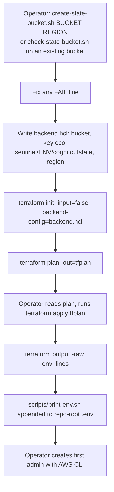
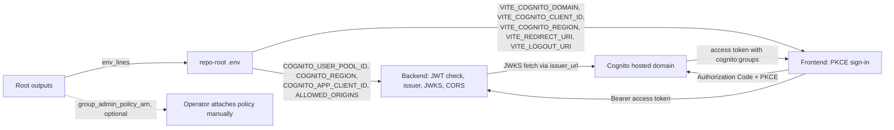
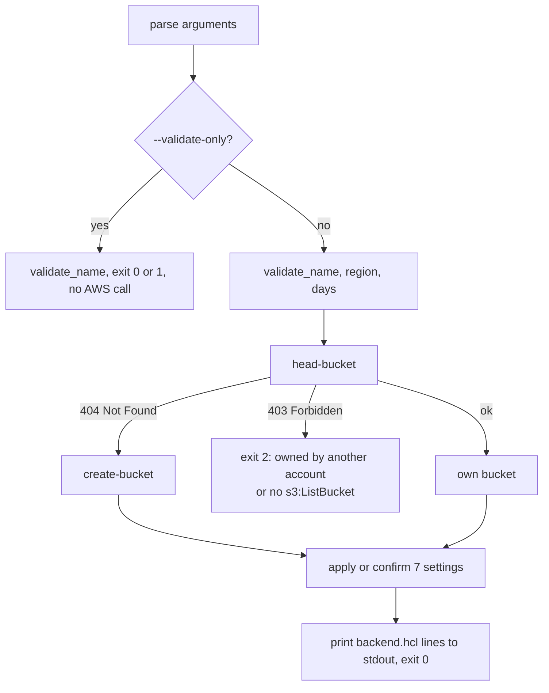

# Design Document

## Overview

This design turns the requirements into one Terraform root configuration, one Terraform module and two operator scripts under `infra/terraform/`:

- **Root configuration** (`infra/terraform/`): provider, variables, one `module "cognito"` call, outputs including `env_lines`, and a partial S3 backend with S3-native locking that is active from the first `terraform init`.
- **Cognito module** (`infra/terraform/modules/cognito/`): user pool, public app client, prefix domain, two groups, and an optional least-privilege IAM policy.
- **State bucket scripts** (`infra/terraform/scripts/create-state-bucket.sh`, `check-state-bucket.sh`): AWS CLI scripts that create or verify the one S3 bucket holding Terraform state. Terraform does not manage this bucket.

Terraform state never exists on local disk and is never migrated. The bucket is created once, outside Terraform, by the Operator. The cost of this choice is that the bucket settings are not drift-checked by `terraform plan` (U13). `check-state-bucket.sh` is the only drift check.

Nothing else is provisioned. The Operator runs every `apply` and every run of `create-state-bucket.sh`. Implementation work stops at `fmt`, `validate`, `test`, `plan`, or the static and stubbed script tests (Plan_Stop_Rule).

### Design Decisions

| # | Decision | Rationale |
|---|---|---|
| D1 | Terraform `>= 1.10.0`, AWS provider `>= 6.6.0, < 7.0.0` | `use_lockfile` needs 1.10. The arguments `user_pool_tier`, `refresh_token_rotation`, `managed_login_version` appear in the provider docs at tag `v6.0.0` and at `main`. The 6.6 floor is conservative: docs at `v6.6.0` list all three, and 6.3.0 fixed a `managed_login_version` update bug. The lock file records the tested exact version. |
| D2 | Module takes `region` as an input and builds `domain_url`, `issuer_url` and `jwks_url` from it | Avoids a `data "aws_region"` lookup, whose value is random under `mock_provider`. The root passes `var.aws_region`. |
| D3 | Cross-variable validation for `deletion_protection` vs `environment` lives in the variable block | Terraform 1.9+ lets a validation reference other variables, so the failure is a plain variable error at plan time and testable with `expect_failures = [var.deletion_protection]`. |
| D4 | Groups come from one `for_each` over a local map `{ admin = 1, researcher = 2 }` | Guarantees exactly two groups with fixed precedence. |
| D5 | `env_lines` is built in the root from module outputs and root variables | The module stays reusable. `ALLOWED_ORIGINS` and the redirect URIs derive from the same variables that feed the client. |
| D6 | The IAM policy uses `aws_iam_policy_document` with `count` gated by `enable_group_admin_policy` | One statement, three actions, one resource ARN, and zero IAM objects when disabled. |
| D7 | State bucket is created by an AWS CLI script, not by Terraform | A bucket created by Terraform cannot hold that Terraform's state from the first init without a local-state phase and a migration. The script removes both. Trade-off recorded as U13. |
| D8 | Root `backend.tf` is committed and holds only `use_lockfile` and `encrypt`. The git-ignored `backend.hcl` supplies `bucket`, `key`, `region`. | Partial configuration (Req. 2.4, 2.5). Every init is `terraform init -input=false -backend-config=backend.hcl`. Tests and validation use `terraform init -backend=false`. |
| D9 | Default `user_pool_tier = "ESSENTIALS"`, `managed_login_version = 2` | Assumed to match current AWS defaults for new pools. Unverified (U1). The README says `LITE` with version `1` is the fallback. |
| D10 | `terraform test` uses `mock_provider "aws"`. Run blocks use `command = plan`, and `command = apply` only where computed values (IDs, ARNs) are needed. | Resolves the former plan-mode computed-value problem. `apply` under `mock_provider` sends no request to AWS (Req. 13.3). `override_resource` stays available to pin values. |
| D11 | Scripts use `jq` to compare JSON documents (policy, lifecycle, public access block, tags) and `--query` for scalar settings | "Already present" needs semantic comparison, not text equality. `jq` is a new Operator prerequisite not named in the requirements (see Gaps). |
| D12 | Script status lines go to standard error. Standard output carries only the three `backend.hcl` lines. | `create-state-bucket.sh ... > backend.hcl` would then be safe, while the script itself writes no file (Req. 16.9). The Operator still has to replace `<environment>`. |

### Provider Argument Verification

Checked against the `hashicorp/terraform-provider-aws` docs source at `main`. The Cognito headline arguments were also checked at `v6.0.0`. No S3 resource is used any more, so the S3 rows of the earlier design are gone.

| Resource | Arguments used | Status |
|---|---|---|
| `aws_cognito_user_pool` | `name`, `username_attributes`, `auto_verified_attributes`, `deletion_protection` (`ACTIVE`/`INACTIVE`), `mfa_configuration`, `user_pool_tier` (`LITE`/`ESSENTIALS`/`PLUS`), `admin_create_user_config.allow_admin_create_user_only`, `password_policy.{minimum_length, require_lowercase, require_uppercase, require_numbers, require_symbols, temporary_password_validity_days}`, `account_recovery_setting.recovery_mechanism.{name, priority}`, `software_token_mfa_configuration.enabled` | Confirmed (the last one: block name confirmed, `enabled` from provider convention, not re-read) |
| `aws_cognito_user_pool_client` | `name`, `user_pool_id`, `generate_secret`, `allowed_oauth_flows_user_pool_client`, `allowed_oauth_flows`, `allowed_oauth_scopes`, `callback_urls`, `logout_urls`, `supported_identity_providers`, `explicit_auth_flows` (`ALLOW_REFRESH_TOKEN_AUTH` listed), `prevent_user_existence_errors`, `enable_token_revocation`, `access_token_validity`, `id_token_validity`, `refresh_token_validity`, `token_validity_units.{access_token,id_token,refresh_token}`, `refresh_token_rotation.{feature, retry_grace_period_seconds}` (0 to 60) | Confirmed |
| `aws_cognito_user_pool_domain` | `domain`, `user_pool_id`, `managed_login_version` (`1` classic, `2` managed login) | Confirmed |
| `aws_cognito_user_group` | `name`, `user_pool_id`, `description`, `precedence`; `role_arn` left unset | Confirmed |
| `aws_iam_policy` + `data.aws_iam_policy_document` | `name`, `description`, `policy`; `statement.{sid, effect, actions, resources}` | Confirmed (`aws_iam_policy.policy` parameter read from the docs listing, not re-grepped) |
| Terraform S3 backend | `bucket`, `key`, `region`, `encrypt`, `use_lockfile` | Taken from the requirements, which cite the backend docs. Not re-read here. |

### AWS CLI Verification (state bucket scripts)

Checked this session against the AWS CLI v2 `s3api` command index (`docs.aws.amazon.com/cli/latest/reference/s3api/`).

| Subcommand | Use | Status |
|---|---|---|
| `head-bucket` | exists / own vs other account | Name confirmed. Error text for 403 and 404 is from AWS behaviour, not re-read (T4). |
| `create-bucket` | create, `--create-bucket-configuration LocationConstraint=<region>` except `us-east-1` | Name confirmed in the index. Argument shape not re-read. |
| `put-bucket-versioning` (`--versioning-configuration Status=Enabled`) | versioning | Name confirmed. Argument shape not re-read. |
| `put-bucket-encryption` (`--server-side-encryption-configuration`) | SSE-S3 | Name confirmed. Argument shape not re-read. |
| `put-public-access-block` (`--public-access-block-configuration`) | four blocks | Name confirmed. Argument shape not re-read. |
| `put-bucket-ownership-controls` (`--ownership-controls`) | `BucketOwnerEnforced` | Name confirmed. Argument shape not re-read. |
| `put-bucket-policy` (`--policy`) | TLS-only deny | Name confirmed. Argument shape not re-read. |
| `put-bucket-lifecycle-configuration` (`--lifecycle-configuration`) | noncurrent expiry, multipart abort | Name confirmed. Argument shape not re-read. |
| `put-bucket-tagging` (`--tagging`) | tags | Name confirmed. Replaces the whole tag set (known AWS behaviour, see Idempotence). |
| `get-public-access-block`, `head-bucket` | read | Names confirmed in the index. |
| `get-bucket-versioning`, `get-bucket-encryption`, `get-bucket-ownership-controls`, `get-bucket-policy`, `get-bucket-lifecycle-configuration`, `get-bucket-tagging` | read | Not visible in the part of the index that was read. Names are standard AWS CLI names and are unverified here (T5). |

### Uncertain Items Carried Into the Design

Requirement uncertainties U1 to U13 stay open. The design adds these (the former T1, plan-mode computed values, is resolved by D10 and removed):

- **T2 Missing-variable test.** Requirement 13.14 asks for a test that proves a missing required variable fails and names the variable. Whether `expect_failures = [var.aws_region]` catches a missing required variable in `terraform test` is not verified. Fallback: a shell test in `tests/scripts/` that runs `terraform plan -input=false -backend=false`-style validation in a fresh directory and greps the error. Decide after the first test run.
- **T3 `software_token_mfa_configuration` with `mfa_configuration = OPTIONAL` on the chosen tier.** Behaviour on `LITE` is not verified.
- **T4 `head-bucket` error mapping.** The scripts treat HTTP 404 / `Not Found` as "absent" and 403 / `Forbidden` as "not readable, probably another account". A 403 also occurs for an own bucket when the caller lacks `s3:ListBucket`. The message says so. The exact CLI error text is not verified.
- **T5 Read-command names and server normalisation.** The `get-bucket-*` names above are unverified. S3 may return the lifecycle `Filter` as `{}` or `{"Prefix": ""}`, and may reorder policy keys. The probes tolerate both filter forms and compare policy semantically. Not verified against a real bucket.
- **T6 IAM action names.** `s3:PutEncryptionConfiguration`, `s3:PutLifecycleConfiguration` and the matching `Get*` names are used as the IAM action names for the `put-bucket-encryption` and `put-bucket-lifecycle-configuration` calls. The Service Authorization Reference could not be searched in this session. Verify before publishing the README.

## Architecture

### Operator Workflow



State is remote from step D. No local state exists at any step and no `-migrate-state` or `-reconfigure` is ever run. The Operator performs A, F and I. Implementation tasks never run `apply`, `destroy`, `init -migrate-state`, `force-unlock`, `import` against a real account, either state bucket script against a real account, or any command with `-auto-approve`.

### How the Other Specs Consume Outputs



The Backend derives `issuer_url` and `jwks_url` from pool ID and region. Terraform also outputs both, so they can be compared by hand.

### File Layout

```
infra/terraform/
  versions.tf                 # terraform{} required_version, required_providers
  backend.tf                  # terraform { backend "s3" { use_lockfile, encrypt } }
  providers.tf                # provider "aws" + default_tags
  variables.tf
  main.tf                     # module "cognito"
  outputs.tf                  # module re-exports + env_lines
  terraform.tfvars.example
  backend.hcl.example
  .terraform.lock.hcl
  README.md
  modules/cognito/
    versions.tf  variables.tf  main.tf  outputs.tf
    tests/ pool.tftest.hcl  client.tftest.hcl  groups_policy.tftest.hcl
           outputs.tftest.hcl  validation.tftest.hcl
  scripts/
    print-env.sh  check-backend.sh
    create-state-bucket.sh  check-state-bucket.sh
  tests/ env_lines.tftest.hcl  validation.tftest.hcl  deletion_protection.tftest.hcl
         scripts/ run.sh  stub-aws
```

`tests/scripts/run.sh` and `tests/scripts/stub-aws` are plain bash (no bats dependency). They hold the script tests of Requirements 13.16 and 13.17.

### `.gitignore` Entries (repo root)

```gitignore
# Terraform
.terraform/
*.tfstate
*.tfstate.*
crash.log
crash.*.log
*.tfvars
*.tfvars.json
*.tfplan
tfplan
backend.hcl
!terraform.tfvars.example
!backend.hcl.example
!.terraform.lock.hcl
```

`*.tfvars` does not match `terraform.tfvars.example`, and `backend.hcl` does not match `backend.hcl.example`, so the negations are a safeguard. `tfplan` is added because the README uses `terraform plan -out=tfplan` and the requirement lists only `*.tfplan`. `.terraform.lock.hcl` is not matched by any ignore pattern.

## Components and Interfaces

### Root: `versions.tf`, `backend.tf`, `providers.tf`

```hcl
# versions.tf
terraform {
  required_version = ">= 1.10.0"
  required_providers {
    aws = {
      source  = "hashicorp/aws"
      version = ">= 6.6.0, < 7.0.0"
    }
  }
}

# backend.tf  (partial configuration: bucket, key, region come from backend.hcl)
terraform {
  backend "s3" {
    use_lockfile = true
    encrypt      = true
  }
}

# providers.tf
provider "aws" {
  region = var.aws_region

  default_tags {
    tags = merge(
      {
        Project     = var.project_name
        Environment = var.environment
        ManagedBy   = "terraform"
      },
      var.tags, # later map wins, so a tags key overrides the defaults (Req. 9.7)
    )
  }
}
```

`backend.hcl.example`:

```hcl
bucket = "<state-bucket-name>"
key    = "eco-sentinel/<environment>/cognito.tfstate"
region = "<aws-region>"
```

The lock object is `<key>.tflock` in the same bucket. The environment in the key and the `environment` variable must match. Terraform cannot check this, so the README states it (Req. 2.7). Every init is `terraform init -input=false -backend-config=backend.hcl`. Tests and validation use `terraform init -backend=false`.

### Root: `main.tf`

```hcl
module "cognito" {
  source = "./modules/cognito"

  project_name                  = var.project_name
  environment                   = var.environment
  region                        = var.aws_region
  cognito_domain_prefix         = var.cognito_domain_prefix
  callback_urls                 = var.callback_urls
  logout_urls                   = var.logout_urls
  allow_self_signup             = var.allow_self_signup
  deletion_protection           = var.deletion_protection
  mfa_configuration             = var.mfa_configuration
  user_pool_tier                = var.user_pool_tier
  managed_login_version         = var.managed_login_version
  access_token_validity_minutes = var.access_token_validity_minutes
  id_token_validity_minutes     = var.id_token_validity_minutes
  refresh_token_validity_days   = var.refresh_token_validity_days
  enable_group_admin_policy     = var.enable_group_admin_policy
}
```

### Variables

The module declares every variable below except `aws_region` and `tags` (root only), and adds `region` (module only, no default). The root declares the same variables with identical `type`, `default` and `validation` (Req. 3.13). The exceptions are the root-only `aws_region`, `tags`, and the cross-variable check on `deletion_protection`, which exists only in the root (Req. 9.3). Each variable has a `description`; they are abbreviated here.

```hcl
variable "project_name" {
  type        = string
  description = "Short project name used in resource names and the Project tag."
  default     = "eco-sentinel"
  validation {
    condition     = can(regex("^[a-z0-9][a-z0-9-]{0,31}$", var.project_name))
    error_message = "project_name must be 1 to 32 characters: lowercase letters, digits, hyphens, not starting with a hyphen."
  }
}

variable "environment" {
  type        = string
  description = "Environment name. Also part of the state key."
  default     = "dev"
  validation {
    condition     = contains(["dev", "staging", "prod"], var.environment)
    error_message = "environment must be one of: dev, staging, prod."
  }
}

# root only
variable "aws_region" {
  type        = string
  description = "AWS region for all resources. No default."
  validation {
    condition     = can(regex("^[a-z]{2}(-[a-z]+)+-[0-9]$", var.aws_region))
    error_message = "aws_region must look like eu-west-1."
  }
}

# module only (root passes var.aws_region)
variable "region" {
  type        = string
  description = "AWS region of the deployed user pool, used to build URLs."
}

variable "cognito_domain_prefix" {
  type        = string
  description = "Cognito prefix domain. Unique per region across AWS. No default."
  validation {
    condition     = can(regex("^[a-z0-9]([a-z0-9-]{0,61}[a-z0-9])?$", var.cognito_domain_prefix))
    error_message = "cognito_domain_prefix must be 1 to 63 characters of lowercase letters, digits and hyphens, not starting or ending with a hyphen. Rejected value: ${var.cognito_domain_prefix}"
  }
  validation {
    condition     = !can(regex("aws|amazon|cognito", var.cognito_domain_prefix))
    error_message = "cognito_domain_prefix must not contain aws, amazon or cognito. Rejected value: ${var.cognito_domain_prefix}"
  }
}

variable "callback_urls" {
  type        = list(string)
  description = "OAuth callback URLs. The first element becomes VITE_REDIRECT_URI."
  default     = ["http://localhost:5173/auth/callback"]

  validation {
    condition     = length(var.callback_urls) >= 1 && length(var.callback_urls) <= 100
    error_message = "callback_urls: 1 to 100 URLs are required."
  }
  validation {
    condition     = alltrue([for u in var.callback_urls : length(u) <= 1024])
    error_message = "callback_urls: each URL must be at most 1024 characters."
  }
  validation {
    condition     = alltrue([for u in var.callback_urls : !can(regex("[#*[:space:]]", u))])
    error_message = "callback_urls: URLs must not contain a fragment (#), a wildcard (*) or whitespace. Rejected: ${join(", ", [for u in var.callback_urls : u if can(regex("[#*[:space:]]", u))])}"
  }
  validation {
    # https with any host, or http only for localhost / 127.0.0.1
    condition = alltrue([
      for u in var.callback_urls :
      can(regex("^https://[A-Za-z0-9]([A-Za-z0-9.-]*[A-Za-z0-9])?(:[0-9]{1,5})?(/[^[:space:]#*]*)?$", u)) ||
      can(regex("^http://(localhost|127\\.0\\.0\\.1)(:[0-9]{1,5})?(/[^[:space:]#*]*)?$", u))
    ])
    error_message = "callback_urls: each URL must be absolute https, or http with host localhost or 127.0.0.1."
  }
  validation {
    condition     = length(var.callback_urls) == length(distinct(var.callback_urls))
    error_message = "callback_urls must not contain duplicates."
  }
}

variable "logout_urls" {
  # identical to callback_urls with the name replaced
  type    = list(string)
  default = ["http://localhost:5173/signed-out", "http://localhost:5173/"]
  # five validation blocks as above, using var.logout_urls
  description = "OAuth sign-out URLs. The first element becomes VITE_LOGOUT_URI."
}

variable "allow_self_signup" {
  type        = bool
  description = "Allow public sign-up. Default false: only an administrator creates users."
  default     = false
}

variable "deletion_protection" {
  type        = bool
  description = "Protect the user pool from deletion. Must stay true outside dev."
  default     = true
  # root only (Req. 9.3). Uses a cross-variable reference, allowed since Terraform 1.9.
  validation {
    condition     = var.environment == "dev" || var.deletion_protection
    error_message = "deletion_protection must stay true when environment is staging or prod."
  }
}

variable "mfa_configuration" {
  type        = string
  description = "User pool MFA mode: OFF, OPTIONAL or ON. TOTP only."
  default     = "OPTIONAL"
  validation {
    condition     = contains(["OFF", "OPTIONAL", "ON"], var.mfa_configuration)
    error_message = "mfa_configuration must be one of: OFF, OPTIONAL, ON."
  }
}

variable "user_pool_tier" {
  type        = string
  description = "Cognito feature plan. Cost-relevant; check the AWS pricing page (U1)."
  default     = "ESSENTIALS"
  validation {
    condition     = contains(["LITE", "ESSENTIALS", "PLUS"], var.user_pool_tier)
    error_message = "user_pool_tier must be one of: LITE, ESSENTIALS, PLUS."
  }
}

variable "managed_login_version" {
  type        = number
  description = "1 for classic hosted UI, 2 for managed login."
  default     = 2
  validation {
    condition     = contains([1, 2], var.managed_login_version)
    error_message = "managed_login_version must be 1 or 2."
  }
}

variable "access_token_validity_minutes" {
  type        = number
  description = "Access token lifetime in minutes (5 to 1440)."
  default     = 60
  validation {
    condition     = floor(var.access_token_validity_minutes) == var.access_token_validity_minutes && var.access_token_validity_minutes >= 5 && var.access_token_validity_minutes <= 1440
    error_message = "access_token_validity_minutes must be a whole number from 5 to 1440."
  }
}

variable "id_token_validity_minutes" {
  # same shape as access_token_validity_minutes, default 60, range 5 to 1440
  type        = number
  description = "ID token lifetime in minutes (5 to 1440)."
  default     = 60
}

variable "refresh_token_validity_days" {
  type        = number
  description = "Refresh token lifetime in days (1 to 3650)."
  default     = 30
  validation {
    condition     = floor(var.refresh_token_validity_days) == var.refresh_token_validity_days && var.refresh_token_validity_days >= 1 && var.refresh_token_validity_days <= 3650
    error_message = "refresh_token_validity_days must be a whole number from 1 to 3650."
  }
}

variable "enable_group_admin_policy" {
  type        = bool
  description = "Create the optional IAM policy for Cognito group management."
  default     = false
}

# root only
variable "tags" {
  type        = map(string)
  description = "Extra tags merged over the default tags."
  default     = {}
}
```

Notes:
- `id_token_validity_minutes` carries the same validation block as `access_token_validity_minutes`; it is elided above only for length.
- A `bool` variable given a non-boolean (Req. 4.8, 11.8) fails Terraform's own type conversion with a message naming the variable, so no extra validation is added.
- Required without default: `aws_region` (root) and `cognito_domain_prefix`. Everything else has a default, so `terraform.tfvars.example` holds placeholders for these two plus commented optional overrides. The module additionally requires `region`.
- An empty `callback_urls` list fails the count rule only. The other rules pass vacuously, so the operator sees one message.
- `error_message` interpolating variables needs Terraform 1.9 or later. This is covered by `>= 1.10.0`.

### Module: `modules/cognito/main.tf`

```hcl
locals {
  name_prefix = "${var.project_name}-${var.environment}"
  groups      = { admin = 1, researcher = 2 }
}

resource "aws_cognito_user_pool" "this" {
  name                     = "${local.name_prefix}-users"
  username_attributes      = ["email"]
  auto_verified_attributes = ["email"]
  deletion_protection      = var.deletion_protection ? "ACTIVE" : "INACTIVE"
  mfa_configuration        = var.mfa_configuration
  user_pool_tier           = var.user_pool_tier

  admin_create_user_config {
    allow_admin_create_user_only = !var.allow_self_signup
  }

  password_policy {
    minimum_length                   = 12
    require_lowercase                = true
    require_uppercase                = true
    require_numbers                  = true
    require_symbols                  = true
    temporary_password_validity_days = 7
  }

  account_recovery_setting {
    recovery_mechanism {
      name     = "verified_email"
      priority = 1
    }
  }

  dynamic "software_token_mfa_configuration" {
    for_each = var.mfa_configuration == "OFF" ? [] : [1]
    content {
      enabled = true
    }
  }
}

resource "aws_cognito_user_pool_client" "web" {
  name         = "${local.name_prefix}-web"
  user_pool_id = aws_cognito_user_pool.this.id

  generate_secret                      = false
  allowed_oauth_flows_user_pool_client = true
  allowed_oauth_flows                  = ["code"]
  allowed_oauth_scopes                 = ["openid", "email", "profile"]
  supported_identity_providers         = ["COGNITO"]
  callback_urls                        = var.callback_urls
  logout_urls                          = var.logout_urls

  explicit_auth_flows           = ["ALLOW_REFRESH_TOKEN_AUTH"] # U3
  prevent_user_existence_errors = "ENABLED"
  enable_token_revocation       = true

  access_token_validity  = var.access_token_validity_minutes
  id_token_validity      = var.id_token_validity_minutes
  refresh_token_validity = var.refresh_token_validity_days
  token_validity_units {
    access_token  = "minutes"
    id_token      = "minutes"
    refresh_token = "days"
  }

  refresh_token_rotation {
    feature                    = "ENABLED"
    retry_grace_period_seconds = 10
  }
  # read_attributes / write_attributes intentionally unset (Req. 6.11)
}

resource "aws_cognito_user_pool_domain" "this" {
  domain                = var.cognito_domain_prefix # no certificate_arn
  user_pool_id          = aws_cognito_user_pool.this.id
  managed_login_version = var.managed_login_version
}

resource "aws_cognito_user_group" "role" {
  for_each     = local.groups
  name         = each.key
  user_pool_id = aws_cognito_user_pool.this.id
  precedence   = each.value
  description  = "Backend role: ${each.key}"
  # role_arn unset: group membership grants no AWS credentials
}

data "aws_iam_policy_document" "group_admin" {
  count = var.enable_group_admin_policy ? 1 : 0

  statement {
    sid     = "ManageRoleGroupMembership"
    effect  = "Allow"
    actions = [
      "cognito-idp:AdminAddUserToGroup",
      "cognito-idp:AdminRemoveUserFromGroup",
      "cognito-idp:AdminListGroupsForUser",
    ]
    resources = [aws_cognito_user_pool.this.arn]
  }
}

resource "aws_iam_policy" "group_admin" {
  count       = var.enable_group_admin_policy ? 1 : 0
  name        = "${local.name_prefix}-cognito-group-admin"
  description = "Add, remove and list Cognito group membership on the ${local.name_prefix} user pool only."
  policy      = data.aws_iam_policy_document.group_admin[0].json
}
```

The policy has no `Condition`, because the three actions have no useful condition keys for this scope. The single resource ARN is the least-privilege boundary. It grants nothing to any identity until the Operator attaches it. A caller who can run `AdminAddUserToGroup` can promote any user to `admin`. The README states this.

### Module: `outputs.tf`

```hcl
output "user_pool_id"  { value = aws_cognito_user_pool.this.id }
output "user_pool_arn" { value = aws_cognito_user_pool.this.arn }
output "app_client_id" { value = aws_cognito_user_pool_client.web.id }
output "region"        { value = var.region }
output "domain_url" {
  value = "https://${aws_cognito_user_pool_domain.this.domain}.auth.${var.region}.amazoncognito.com"
}
output "issuer_url" {
  value = "https://cognito-idp.${var.region}.amazonaws.com/${aws_cognito_user_pool.this.id}"
}
output "jwks_url" {
  value = "https://cognito-idp.${var.region}.amazonaws.com/${aws_cognito_user_pool.this.id}/.well-known/jwks.json"
}
output "group_names" { value = sort(keys(aws_cognito_user_group.role)) } # ["admin", "researcher"]
output "group_admin_policy_arn" {
  value = one(aws_iam_policy.group_admin[*].arn) # null when the policy is disabled
}
```

No output is `sensitive` and there is no `client_secret` output (Req. 6.10, 10.12).

### Root: `outputs.tf`

```hcl
locals {
  # scheme://host[:port] of each callback URL, de-duplicated, first appearance order
  allowed_origins = join(",", distinct([
    for u in var.callback_urls : regex("^(https?://[^/]+)", u)[0]
  ]))

  env_lines = join("\n", [
    "COGNITO_USER_POOL_ID=${module.cognito.user_pool_id}",
    "COGNITO_REGION=${module.cognito.region}",
    "COGNITO_APP_CLIENT_ID=${module.cognito.app_client_id}",
    "ALLOWED_ORIGINS=${local.allowed_origins}",
    "VITE_COGNITO_DOMAIN=${module.cognito.domain_url}",
    "VITE_COGNITO_CLIENT_ID=${module.cognito.app_client_id}",
    "VITE_COGNITO_REGION=${module.cognito.region}",
    "VITE_REDIRECT_URI=${var.callback_urls[0]}",
    "VITE_LOGOUT_URI=${var.logout_urls[0]}",
  ])
}

output "env_lines" { value = local.env_lines }
# re-exports: one output per module output, same names and values
output "user_pool_id"            { value = module.cognito.user_pool_id }
output "user_pool_arn"           { value = module.cognito.user_pool_arn }
output "app_client_id"           { value = module.cognito.app_client_id }
output "region"                  { value = module.cognito.region }
output "domain_url"              { value = module.cognito.domain_url }
output "issuer_url"              { value = module.cognito.issuer_url }
output "jwks_url"                { value = module.cognito.jwks_url }
output "group_names"             { value = module.cognito.group_names }
output "group_admin_policy_arn"  { value = module.cognito.group_admin_policy_arn }
```

`ALLOWED_ORIGINS` for the default URLs is `http://localhost:5173`. Two callback URLs on the same origin produce that origin once. The text contains the lowercase substring `secret` nowhere (Req. 13.12).

### Scripts: `print-env.sh`

```bash
#!/usr/bin/env bash
set -euo pipefail
cd "$(dirname "$0")/.."            # infra/terraform/
if ! out="$(terraform output -raw env_lines 2>/dev/null)" || [ -z "$out" ]; then
  echo "print-env.sh: Terraform has no applied state (or no env_lines output). Run init and apply first." >&2
  exit 1
fi
printf '%s' "$out"                 # unchanged; prints no trailing newline
```

It writes no file. The README append command is `{ infra/terraform/scripts/print-env.sh; echo; } >> .env`. This keeps stdout identical to `terraform output -raw env_lines` (Req. 10.9) and still ends the `.env` line.

### Scripts: `create-state-bucket.sh`

Interface: `create-state-bucket.sh <bucket-name> <region> [--noncurrent-days <n>]` and `create-state-bucket.sh --validate-only <bucket-name>`.

Exit codes: `0` success or valid name; `1` rejected name or bad arguments (usage on stderr); `2` bucket owned by another account or not readable; `3` an AWS call failed.

Flow:



Sketch (bash, shown in full for the parts that matter; the other probes follow the same shape):

```bash
#!/usr/bin/env bash
set -euo pipefail

usage() { echo "usage: $0 <bucket-name> <region> [--noncurrent-days N] | --validate-only <bucket-name>" >&2; exit 1; }
status() { printf '%-20s %s\n' "$1" "$2" >&2; }       # D12: status lines on stderr

validate_name() {   # returns 1 and prints the rejected value and the rule; never calls aws
  local n="$1" rule=""
  if   [ "${#n}" -lt 3 ] || [ "${#n}" -gt 63 ];            then rule="must be 3 to 63 characters"
  elif [[ "$n" =~ [^a-z0-9-] ]];                           then rule="may contain only lowercase letters, digits and hyphens (no period)"
  elif [[ "$n" == -* || "$n" == *- ]];                     then rule="must not start or end with a hyphen"
  elif [[ "$n" =~ ^[0-9]+\.[0-9]+\.[0-9]+\.[0-9]+$ ]];     then rule="must not look like an IPv4 address"   # unreachable after the period rule; kept for the message
  elif [[ "$n" == xn--* || "$n" == sthree-* ]];            then rule="must not start with xn-- or sthree-"
  elif [[ "$n" == *-s3alias || "$n" == *--ol-s3 ]];        then rule="must not end with -s3alias or --ol-s3"
  fi
  [ -z "$rule" ] || { echo "invalid bucket name '$n': $rule" >&2; return 1; }
}

DAYS=90
if [ "${1:-}" = "--validate-only" ]; then
  [ $# -eq 2 ] || usage
  validate_name "$2" || exit 1
  exit 0
fi
[ $# -ge 2 ] || usage
BUCKET="$1"; REGION="$2"; shift 2
while [ $# -gt 0 ]; do
  case "$1" in
    --noncurrent-days) [ $# -ge 2 ] || usage; DAYS="$2"; shift 2 ;;
    *) usage ;;
  esac
done
[[ "$DAYS" =~ ^[0-9]+$ ]] && [ "$DAYS" -ge 1 ] && [ "$DAYS" -le 3650 ] || usage
validate_name "$BUCKET" || exit 1
[ -n "$REGION" ] || usage

S3API=(aws s3api --region "$REGION")

# --- existence and ownership ---------------------------------------------
if err="$("${S3API[@]}" head-bucket --bucket "$BUCKET" 2>&1)"; then
  status "bucket" "already present"
elif [[ "$err" == *"404"* || "$err" == *"Not Found"* ]]; then
  if [ "$REGION" = "us-east-1" ]; then
    "${S3API[@]}" create-bucket --bucket "$BUCKET"
  else
    "${S3API[@]}" create-bucket --bucket "$BUCKET" \
      --create-bucket-configuration "LocationConstraint=$REGION"
  fi
  status "bucket" "applied"
elif [[ "$err" == *"403"* || "$err" == *"Forbidden"* ]]; then
  echo "bucket '$BUCKET' exists and is not readable with these credentials; it is probably owned by another account (or you lack s3:ListBucket). Choose another name." >&2
  exit 2
else
  echo "head-bucket failed: $err" >&2; exit 3
fi

# --- one function pair per setting: probe_X (read, returns 0 when correct), apply_X (put) --
probe_versioning() { [ "$("${S3API[@]}" get-bucket-versioning --bucket "$BUCKET" --query Status --output text 2>/dev/null)" = "Enabled" ]; }
apply_versioning() { "${S3API[@]}" put-bucket-versioning --bucket "$BUCKET" --versioning-configuration Status=Enabled; }

probe_encryption() { [ "$("${S3API[@]}" get-bucket-encryption --bucket "$BUCKET" \
  --query 'ServerSideEncryptionConfiguration.Rules[0].ApplyServerSideEncryptionByDefault.SSEAlgorithm' --output text 2>/dev/null)" = "AES256" ]; }
apply_encryption() { "${S3API[@]}" put-bucket-encryption --bucket "$BUCKET" --server-side-encryption-configuration \
  '{"Rules":[{"ApplyServerSideEncryptionByDefault":{"SSEAlgorithm":"AES256"}}]}'; }

probe_pab() { "${S3API[@]}" get-public-access-block --bucket "$BUCKET" --output json 2>/dev/null \
  | jq -e '.PublicAccessBlockConfiguration | .BlockPublicAcls and .IgnorePublicAcls and .BlockPublicPolicy and .RestrictPublicBuckets' >/dev/null; }
apply_pab() { "${S3API[@]}" put-public-access-block --bucket "$BUCKET" --public-access-block-configuration \
  BlockPublicAcls=true,IgnorePublicAcls=true,BlockPublicPolicy=true,RestrictPublicBuckets=true; }

probe_ownership() { [ "$("${S3API[@]}" get-bucket-ownership-controls --bucket "$BUCKET" \
  --query 'OwnershipControls.Rules[0].ObjectOwnership' --output text 2>/dev/null)" = "BucketOwnerEnforced" ]; }
apply_ownership() { "${S3API[@]}" put-bucket-ownership-controls --bucket "$BUCKET" \
  --ownership-controls 'Rules=[{ObjectOwnership=BucketOwnerEnforced}]'; }

POLICY=$(jq -cn --arg arn "arn:aws:s3:::$BUCKET" '{Version:"2012-10-17",Statement:[{
  Sid:"DenyInsecureTransport",Effect:"Deny",Principal:"*",Action:"s3:*",
  Resource:[$arn,($arn+"/*")],Condition:{Bool:{"aws:SecureTransport":"false"}}}]}')
probe_policy() { "${S3API[@]}" get-bucket-policy --bucket "$BUCKET" --query Policy --output text 2>/dev/null \
  | jq -e --arg arn "arn:aws:s3:::$BUCKET" '[.Statement[]? | select(.Effect=="Deny" and (.Principal=="*" or .Principal.AWS=="*")
      and ([.Action]|flatten)==["s3:*"] and (([.Resource]|flatten|sort)==([$arn,($arn+"/*")]|sort))
      and (.Condition.Bool["aws:SecureTransport"]=="false"))] | length>=1' >/dev/null; }
apply_policy() { "${S3API[@]}" put-bucket-policy --bucket "$BUCKET" --policy "$POLICY"; }  # replaces the whole policy

LIFECYCLE=$(jq -cn --argjson d "$DAYS" '{Rules:[{ID:"state-housekeeping",Status:"Enabled",Filter:{},
  NoncurrentVersionExpiration:{NoncurrentDays:$d},AbortIncompleteMultipartUpload:{DaysAfterInitiation:7}}]}')
probe_lifecycle() { "${S3API[@]}" get-bucket-lifecycle-configuration --bucket "$BUCKET" --output json 2>/dev/null \
  | jq -e --argjson d "$DAYS" '(.Rules|length)==1 and .Rules[0].Status=="Enabled"
      and ((.Rules[0].Filter // {}) as $f | ($f=={} or $f=={"Prefix":""}) and (.Rules[0].Prefix // "")=="")
      and .Rules[0].NoncurrentVersionExpiration.NoncurrentDays==$d
      and .Rules[0].AbortIncompleteMultipartUpload.DaysAfterInitiation==7
      and (.Rules[0]|has("Expiration")|not)' >/dev/null; }
apply_lifecycle() { "${S3API[@]}" put-bucket-lifecycle-configuration --bucket "$BUCKET" --lifecycle-configuration "$LIFECYCLE"; }  # replaces all rules

probe_tags() { "${S3API[@]}" get-bucket-tagging --bucket "$BUCKET" --output json 2>/dev/null \
  | jq -e '[.TagSet[]|{(.Key):.Value}]|add|(.Project=="eco-sentinel" and .ManagedBy=="operator-script")' >/dev/null; }
apply_tags() {   # put-bucket-tagging replaces the whole set, so merge with the existing tags first
  local merged
  merged=$("${S3API[@]}" get-bucket-tagging --bucket "$BUCKET" --output json 2>/dev/null \
    | jq -c '{TagSet: ([.TagSet[]|select(.Key!="Project" and .Key!="ManagedBy")]
        + [{Key:"Project",Value:"eco-sentinel"},{Key:"ManagedBy",Value:"operator-script"}])}' \
    || jq -cn '{TagSet:[{Key:"Project",Value:"eco-sentinel"},{Key:"ManagedBy",Value:"operator-script"}]}')
  "${S3API[@]}" put-bucket-tagging --bucket "$BUCKET" --tagging "$merged"
}

for s in versioning encryption pab ownership policy lifecycle tags; do
  if "probe_$s"; then status "$s" "already present"; else "apply_$s"; status "$s" "applied"; fi
done

printf 'bucket = "%s"\nkey    = "eco-sentinel/<environment>/cognito.tfstate"\nregion = "%s"\n' "$BUCKET" "$REGION"
```

Design points:

- **Idempotence.** Each setting is read first. The `put-*` call runs only when the read shows a difference, so a second run with the same arguments prints `already present` seven times and makes no `put-*` call (Req. 16.6). Comparison is semantic (`jq` conditions), not text equality, because S3 may reformat documents (T5).
- **Whole-document puts.** `put-bucket-tagging`, `put-bucket-policy` and `put-bucket-lifecycle-configuration` each replace the complete document. For tags the script merges the existing tags, so other tags survive. For policy and lifecycle the script overwrites any other statements or rules. The README states this and tells the Operator to run `check-state-bucket.sh` and review before running the create script on an existing bucket that has other policies.
- **Ownership by head-bucket.** A 403 is treated as "another account" (Req. 16.7). It can also mean an own bucket without `s3:ListBucket`. The message names both causes (T4). No setting is changed on that path.
- **Create race.** If `create-bucket` fails with `BucketAlreadyExists` between `head-bucket` and the create call, `set -e` stops the script with the AWS error and exit code from the CLI. `BucketAlreadyOwnedByYou` cannot be reached in the 404 path.
- **No delete.** The script contains no `aws s3api delete-*` or `aws s3 rm` call. The stubbed test checks the invocation log (Req. 16.8).
- **No file written, no credentials in the script.** The AWS CLI credential chain is the only source (Req. 16.17). `jq` is a prerequisite (D11).
- **Region.** `--region "$REGION"` is passed on every call. For `us-east-1` the `--create-bucket-configuration` argument is omitted because S3 rejects `LocationConstraint=us-east-1` (AWS behaviour, not re-read here).

### Scripts: `check-state-bucket.sh`

Interface: `check-state-bucket.sh <bucket-name>`. Exit codes: `0` all seven `PASS`; `1` at least one `FAIL`, or bad arguments; `2` the bucket cannot be read.

```bash
#!/usr/bin/env bash
set -euo pipefail

[ $# -eq 1 ] || { echo "usage: $0 <bucket-name>" >&2; exit 1; }
BUCKET="$1"
DAYS="${NONCURRENT_DAYS:-}"          # optional: if set, the lifecycle PASS also requires this value
S3API=(aws s3api)

if ! err="$("${S3API[@]}" head-bucket --bucket "$BUCKET" 2>&1)"; then
  echo "cannot read bucket '$BUCKET': $err" >&2
  exit 2                              # no PASS line printed
fi

# probe_* functions: the same bodies as in create-state-bucket.sh (read-only get-* calls)
# probe_lifecycle here accepts any NoncurrentDays >= 1 unless NONCURRENT_DAYS is set.

rc=0
for s in versioning encryption pab ownership policy lifecycle tags; do
  if "probe_$s"; then echo "PASS $s"; else echo "FAIL $s"; rc=1; fi
done
exit $rc
```

The probe functions are copied from the create script, so a drift between the two is possible. The stubbed tests run both scripts against the same stub state to catch it. The region comes from the AWS CLI configuration or `AWS_REGION`; the script passes no region of its own. It calls only `head-bucket` and `get-*` subcommands (Req. 16.10). A `get-*` call that fails (for example `NoSuchTagSet`, no policy, no lifecycle) makes its probe return non-zero and prints `FAIL`.

### Stubbed `aws` for script tests

`tests/scripts/stub-aws` is a bash script placed first on `PATH` as `aws`. It appends each invocation to `$STUB_DIR/calls.log` and keeps bucket state as files in `$STUB_DIR` (`versioning`, `encryption`, `pab.json`, `ownership`, `policy.json`, `lifecycle.json`, `tags.json`). `put-*` writes the state file, `get-*` prints it in AWS CLI JSON shape or exits 254 with `NoSuch...` text when absent. `head-bucket` behaviour is chosen by `$STUB_MODE`: `absent` (exit 254, `404 Not Found`), `own` (exit 0), `other` (exit 254, `403 Forbidden`). `run.sh` loops over tables of cases and compares exit codes and output. It needs no credentials and no network.

## Data Models

The design adds no application data model. The State_Bucket and its seven settings are the only persistent structure outside Cognito.

### State Bucket Settings (Req. 16.5)

| Setting | Value | Create script call | Check read |
|---|---|---|---|
| versioning | `Enabled` | `put-bucket-versioning` | `get-bucket-versioning` |
| encryption | SSE-S3 `AES256` | `put-bucket-encryption` | `get-bucket-encryption` |
| public access block | four flags `true` | `put-public-access-block` | `get-public-access-block` |
| object ownership | `BucketOwnerEnforced` | `put-bucket-ownership-controls` | `get-bucket-ownership-controls` |
| TLS-only policy | `Deny`, principal `*`, `s3:*`, bucket ARN and `/*`, `aws:SecureTransport` = `false` | `put-bucket-policy` | `get-bucket-policy` |
| lifecycle | one enabled rule, no prefix filter, noncurrent expiry N days (default 90), abort multipart 7 days, no current-version expiry | `put-bucket-lifecycle-configuration` | `get-bucket-lifecycle-configuration` |
| tags | `Project=eco-sentinel`, `ManagedBy=operator-script` | `put-bucket-tagging` (merged) | `get-bucket-tagging` |

The `Project` tag value `eco-sentinel` is a design choice; the requirement fixes only the keys and the `ManagedBy` value.

### State Layout in the Bucket

| Object | Written by |
|---|---|
| `eco-sentinel/<environment>/cognito.tfstate` | root, one per environment |
| `eco-sentinel/<environment>/cognito.tfstate.tflock` | S3 backend lock, exists only while a command runs |

### Operator Permissions (README content, Req. 14.6)

Replace `<state-bucket>` with the real name at use time; never commit it.

**(a) Cognito.** `cognito-idp:CreateUserPool`, `UpdateUserPool`, `DeleteUserPool`, `DescribeUserPool`, `SetUserPoolMfaConfig`, `GetUserPoolMfaConfig`, `CreateUserPoolClient`, `UpdateUserPoolClient`, `DeleteUserPoolClient`, `DescribeUserPoolClient`, `CreateUserPoolDomain`, `UpdateUserPoolDomain`, `DeleteUserPoolDomain`, `DescribeUserPoolDomain`, `CreateGroup`, `UpdateGroup`, `DeleteGroup`, `GetGroup`, `TagResource`, `UntagResource`, `ListTagsForResource`. Add `iam:CreatePolicy`, `GetPolicy`, `GetPolicyVersion`, `ListPolicyVersions`, `DeletePolicy`, `TagPolicy`, `ListPolicyTags` only when `enable_group_admin_policy` is true. The exact set the provider calls on refresh is not verified; the first `terraform plan` shows any gap.

**(b) State access** (each state key in use):

```json
{
  "Version": "2012-10-17",
  "Statement": [
    { "Effect": "Allow", "Action": "s3:ListBucket",
      "Resource": "arn:aws:s3:::<state-bucket>",
      "Condition": { "StringLike": { "s3:prefix": ["eco-sentinel/*"] } } },
    { "Effect": "Allow", "Action": ["s3:GetObject", "s3:PutObject"],
      "Resource": "arn:aws:s3:::<state-bucket>/eco-sentinel/<environment>/cognito.tfstate" },
    { "Effect": "Allow", "Action": ["s3:GetObject", "s3:PutObject", "s3:DeleteObject"],
      "Resource": "arn:aws:s3:::<state-bucket>/eco-sentinel/<environment>/cognito.tfstate.tflock" }
  ]
}
```

**(c) State bucket scripts.** For `create-state-bucket.sh`: `s3:CreateBucket`, `s3:PutBucketVersioning`, `s3:PutEncryptionConfiguration`, `s3:PutBucketPublicAccessBlock`, `s3:PutBucketOwnershipControls`, `s3:PutBucketPolicy`, `s3:PutLifecycleConfiguration`, `s3:PutBucketTagging`. For both scripts the matching reads: `s3:ListBucket` (needed by `head-bucket`), `s3:GetBucketVersioning`, `s3:GetEncryptionConfiguration`, `s3:GetBucketPublicAccessBlock`, `s3:GetBucketOwnershipControls`, `s3:GetBucketPolicy`, `s3:GetLifecycleConfiguration`, `s3:GetBucketTagging`. The IAM action names for encryption and lifecycle differ from the API names (`PutEncryptionConfiguration`, `PutLifecycleConfiguration`). They are not verified here (T6). The first run of `check-state-bucket.sh` shows any missing action (U11).

## Correctness Properties

*A property is a characteristic or behavior that should hold true across all valid executions of a system-essentially, a formal statement about what the system should do. Properties serve as the bridge between human-readable specifications and machine-verifiable correctness guarantees.*

This feature is infrastructure as code plus two CLI scripts, so the usual property-based testing approach does not apply: there is no pure function to feed generated inputs, and the scripts are I/O. I did not run the prework analysis. The properties below are universally quantified statements. Each is checked by `terraform test` run blocks, by `check-backend.sh`, or by bash test loops over tables of representative inputs, not by a generative library. The "100 iterations" rule does not apply.

### Property 1: Public PKCE client

For any valid module input, the app client has `generate_secret = false`, `allowed_oauth_flows = ["code"]`, scopes exactly `openid`, `email`, `profile`, `supported_identity_providers = ["COGNITO"]`, `prevent_user_existence_errors = "ENABLED"`, `enable_token_revocation = true`, `explicit_auth_flows` containing `ALLOW_REFRESH_TOKEN_AUTH` and neither `ALLOW_USER_PASSWORD_AUTH` nor `ADMIN_NO_SRP_AUTH`, and `refresh_token_rotation` enabled with a 10 second grace period.

**Validates: Requirements 6.1, 6.2, 6.3, 6.5, 6.6, 6.7, 6.9, 13.4**

### Property 2: URL and token pass-through

For any valid `callback_urls`, `logout_urls` and token validity values, the client's lists equal the input lists in the same order, its validity values equal the inputs, and its units are `minutes`, `minutes`, `days`.

**Validates: Requirements 6.4, 6.8, 13.5**

### Property 3: Sign-up policy mapping

For any value of `allow_self_signup`, `allow_admin_create_user_only` equals its negation, and the default (unset) gives `true`. The module declares no user and no group-membership resource.

**Validates: Requirements 4.2, 4.3, 4.4, 4.6, 13.6**

### Property 4: Deletion protection mapping and guard

For any `deletion_protection` value, the pool setting is `ACTIVE` when true and `INACTIVE` when false, defaulting to `ACTIVE`. For any `environment` in `staging` or `prod`, setting `deletion_protection = false` fails the root plan.

**Validates: Requirements 9.1, 9.2, 9.3, 13.9**

### Property 5: Exactly two role groups

For any valid input, the pool has exactly two groups, `admin` with precedence 1 and `researcher` with precedence 2, neither with a `role_arn`, and `group_names` equals `["admin", "researcher"]`.

**Validates: Requirements 8.1, 8.2, 8.3, 8.4, 8.5, 13.7**

### Property 6: Optional policy is gated and minimal

For any module input with `enable_group_admin_policy = false`, the plan contains zero IAM resources and `group_admin_policy_arn` is `null`. For any input with it `true`, the plan contains exactly one `aws_iam_policy`, whose document has one `Allow` statement with exactly the three required actions and exactly one resource (the pool ARN), with no `*` in actions or resource. In both cases the module declares no IAM user, access key, role or attachment.

**Validates: Requirements 11.1, 11.2, 11.3, 11.4, 11.5, 11.6, 13.8**

### Property 7: MFA block follows the mode

For any `mfa_configuration` in `OFF`, `OPTIONAL`, `ON`, the pool has one TOTP block when the value is not `OFF` and none when it is `OFF`. The module declares no SMS configuration, SNS topic or SES identity.

**Validates: Requirements 5.3, 5.5, 5.6, 5.7**

### Property 8: Password and recovery policy is fixed

For any valid input, the password policy has minimum length 12 and all four character-class requirements, the temporary password validity is between 1 and 7 days, and the only recovery mechanism is `verified_email` with priority 1. The pool uses the email as username and auto-verifies it.

**Validates: Requirements 4.1, 4.5, 5.1, 5.2**

### Property 9: Invalid URL lists are rejected

For any `callback_urls` or `logout_urls` that is empty, has more than 100 entries, has an entry over 1024 characters, is not absolute, uses `http` with a host other than `localhost` or `127.0.0.1`, contains `#`, `*` or whitespace, or has a duplicate, the plan fails with an error naming the variable and creates no resource. This holds in the root and in the module.

**Validates: Requirements 3.4, 3.5, 3.6, 3.7, 3.12, 3.13, 6.13, 13.10**

### Property 10: Invalid scalar inputs are rejected

For any `cognito_domain_prefix` outside 1 to 63 characters of lowercase letters, digits and hyphens, with a leading or trailing hyphen, or containing `aws`, `amazon` or `cognito`; any `environment`, `mfa_configuration`, `user_pool_tier` or `managed_login_version` outside its allowed set; any access or ID token validity outside 5 to 1440; and any refresh token validity outside 1 to 3650, the plan fails with an error naming the variable. A missing `aws_region` or `cognito_domain_prefix` also fails and names the variable.

**Validates: Requirements 3.2, 3.8, 3.9, 3.10, 3.11, 3.13, 5.4, 6.12, 7.5, 7.6, 13.10, 13.14**

### Property 11: Output URL formats

For any valid `region`, `cognito_domain_prefix` and pool ID, `domain_url` equals `https://<prefix>.auth.<region>.amazoncognito.com`, `issuer_url` equals `https://cognito-idp.<region>.amazonaws.com/<pool_id>`, and `jwks_url` equals `<issuer_url>/.well-known/jwks.json`, with no trailing slash on either. The module has no `client_secret` output and the root has no `sensitive` output.

**Validates: Requirements 7.1, 7.2, 10.1, 10.2, 10.12, 13.12, 13.13**

### Property 12: `env_lines` shape and derivation

For any valid root input, `env_lines` has exactly nine lines, each `NAME=value`, with exactly the nine required names once each. `ALLOWED_ORIGINS` equals the de-duplicated origins of `callback_urls` in first-appearance order, joined by commas with no spaces, path or trailing slash. `VITE_REDIRECT_URI` equals `callback_urls[0]` and `VITE_LOGOUT_URI` equals `logout_urls[0]`. The ID, region, client ID and domain lines equal the module outputs. The text contains no `secret` in any letter case.

**Validates: Requirements 10.3, 10.4, 10.5, 10.7, 10.8, 13.11, 13.12**

### Property 13: Bucket name validation

For any bucket name, `create-state-bucket.sh --validate-only <name>` exits 0 and makes no `aws` call if and only if the name is 3 to 63 characters of lowercase letters, digits and hyphens, with no leading or trailing hyphen, no period, not IPv4 form, no `xn--` or `sthree-` prefix and no `-s3alias` or `--ol-s3` suffix. Otherwise it exits non-zero, prints a message naming the rejected value and the rule, and makes no `aws` call. A missing argument exits non-zero with a usage message.

**Validates: Requirements 16.1, 16.2, 16.3, 13.16**

### Property 14: Create script is idempotent and never deletes

For any valid arguments and any initial state of a stubbed bucket that is absent or owned by the caller, running `create-state-bucket.sh` ends with all seven settings of Requirement 16 criterion 5 present and exit code 0, and a second run with the same arguments exits 0, reports `already present` for every setting and makes no `put-*` or `create-bucket` call. For any run, no invoked `aws` subcommand name contains `delete`. For a stubbed `head-bucket` that returns 403, the script exits non-zero, prints the other-account message and makes no `put-*` or `create-bucket` call.

**Validates: Requirements 16.4, 16.6, 16.7, 16.8, 16.9, 13.17**

### Property 15: Check script reports every setting and is read-only

For any stubbed bucket state, `check-state-bucket.sh` prints exactly one `PASS` or `FAIL` line for each of the seven settings, exits 0 if and only if all seven are `PASS`, and invokes only `head-bucket` and `get-*` subcommands. For a stubbed unreadable bucket it prints no `PASS` line and exits non-zero.

**Validates: Requirements 16.10, 16.11, 16.12, 13.17**

### Property 16: Backend and repository files stay compliant

For any state of the repository, `check-backend.sh` exits 0 only if the root has exactly one `backend "s3"` block with `use_lockfile = true`, `encrypt = true` and no `bucket`, `key` or `region`; no `.tf` file contains `backend "local"`, `dynamodb_table`, `dynamodb_endpoint` or `aws_dynamodb_table`; no file under `infra/terraform/` and no `tasks.md` of this spec contains `-migrate-state` outside a line that forbids it; no `*.tfstate` or `*.tfstate.*` file exists outside `.terraform/` directories; and `backend.hcl.example` has three placeholder-only entries and no 12-digit number. On any violation it prints the file and the rule to stderr and exits non-zero.

**Validates: Requirements 2.4, 2.5, 2.6, 2.17, 13.18, 13.19, 16.17**

## Error Handling

| Failure | Where caught | Result |
|---|---|---|
| Terraform older than 1.10.0 | `required_version` at init | Init fails naming `>= 1.10.0`. No state file is written. |
| Provider or hash differs from `.terraform.lock.hcl` | `terraform init` | Init fails. The lock file changes only with `init -upgrade`. |
| `backend.hcl` missing or incomplete | `terraform init -input=false` | Init fails instead of prompting. No state is written. |
| Missing `aws_region` or `cognito_domain_prefix` | variable resolution at plan | Plan fails naming the variable. No resource is touched. |
| Variable validation (URLs, prefix, enums, ranges) | plan | Plan fails with the message naming the variable and, where included, the rejected value. Nothing is created, changed or destroyed. |
| `deletion_protection = false` with `staging` or `prod` | root variable validation | Plan fails with the "must stay true outside dev" message. |
| Domain prefix taken in region (U4) | apply | AWS error is shown. Existing domain unchanged. |
| Group `admin` or `researcher` already exists outside state | apply | AWS conflict error. Existing group untouched. README points to `terraform import`, run by the Operator only. |
| `terraform destroy` on the pool while protection is `ACTIVE` | AWS API | Delete fails naming the pool. README gives the procedure: set `false`, apply, then destroy. |
| Second run while `<key>.tflock` exists | S3 backend | Second command fails with a lock error. State unchanged. README documents `terraform force-unlock <lock-id>` only after confirming no other process runs. |
| Invalid bucket name or arguments | `create-state-bucket.sh` | Message naming the value and rule (or usage) on stderr, exit 1, no AWS call. |
| Bucket name exists, `head-bucket` returns 403 | `create-state-bucket.sh` | Message "owned by another account or no `s3:ListBucket`, choose another name" (U9, T4), exit 2, no setting changed. |
| Bucket name taken during create | `create-state-bucket.sh` | The `create-bucket` error is shown and the script stops with a non-zero exit. No setting is applied. |
| A `put-*` call fails (for example `AccessDenied`) | `create-state-bucket.sh` | `set -e` stops the script with the AWS error. A rerun continues from the settings still missing, because each setting is probed first. |
| Bucket unreadable or missing | `check-state-bucket.sh` | Message naming the bucket and AWS error on stderr, no `PASS` line, exit 2. |
| A setting differs from the requirement | `check-state-bucket.sh` | `FAIL <setting>` line, exit 1. The README says to fix it (rerun the create script, or correct by hand) before the first `terraform init`. |
| Bucket settings changed after the first apply (U13) | not detected by Terraform | Found only when the Operator runs `check-state-bucket.sh`. |
| State object overwritten or damaged | Operator | Recover a previous S3 object version (README). |
| `print-env.sh` with no state or empty output | script | Nothing on stdout, message on stderr, exit 1. |
| Group-admin command for a missing user, or create for an existing user | AWS CLI | README states the error and the fix (Req. 12.6, 12.7). |
| Backend rule or stray state file violated in repo | `check-backend.sh` | File and rule on stderr, exit 1. |

## Testing Strategy

Property-based testing does not fit IaC or CLI scripts that call AWS (see Correctness Properties). The strategy is `terraform test` with `mock_provider "aws"`, bash tests with a stubbed `aws`, and static checks. All checks run without AWS credentials and without network access to AWS, and `terraform test` finishes in under 120 seconds.

### Commands (run from `infra/terraform/`)

```
terraform fmt -check -recursive
terraform init -backend=false
terraform validate
terraform test
tflint                              # only if installed
scripts/check-backend.sh
tests/scripts/run.sh                # script tests, stubbed aws
shellcheck scripts/*.sh             # only if installed
```

`terraform init -backend=false` is used for validation and tests so that no `backend.hcl` or credentials are needed. `terraform test` does not exercise backends, so `check-backend.sh` covers them.

### Terraform Tests

Common header for module and root tests:

```hcl
mock_provider "aws" {
  mock_data "aws_iam_policy_document" {
    defaults = { json = "{\"Version\":\"2012-10-17\",\"Statement\":[]}" }
  }
}
```

Run blocks use `command = plan` by default. A block uses `command = apply` only when it must read computed values (pool ID, client ID, ARNs) to assert output formats or `env_lines`, and only under `mock_provider "aws"`, which sends no request to AWS (Req. 13.3). Such blocks assert against the mock-generated values, for example `issuer_url == "https://cognito-idp.${var.region}.amazonaws.com/${aws_cognito_user_pool.this.id}"`. `override_resource` may pin a value where an assertion needs a fixed string. Any fake account ID in a fixture is `000000000000`.

**`modules/cognito/tests/`**

| File | Run blocks | Property |
|---|---|---|
| `pool.tftest.hcl` | defaults (ACTIVE, admin-only true, OPTIONAL with one TOTP block, password policy, recovery, email username); `allow_self_signup = true`; `deletion_protection = false` in `dev`; `mfa_configuration = "OFF"` (no TOTP block); `ON` (TOTP block) | 3, 4, 7, 8 |
| `client.tftest.hcl` | defaults (all P1 assertions); two callback URLs (order kept); two logout URLs (order kept); custom token validities and units | 1, 2 |
| `groups_policy.tftest.hcl` | two groups, precedence, no `role_arn`; policy disabled (0 IAM resources, null ARN); policy enabled (1 policy, 3 actions via `toset`, 1 resource, no `*`) | 5, 6 |
| `outputs.tftest.hcl` | `command = apply`: `domain_url`, `issuer_url`, `jwks_url`, `group_names`; no `client_secret` output | 11, 5 |
| `validation.tftest.hcl` | `expect_failures` cases below | 9, 10 |

**`tests/` (root)**

| File | Run blocks | Property |
|---|---|---|
| `env_lines.tftest.hcl` | `command = apply`: default URLs (nine names, `ALLOWED_ORIGINS = http://localhost:5173`); two callback URLs on one origin (origin once); two origins (both, in order); redirect and logout from first elements; no `secret` | 12 |
| `deletion_protection.tftest.hcl` | `prod` with `false` fails; `staging` with `false` fails; `dev` with `false` passes with `INACTIVE`; default gives `ACTIVE` | 4 |
| `validation.tftest.hcl` | the same URL and scalar cases as the module, plus missing `aws_region` and `cognito_domain_prefix` (T2) | 9, 10 |

### `expect_failures` Cases

Each case is its own run block with `expect_failures = [var.<name>]`.

- **URLs** (`callback_urls` and `logout_urls`, one block each): empty list; `http://example.com/cb`; `https://example.com/cb#frag`; `https://example.com/*`; `https://example.com/a b`; a duplicate; more than 100 entries; one over 1024 characters; `not-a-url`.
- **Scalars:** `cognito_domain_prefix` = `Bad_Prefix`, `-lead`, `trail-`, `myaws`, `amazonauth`, `cognitoapp`, 64 characters; `environment = "test"`; `mfa_configuration = "SMS"`; `user_pool_tier = "FREE"`; `managed_login_version = 3`; `access_token_validity_minutes` 4 and 1441; `id_token_validity_minutes` 4 and 1441; `refresh_token_validity_days` 0 and 3651.
- **Missing required variables:** `aws_region`, `cognito_domain_prefix` (see T2).

### Script Tests (`tests/scripts/run.sh`)

- **Name validation** (no stub needed, `aws` replaced by a stub that fails the test if called): `--validate-only` with valid names (`abc`, a 63-character name, `eco-sentinel-tfstate`) exits 0. Each of these exits non-zero with the rejected value in the message: `Upper`, `ab`, 64 characters, `-lead`, `trail-`, `a.b`, `10.0.0.1`, `xn--abc`, `sthree-abc`, `abc-s3alias`, `abc--ol-s3`, and a missing argument. The stub log stays empty in every case.
- **Argument errors:** missing region, `--noncurrent-days 0`, `3651`, `abc`, unknown flag: usage on stderr, non-zero, empty stub log.
- **Create, absent bucket** (`STUB_MODE=absent`): exit 0, `create-bucket` called, seven `applied` lines, the three `backend.hcl` lines on stdout with the `<environment>` placeholder. Repeated for `us-east-1` (no `--create-bucket-configuration`) and another region (`LocationConstraint` present).
- **Idempotence:** run twice with the same `STUB_DIR`. The second run (`STUB_MODE=own`) exits 0, prints seven `already present`, and the log slice for that run holds no `put-*` and no `create-bucket`.
- **Own bucket with tags from another tool:** the merged tag set keeps the foreign tag.
- **Other account** (`STUB_MODE=other`): non-zero, message about another account, no `put-*`, no `create-bucket`.
- **No delete:** for every create and check run, `grep -i delete calls.log` finds nothing.
- **Check script:** one case per setting where the stub state is wrong (that line is `FAIL`, exit 1, the other six `PASS`), a fully correct state (seven `PASS`, exit 0), and an unreadable bucket (no `PASS`, exit 2). The log holds only `head-bucket` and `get-*`.
- **Create then check:** after a create run on a fresh stub, `check-state-bucket.sh` returns seven `PASS`, which guards against drift between the two copies of the probes.
- **Static:** `shellcheck` on the four scripts where installed. A grep test confirms each script starts with `#!/usr/bin/env bash`, contains `set -euo pipefail`, and contains no 12-digit number and no `AKIA` pattern (Req. 16.17).

### Static Checks

- `terraform fmt -check -recursive` exits 0 with no output.
- `tflint` runs only if installed.
- `check-backend.sh` as below. It is the only check for `backend` blocks, forbidden strings, stray state files and placeholder files.
- Layout check (Req. 1.8): `terraform validate` fails on a missing module file because the module call or a required file is absent. A missing README, script or example file is found by `check-backend.sh` (file existence list) and by review at task end.

`check-backend.sh` (no credentials, no network, only `grep`, `awk`, `find`). It assumes `terraform fmt` layout, so a backend block ends at the first line equal to `  }`:

```bash
#!/usr/bin/env bash
set -uo pipefail
ROOT="$(cd "$(dirname "$0")/.." && pwd)"
REPO="$(cd "$ROOT/../.." && pwd)"
rc=0
fail() { echo "$1: $2" >&2; rc=1; }

block() { awk '/backend "s3"/{f=1;next} f&&/^  }/{exit} f' "$1"; }

# 1. exactly one root file with exactly one backend "s3" block, with the required arguments
roots=$(grep -l 'backend "s3"' "$ROOT"/*.tf 2>/dev/null)
[ "$(echo "$roots" | grep -c .)" -eq 1 ] || fail "$ROOT" "expected one root .tf file with a backend \"s3\" block"
if [ -n "$roots" ]; then
  [ "$(grep -c 'backend "s3"' "$roots")" -eq 1 ] || fail "$roots" "expected exactly one backend \"s3\" block"
  block "$roots" | grep -Eq '^[[:space:]]*use_lockfile[[:space:]]*=[[:space:]]*true' || fail "$roots" "use_lockfile = true missing"
  block "$roots" | grep -Eq '^[[:space:]]*encrypt[[:space:]]*=[[:space:]]*true'      || fail "$roots" "encrypt = true missing"
  block "$roots" | grep -Eq '^[[:space:]]*(bucket|key|region)[[:space:]]*='          && fail "$roots" "bucket/key/region must come from backend.hcl"
fi

# 2. forbidden strings in any .tf file outside .terraform/
while IFS= read -r f; do
  for pat in 'backend "local"' 'dynamodb_table' 'dynamodb_endpoint' 'aws_dynamodb_table'; do
    grep -q "$pat" "$f" && fail "$f" "forbidden: $pat"
  done
done < <(find "$ROOT" -name '*.tf' -not -path '*/.terraform/*')

# 3. -migrate-state only on a line that forbids it
while IFS= read -r f; do
  grep -n -- '-migrate-state' "$f" | grep -viE 'never|not|no |forbid|must' && fail "$f" "-migrate-state used"
done < <(find "$ROOT" "$REPO/.kiro/specs/eco-sentinel-infrastructure" -type f \( -name '*.md' -o -name '*.sh' -o -name '*.tf' \) -not -path '*/.terraform/*' -not -name 'check-backend.sh')

# 4. no state files outside .terraform/
stray=$(find "$REPO" -type f \( -name '*.tfstate' -o -name '*.tfstate.*' \) -not -path '*/.terraform/*' -not -path '*/.git/*')
[ -z "$stray" ] || fail "$stray" "stray Terraform state file"

# 5. backend.hcl.example holds placeholders only
f="$ROOT/backend.hcl.example"
[ "$(grep -cE '^(bucket|key|region)[[:space:]]*=' "$f")" -eq 3 ] || fail "$f" "expected exactly 3 entries"
grep -E '^(bucket|key|region)[[:space:]]*=' "$f" | grep -Evq '"[^"]*<[^">]+>[^"]*"' && fail "$f" "non-placeholder value"
grep -Eq '[0-9]{12}' "$f" && fail "$f" "contains a 12-digit number"

# 6. required files exist
for p in versions.tf backend.tf providers.tf variables.tf main.tf outputs.tf terraform.tfvars.example \
         backend.hcl.example README.md .terraform.lock.hcl \
         scripts/print-env.sh scripts/check-backend.sh scripts/create-state-bucket.sh scripts/check-state-bucket.sh \
         modules/cognito/main.tf modules/cognito/variables.tf modules/cognito/outputs.tf modules/cognito/versions.tf; do
  [ -e "$ROOT/$p" ] || fail "$ROOT/$p" "required file missing"
done
exit $rc
```

The `-migrate-state` grep is a heuristic: a line that mentions the flag passes only if it also contains a forbidding word. It is exempt for `check-backend.sh` itself. The stray-state check runs over the whole repository, as Requirement 13.18 states.

### Plan_Stop_Rule for Implementation

Every implementation task ends at `terraform fmt`, `terraform validate`, `terraform test`, `terraform plan`, the stubbed script tests, or `check-backend.sh`. No task runs `terraform apply`, `terraform destroy`, `terraform init -migrate-state`, `terraform force-unlock`, `terraform import` against a real account, `create-state-bucket.sh` or `check-state-bucket.sh` against a real account, or any command with `-auto-approve`. The lock file is generated with `terraform providers lock -platform=darwin_arm64 -platform=darwin_amd64 -platform=linux_amd64`, which reads the registry and changes no AWS resource. A real-account `terraform plan` needs the backend and credentials, so it is an Operator step.

## README Outline (`infra/terraform/README.md`)

Ten top-level sections in this order (Req. 15.1):

1. **Prerequisites.** Terraform `1.10.0` or later, AWS CLI, `jq` (see Gaps), an AWS profile allowed to manage Cognito and the state bucket.
2. **Quick start.** Exactly six numbered steps: (1) create or choose the State_Bucket with `create-state-bucket.sh <bucket> <region>` (or run `check-state-bucket.sh` on an existing bucket and fix any `FAIL`); (2) write `backend.hcl` from the printed lines, replacing `<environment>`; (3) `terraform init -input=false -backend-config=backend.hcl` (`-input=false` makes a missing backend value fail instead of prompting); (4) `terraform plan -out=tfplan`; (5) the Operator-run `terraform apply tfplan` after reading the plan (`tfplan` is not committed); (6) retrieve `env_lines` with `terraform output -raw env_lines` or `scripts/print-env.sh`, with the append command `{ infra/terraform/scripts/print-env.sh; echo; } >> .env`. Notes that list order decides `VITE_REDIRECT_URI` and `VITE_LOGOUT_URI`.
3. **Variable table.** One row per declared variable: name, description, default, required.
4. **Output table.** One row per declared output: name, description.
5. **First administrator procedure.** AWS CLI (`admin-create-user`, then `admin-add-user-to-group` with `--group-name admin`, pool ID from `terraform output -raw user_pool_id`) and the console steps. Temporary password by email, never in Terraform. Re-sign-in after group changes (U8). Error cases for a missing or existing user.
6. **Self-sign-up decision.** Why `allow_self_signup` defaults to `false` (Req. 4.7).
7. **Feature plan and cost notes.** `user_pool_tier` is the cost-relevant choice. Check the AWS pricing page before apply. U1 and the `LITE` with version `1` fallback. Table of values that must match Frontend and Backend docs (callback URL, both sign-out URLs, allowed origin, scopes, groups, public client), each with its variable or output. Adding a second environment: new tfvars, distinct prefix, own `backend.hcl`, key `eco-sentinel/<environment>/cognito.tfstate` in the same bucket.
8. **State bucket and backend.** The State_Bucket and why Terraform does not manage it (no local state, no migration; trade-off U13: settings verified only by `check-state-bucket.sh`). Both scripts with arguments, `--noncurrent-days`, `--validate-only`, exit codes and an example call. The seven settings. The whole-document overwrite warning for policy and lifecycle, and the tag merge. Using an existing bucket: run `check-state-bucket.sh` and fix every `FAIL` before the first init. Partial backend configuration, key naming, lock object `<key>.tflock`, no DynamoDB table, `force-unlock` only after confirming no other process runs, version recovery from S3 object versions, deletion of the bucket is manual and outside this spec. The verification command `find infra/terraform -name '*.tfstate*' -not -path '*/.terraform/*'` (expected empty; `.terraform/terraform.tfstate` holds only backend settings and is git-ignored). Operating rules (only the Operator applies; apps never run Terraform; Backend rule 20.14), deletion-protection and replacement warnings, and the three permission groups of Requirement 14.6.
9. **Optional group policy.** What `enable_group_admin_policy` creates; that attaching it, giving the identity's credentials to the Backend and setting `COGNITO_ADMIN_ENABLED=true` are manual; that the Backend design assumes these permissions without verifying them.
10. **Uncertainties.** U1 to U13 copied from the requirements, plus T2 to T6 from this design.

## Gaps and Items for the User

- Requirement 1.1 does not list `backend.tf` in the root files, nor `tests/scripts/` inside `tests/`. This design adds both. Suggest adding `backend.tf` to 1.1.
- The `.gitignore` list in Requirement 2.8 lacks `tfplan`. This design adds it.
- `jq` is used by both scripts to compare JSON. The requirements do not list it as a prerequisite. Either accept `jq` (suggested) or require a `--query`-only implementation, which is less precise for the policy and lifecycle checks.
- `check-state-bucket.sh` accepts an optional `NONCURRENT_DAYS` environment variable to pin the lifecycle days. Requirement 16 sets only the default of 90 in the create script. Without the variable the check accepts any days from 1 upward.
- Requirement 10.9 says print the output unchanged. `print-env.sh` prints no trailing newline, so the README append command adds one.
- The AWS CLI argument shapes, the `get-bucket-*` command names, the 403/404 error text and the IAM action names for encryption and lifecycle are not fully verified (T4 to T6). Verify them against a sandbox account before the first real run.
- The `environment` variable and the state key cannot be tied together by Terraform. This stays a documented Operator rule.

## Verification Results

Task 12.1. Checked against public documentation only. No command was run against an AWS account, and no Terraform command was run for this task. The scripts, README and tests did not exist when this was written, so the "Action" column lists what the later tasks must apply. Content below is paraphrased from the cited pages.

### Summary

| Item | Result | Status | Action for later tasks |
|---|---|---|---|
| s3api names and arguments | All 16 subcommands in the table below exist with the arguments the design uses | Confirmed | None to the commands. See "Output shapes" for the lifecycle probe. |
| T6 IAM action names | All names correct; `head-bucket` needs `s3:ListBucket` | Confirmed | Use the table below in README section 8 and Design (c). |
| T4 `head-bucket` 403/404 | Reference documents only the status codes, and adds `400`. Exact CLI error text is not documented. | Partly confirmed | Match on the status code in the error text, treat 400 like "cannot tell". Keep the stub text as an assumption. |
| T5 names and normalisation | `get-*` names confirmed. Filter `{}` vs `{"Prefix": ""}` and policy key order are not documented. | Names confirmed, normalisation open | Keep both-forms tolerance and semantic policy compare. |
| T2 `expect_failures` and a missing variable | Docs say it applies to custom conditions only. A missing required variable has no condition. | Inferred from docs, not run | Task 8.16: use the shell fallback. Re-check once with `terraform test` before deleting the `expect_failures` attempt. |
| T3 TOTP MFA on `LITE` | Authenticator-app MFA is listed for Lite, Essentials and Plus. Only email MFA needs Essentials. | Confirmed (docs) | None. Provider behaviour on Lite is still untested. |
| New: managed login on `LITE` | Managed login is Essentials and Plus only. Lite has the classic hosted UI. | Confirmed (docs) | See finding F1. |

### s3api subcommands and arguments (T5)

Source: [AWS CLI s3api reference](https://docs.aws.amazon.com/cli/latest/reference/s3api/), AWS CLI 2.40.3 pages. Each page below was read for its synopsis.

| Subcommand | Required arguments confirmed | Page |
|---|---|---|
| `head-bucket` | `--bucket`; optional `--expected-bucket-owner` | [head-bucket](https://docs.aws.amazon.com/cli/latest/reference/s3api/head-bucket.html) |
| `create-bucket` | `--bucket`; optional `--create-bucket-configuration` (`LocationConstraint`) | [create-bucket](https://docs.aws.amazon.com/cli/latest/reference/s3api/create-bucket.html) |
| `put-bucket-versioning` | `--bucket`, `--versioning-configuration` | [put-bucket-versioning](https://docs.aws.amazon.com/cli/latest/reference/s3api/put-bucket-versioning.html) |
| `put-bucket-encryption` | `--bucket`, `--server-side-encryption-configuration`. Documented example: `{"Rules": [{"ApplyServerSideEncryptionByDefault": {"SSEAlgorithm": "AES256"}}]}` | [put-bucket-encryption](https://docs.aws.amazon.com/cli/latest/reference/s3api/put-bucket-encryption.html) |
| `put-public-access-block` | `--bucket`, `--public-access-block-configuration` | [put-public-access-block](https://docs.aws.amazon.com/cli/latest/reference/s3api/put-public-access-block.html) |
| `put-bucket-ownership-controls` | `--bucket`, `--ownership-controls` | [put-bucket-ownership-controls](https://docs.aws.amazon.com/cli/latest/reference/s3api/put-bucket-ownership-controls.html) |
| `put-bucket-policy` | `--bucket`, `--policy` | [put-bucket-policy](https://docs.aws.amazon.com/cli/latest/reference/s3api/put-bucket-policy.html) |
| `put-bucket-lifecycle-configuration` | `--bucket`; `--lifecycle-configuration` (`Rules[]` with `ID`, `Status`, `Filter`, `NoncurrentVersionExpiration.NoncurrentDays`, `AbortIncompleteMultipartUpload.DaysAfterInitiation`) | [put-bucket-lifecycle-configuration](https://docs.aws.amazon.com/cli/latest/reference/s3api/put-bucket-lifecycle-configuration.html) |
| `put-bucket-tagging` | `--bucket`, `--tagging` | [put-bucket-tagging](https://docs.aws.amazon.com/cli/latest/reference/s3api/put-bucket-tagging.html) |
| `get-bucket-versioning` | `--bucket` | [get-bucket-versioning](https://docs.aws.amazon.com/cli/latest/reference/s3api/get-bucket-versioning.html) |
| `get-bucket-encryption` | `--bucket` | [get-bucket-encryption](https://docs.aws.amazon.com/cli/latest/reference/s3api/get-bucket-encryption.html) |
| `get-public-access-block` | `--bucket` | [get-public-access-block](https://docs.aws.amazon.com/cli/latest/reference/s3api/get-public-access-block.html) |
| `get-bucket-ownership-controls` | `--bucket` | [get-bucket-ownership-controls](https://docs.aws.amazon.com/cli/latest/reference/s3api/get-bucket-ownership-controls.html) |
| `get-bucket-policy` | `--bucket` | [get-bucket-policy](https://docs.aws.amazon.com/cli/latest/reference/s3api/get-bucket-policy.html) |
| `get-bucket-lifecycle-configuration` | `--bucket` | [get-bucket-lifecycle-configuration](https://docs.aws.amazon.com/cli/latest/reference/s3api/get-bucket-lifecycle-configuration.html) |
| `get-bucket-tagging` | `--bucket` | [get-bucket-tagging](https://docs.aws.amazon.com/cli/latest/reference/s3api/get-bucket-tagging.html) |

All `get-*` commands also accept `--expected-bucket-owner`. The create script could pass it on every call once the account ID is known, but the design does not require this.

**Output shapes the probes depend on**

- `get-bucket-versioning` returns `Status` (`Enabled` or `Suspended`). The page does not say what a never-versioned bucket returns. The design's `--query Status --output text` comparison to `Enabled` is safe either way.
- `get-bucket-encryption` returns `ServerSideEncryptionConfiguration.Rules[].ApplyServerSideEncryptionByDefault.SSEAlgorithm`.
- `get-bucket-policy` returns `Policy` as a JSON **string**, not an object. A `jq` comparison must decode it first, for example `jq -r .Policy | jq -S .`, before comparing with the expected document. This matters for Property 14 and 15 stubs: the stub must print the string form.
- `get-bucket-tagging` returns `TagSet[]` of `Key` and `Value`.
- `get-public-access-block` returns `PublicAccessBlockConfiguration` with the four booleans.
- `get-bucket-ownership-controls` returns `OwnershipControls.Rules[].ObjectOwnership`.
- `get-bucket-lifecycle-configuration` returns `Rules` **and** a top-level `TransitionDefaultMinimumObjectSize` (`varies_by_storage_class` or `all_storage_classes_128K`). The put command accepts the same field as `--transition-default-minimum-object-size`. The lifecycle probe must compare `.Rules` only, not the whole response, or a server-added default makes every run report a difference.
- Documented "absent" errors: `NoSuchLifecycleConfiguration` (404) and `NoSuchTagSet`. The pages read did not name the error codes for a missing policy, public access block or ownership controls, so the scripts must treat any non-zero `get-*` exit as "not correct" (as the design already does) and not match on specific codes.

**Lifecycle `Filter` (T5).** The reference says a `Filter` must have exactly one of `Prefix`, `Tag`, `ObjectSizeGreaterThan`, `ObjectSizeLessThan` or `And`, and that `Filter` is required when the rule has no top-level `Prefix`. It also recommends `Filter` over the legacy `Prefix` for new PUTs. It does not describe how an empty filter is stored or returned. The design's choice to accept both `{}` and `{"Prefix": ""}` on read stays correct. The create script should send `"Filter": {"Prefix": ""}`, which satisfies the "exactly one member" wording.

**Policy normalisation (T5).** Not documented. `get-bucket-policy` returns a string, and key order and whitespace are not promised. Compare after `jq -S` on both sides. Whether S3 rewrites a single-element `Action` or `Resource` array to a bare string is not documented either. Normalise those to arrays in the `jq` filter before comparing, or write the expected policy so that it round-trips (for example, use scalar form where only one value exists, and test it on a scratch bucket in an Operator-run session).

**`us-east-1` and `LocationConstraint`.** The `create-bucket` page says that without a Region the bucket goes to `us-east-1`. It does not state that `LocationConstraint=us-east-1` is rejected in the text read. Omitting the argument for `us-east-1`, as the design does, is the documented path and stays.

### IAM action names (T6)

Source: [S3 policy actions for bucket operations](https://docs.aws.amazon.com/AmazonS3/latest/userguide/using-with-s3-policy-actions.html), mapping table of API operation to policy action. The Service Authorization Reference page could not be fetched (it redirected), so this table is the source.

| CLI call | IAM action | Status |
|---|---|---|
| `create-bucket` | `s3:CreateBucket` (plus `s3:PutBucketOwnershipControls` only if ownership is given at creation, `s3:PutBucketAcl` only if an ACL is given) | Confirmed |
| `head-bucket` | `s3:ListBucket` | Confirmed |
| `put-bucket-versioning` / `get-bucket-versioning` | `s3:PutBucketVersioning` / `s3:GetBucketVersioning` | Confirmed |
| `put-bucket-encryption` / `get-bucket-encryption` | `s3:PutEncryptionConfiguration` / `s3:GetEncryptionConfiguration` | Confirmed. Names differ from the CLI name pattern. |
| `put-public-access-block` / `get-public-access-block` | `s3:PutBucketPublicAccessBlock` / `s3:GetBucketPublicAccessBlock` | Confirmed |
| `put-bucket-ownership-controls` / `get-bucket-ownership-controls` | `s3:PutBucketOwnershipControls` / `s3:GetBucketOwnershipControls` | Confirmed |
| `put-bucket-policy` / `get-bucket-policy` | `s3:PutBucketPolicy` / `s3:GetBucketPolicy` | Confirmed |
| `put-bucket-lifecycle-configuration` / `get-bucket-lifecycle-configuration` | `s3:PutLifecycleConfiguration` / `s3:GetLifecycleConfiguration` | Confirmed. Names differ from the CLI name pattern. |
| `put-bucket-tagging` / `get-bucket-tagging` | `s3:PutBucketTagging` / `s3:GetBucketTagging` | Confirmed |

The design's names for encryption and lifecycle are correct. The `put-bucket-lifecycle-configuration` page also confirms `s3:PutLifecycleConfiguration` as the permission, and `put-bucket-encryption` confirms `s3:PutEncryptionConfiguration`. The statement in Data Models (c) can drop "unverified".

Terraform state access itself (`s3:ListBucket`, `s3:GetObject`, `s3:PutObject`, `s3:DeleteObject` for the `.tflock` file) is covered by the Terraform backend documentation cited in the requirements and was not re-read.

### `head-bucket` 403 and 404 (T4)

Source: [head-bucket](https://docs.aws.amazon.com/cli/latest/reference/s3api/head-bucket.html).

- If the bucket does not exist, or the caller has no access, the request returns a generic `400 Bad Request`, `403 Forbidden` or `404 Not Found`. There is no message body, so the exception cannot be told apart beyond the code.
- The permission needed is `s3:ListBucket`. A caller who owns the bucket but lacks it gets an error, which confirms the design's note that 403 does not prove "another account".
- `--expected-bucket-owner` makes a mismatch return `403`. This is a way to tell "mine" from "not mine" if the Operator's account ID is known, at the cost of one more required input. Not adopted. Recorded as an option.
- The CLI's printed error text (for example the string around "Not Found") is not in the reference. The scripts should match on the numeric code or the words `Not Found` and `Forbidden`, case-insensitively, and the stub should print both the code and the word.

**Finding F2 (script change, apply in task 6.3):** the design handles 404 (create), 403 (other account) and success. A `400` can also mean "name unusable". Treat `400` and any unrecognised error as exit 3 with the raw message, never as "absent", so the script does not attempt `create-bucket` on an error it does not understand.

### `expect_failures` and a missing variable (T2)

Source: [Terraform tests](https://developer.hashicorp.com/terraform/language/tests).

- `expect_failures` takes checkable objects (resources, data sources, check blocks, input variables, outputs) that should fail their **custom conditions**. The page states that expected failures apply only to user-defined custom conditions, and that other failures still fail the test. It gives a wrong variable type as the example.
- A missing required variable has no custom condition. By this reading, `expect_failures = [var.aws_region]` does not catch it. This is inferred from the page, not run. `terraform test` was not executed, because the configuration does not exist yet.
- Missing values for required variables are also not something a test file's `variables` block can express as "absent" except by leaving the variable out, which then fails the run for a different reason than the one listed.

**Decision:** task 8.16 uses the shell fallback described in Testing Strategy for the two missing-variable cases, and checks the error text for the variable name. Task 8.16 may try `expect_failures` once as a confirmation. If it passes, keep both.

### TOTP MFA on `LITE` (T3)

Sources: [User pool feature plans](https://docs.aws.amazon.com/cognito/latest/developerguide/cognito-sign-in-feature-plans.html), [Adding MFA to a user pool](https://docs.aws.amazon.com/cognito/latest/developerguide/user-pool-settings-mfa.html).

- The feature plan table lists "MFA with authenticator apps and SMS one-time codes" under Lite, Essentials and Plus. "MFA with email one-time codes" is Essentials and Plus only. TOTP on Lite is therefore supported, and the design's TOTP-only choice (Req. 5.5 to 5.7) needs no change.
- Whether the AWS provider accepts `software_token_mfa_configuration` with `mfa_configuration = "OPTIONAL"` on `user_pool_tier = "LITE"` without an API error is still unproven. It can only be seen in a plan or apply against AWS. Terraform tests under `mock_provider` do not exercise this. Leave T3 open for the Operator's first `apply`.

**Finding F1 (affects D9 and U1):** the same page says managed login is available on Essentials and Plus, and the classic hosted UI on all plans. The module defaults are `ESSENTIALS` and `managed_login_version = 2`, which is consistent. But `user_pool_tier = "LITE"` with `managed_login_version = 2` is an invalid combination, and the variables accept it. Options, none applied here because variables are outside this task:
1. Add a root and module validation: `var.user_pool_tier != "LITE" || var.managed_login_version == 1`. Needs a test case in tasks 8.12 and 8.16.
2. Only document it in README section 7 and section 10. Cheaper, but the failure then appears at apply time.

Recommendation: option 1 when task 2.1 and 3.1 are done, since it follows the pattern of D3. The README section 7 should state the rule either way. This needs a user decision because it adds a validation not in Requirements 3 to 7.

### Gaps that remain

- T3 on the provider (above) and the real shape of `Filter` and policy responses (T5) need an Operator-run check on a scratch bucket. These are not testable under the Plan_Stop_Rule.
- The Terraform S3 backend arguments (`use_lockfile`, `encrypt`) were not re-read in this task.
- Page versions: CLI pages are from the AWS CLI 2.40.3 reference at the time of reading. Re-check if the Operator's CLI is much older.
